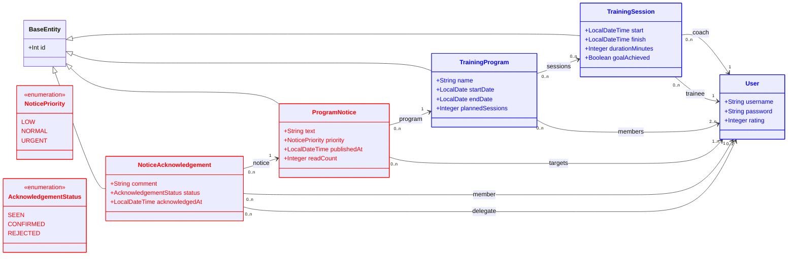
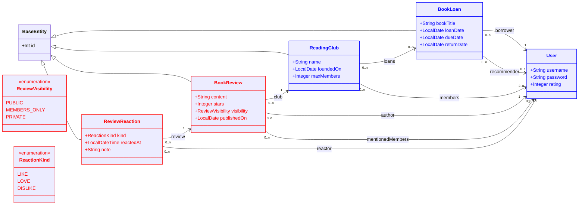
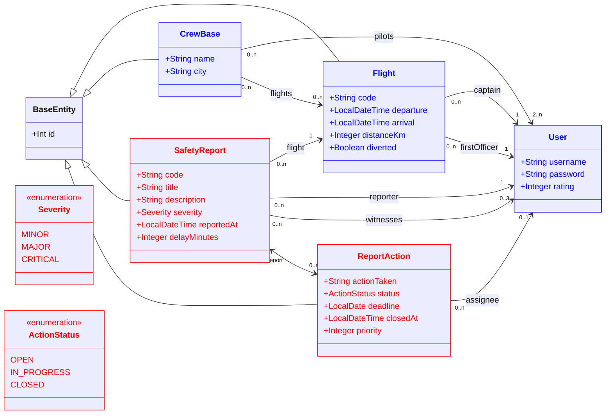

# DP1 – Practical exam training set

> Practice material built from the mock exam in this repository ([README.en.md](README.en.md), *DP1 2025-2026 Practical Exam, Second Sitting*), the course lessons **T2** (presentation layers), **T4** (business logic and resource layers), **T5** (data model design) and **T6** (Spring and React best practices), and the lab guide **Lab 2** (*Introduction to React and basic security concepts*, 2026-2027).
>
> Stack (same as the mock): Spring Boot **3.5.5**, Java **21**, `jakarta.*`, Hibernate 6.6, H2 + `data.sql`, Lombok, JUnit 5 + Mockito + Spring Boot Test; React 18 (react-scripts 5) + Jest + React Testing Library + MSW 1.x.

**Contents**

1. [How to use this document](#1-how-to-use-this-document)
2. [Assumptions and topic map](#2-assumptions-and-topic-map)
3. [Index](#3-index)
4. Exercises: [Block 0 – the mock exam](#block-0--the-mock-exam) · [Block A – gym](#block-a--gym-peer-training-programs) · [Block B – library](#block-b--library-reading-clubs) · [Block C – airline (harder)](#block-c--airline-crew-bases-slightly-harder-than-the-mock) · [Block X – extra exercises](#block-x--extra-exercises-by-topic)

---

## 1. How to use this document

Every exercise is graded by a test class, exactly like in the exam: your grade for an exercise is the percentage of its tests that pass. Blocks **A**, **B** and **C** are complete practice exams with the same shape as the mock (10 exercises, 1 point each, one domain per exam, exercises 3 and 4 depend on 1 and 2, exercise 8 asks you to *write* tests, exercises 9 and 10 are React). Block **X** contains shorter exercises on every examinable topic that the mock does not cover.

> ⚠️ As in the exam: **a project that does not compile or does not start Spring gets 0 points**. A broken entity mapping makes *every* Spring test fail, so run the whole suite from time to time, not only the test of the exercise you are working on.

### 1.1 Running the tests of one exercise

The test class of each exercise is given in the index and in the exercise itself.

**Unix (bash/zsh)** – from the repository root:

```bash
./mvnw test -Dtest=TestA1                      # one exercise (backend)
./mvnw test -Dtest='TestA*'                    # a whole block (backend part)
./mvnw test -Dtest=Test1                       # Block 0 uses the mock's own tests: Test1 ... Test8 (and Test7Alt)
./mvnw test                                    # everything
cd frontend                                    # the React tests run from the frontend folder:
npx react-scripts test --watchAll=false src/practice/a/Program.test.js   # one React exercise
npx react-scripts test --watchAll=false src/practice/a                   # all React exercises of Block A
npx react-scripts test --watchAll=false                                  # all React tests
cd ..
```

**Windows PowerShell** – from the repository root (quote every `-D...` argument, otherwise PowerShell splits it at the dots):

```powershell
.\mvnw.cmd test "-Dtest=TestA1"
.\mvnw.cmd test "-Dtest=TestA*"
.\mvnw.cmd test "-Dtest=Test1"
.\mvnw.cmd test
cd frontend
npx react-scripts test --watchAll=false src/practice/a/Program.test.js
npx react-scripts test --watchAll=false src/practice/a
npx react-scripts test --watchAll=false
cd ..
```

Run `npm install` once inside `frontend` before the first React test. `npm test` (the command in the mock statement) also works: it starts Jest in watch mode, where you press `a` to run all tests.

### 1.2 Attempting an exercise blind and comparing with the solution

The branch `exam-practice` contains the reference solutions. For every block there is a commit with the **exam starting state** (the skeleton you would receive in the exam, already compiling and starting Spring), followed by one commit per solved exercise:

| Block | Starting state (commit to branch from) | Solution of exercise *N* |
|---|---|---|
| 0 (mock) | `main` (the original repository) | commit `practice: 0.N ...` |
| A, B, C | commit `practice: A-start ...`, `practice: B-start ...`, `practice: C-start ...` | commit `practice: A3 ...` etc. |
| X | commit `practice: X-start ...` | commit `practice: X05 ...` etc. |

Git can find a commit by the text of its message with the `:/text` syntax, so you do not need hashes. The commands are identical in bash and PowerShell.

**Attempt a whole practice exam (example: Block A)**

```bash
git switch exam-practice
git status                                   # must say "nothing to commit"
git switch -c try-A ":/practice: A-start"    # scratch branch at the exam starting state of Block A
# bring in the graders of the block (backend test classes + React test files), as in the exam:
git restore --source=exam-practice -- "src/test/java/es/us/dp1/chess/tournament/practice/a/TestA*.java" "frontend/src/practice/a/*.test.js"
./mvnw test -Dtest='TestA*'                  # PowerShell: .\mvnw.cmd test "-Dtest=TestA*"   (everything fails at first)
# ... solve the exercises, re-running the tests ...
```

**Attempt a single exercise (example: A6)** – start from the starting state of its block (for A3/A4 start from the commit of A2, because they need A1 and A2 solved):

```bash
git switch -c try-A6 ":/practice: A-start"
git restore --source=exam-practice -- src/test/java/es/us/dp1/chess/tournament/practice/a/TestA6.java
./mvnw test -Dtest=TestA6
```

**Compare with the reference solution**

```bash
git show ":/practice: A6 "                                   # the reference solution of A6 (diff of its commit, grader included)
git diff exam-practice -- src/main/java/es/us/dp1/chess/tournament/practice/a   # your working tree vs. the final reference of Block A
git diff exam-practice -- src/main/resources/data.sql        # data.sql (also lists the sections of later blocks: ignore them)
```

Note the space before the closing quote in `":/practice: A6 "`: it prevents `A1` from also matching `A10`.

**Leave the attempt**

```bash
git stash push -u -m "my attempt"    # or: git add -A && git commit -m "my attempt"
git switch exam-practice
git branch -D try-A                  # only if you do not want to keep the branch
```

**Block 0 (the mock)**: `git switch -c try-0 main`. Its graders (`Test1`…`Test8`, `Test7Alt`, the two React tests) are already in `main`; nothing has to be restored. For **Block X**, branch from `":/practice: X-start"` and restore only the grader of the exercise, e.g. `git restore --source=exam-practice -- src/test/java/es/us/dp1/chess/tournament/practice/x/queries/TestX05.java`, or for a React exercise `git restore --source=exam-practice -- frontend/src/practice/x/lab2/partners/Partners.test.js` and then, inside `frontend`, `npx react-scripts test --watchAll=false src/practice/x/lab2/partners`.

In exercise 8 of every block *you* write the tests: its grader is a dispatcher (`TestA8`, `TestB8`, `TestC8`) that runs your test class against four implementations, and restoring it does **not** bring the solution, which lives in a different file. In X46–X47 there is nothing to restore: the broken components you test against are already in the starting state.

---

## 2. Assumptions and topic map

### 2.1 Assumptions

1. **Language and format.** The statements follow the English mock statement ([README.en.md](README.en.md)): "Test N – …" titles, the same wording for attributes, relations, initial data, services, queries, controllers and React components.
2. **Page references** use the PDF page number shown by the PDF viewer (*p.*), not the slide number printed on each slide; they differ because hidden slides were removed (for example T4 p.14 is slide 15).
3. **Shape of tomorrow's exam.** It is assumed to look like the mock: 10 exercises × 1 point, backend exercises 1–8 + React 9–10, a single domain in which exercises 3–4 depend on 1–2 and the rest are independent; only the domain and the details change. Likelihood is rated from that assumption plus the lessons. Exercise type 8 (writing JUnit tests) is rated *medium* and not *high*: the mock has it, but T2 p.56 says testing is covered in lessons T9 (3 Nov) and T10 (10 Nov), after the exam date. Lab 2 shows that this year's project template (`group-project-seed`, 2026-27) uses Vite, `.jsx` files, an axios client, one service function per API operation and the hooks `useFetchState(initial, serviceFn, deps, { skip, onError })` and `useErrorModal`. Tomorrow's exam may be built on that template instead of this repository's: the React exercises of Blocks 0, A, B and C use the mock's style (plain `fetch`), and X09, X10 and X30–X35 practise the template's style. The tests look the same in both, because Vitest has the same API as Jest (T2 p.58).
4. **Only topics with a source.** Every exercise traces back to a mock exercise or to a specific PDF page. Topics that appear in none of them are **not** trained: how JWT works internally (Lab 2 p.7 leaves it to the lectures), `@Modifying`/native queries/pagination, fetch types, `@Inheritance` strategies, `@DateTimeFormat`, and Mockito/`@DataJpaTest`/`@WebMvcTest`/parameterized tests *as something you write* (they only appear in the mock's graders; parameterized tests are explicitly forbidden in mock Test 8). PUT and DELETE endpoints and the security rules of API paths are trained only because Lab 2 documents them (p.15, p.16, p.27). HTTP status codes are limited to those in the sources: 200, 201, 204, 400, 403 and 404 (plus 401, which the scaffold returns on its own for unauthenticated requests).
5. **Course over generic practice** where they differ: `@Autowired` constructor injection (T5 p.17, p.27); `@Transactional` on service methods, `readOnly = true` for reads (T5 p.17, p.39); semantic rules as checked exceptions + `rollbackFor` (T5 p.38, p.85); mandatory to-one associations as `@ManyToOne(optional = false)` (T4 p.50, p.87) **plus** `@NotNull` (required by the mock's graders); `@Size` rather than `@Length` (T5 p.80); `@Min/@Max` only for integer types and `@DecimalMin/@DecimalMax` for `BigDecimal`/`Double` (T5 p.81); exception handlers in the `@RestControllerAdvice` class returning `ErrorMessage` (T6 p.14–16); `new ResponseEntity<>(body, HttpStatus.X)` (T6 p.11, p.16); `BeanUtils.copyProperties(input, newEntity, "id", …)` when creating from a request body (T5 p.77, T6 p.37); `@JsonIgnore` on the collection side to break JSON loops (T6 p.27); presentation components + custom hooks in React (T6 p.62–73). One conflict is resolved in favour of the mock: T5 p.86 and T6 p.37 check authorities **in the controller**, but the mock's `Test7Alt` and T4 p.17 ("security checks" are application logic in the service layer) require access checks **in the service**, so that is what the solutions do.
6. **Everything lives in one project.** Each practice block has its own package: `es.us.dp1.chess.tournament.practice.a`, `.b`, `.c` and `.x.<topic>`, and its own React folder `frontend/src/practice/<block>`. Entity, table and join-table names are unique across the project. The blocks reuse the scaffold (`User`, `UserService`, the exceptions in `exceptions/`, `ExceptionHandlerController`) and the users already loaded by `data.sql` (`admin1` with id 1; `player1`…`player10` with ids 4…13). Each block appends its own clearly delimited section to `data.sql`, with its own tables, ids below 100 (generated ids start at 100, T4 p.44 / T5 p.46) and inserts in foreign-key order.
7. **Skeleton commits.** To make blind attempts possible, every block starts with a commit containing its exam starting state, against which all of its graders compile. One deliberate difference from the mock: the starting version of the test class you write in exercise 8 has no `@Test` method (the mock's has a failing `fail()` test), so that the whole build stays green at every commit.
8. **React graders** register their fake API responses with `server.use(...)` inside the test file, so the mock's `frontend/src/mocks/handlers.js` is not modified.
9. **No new dependencies.** Only what `pom.xml` and `frontend/package.json` already contain is used.
10. **Mock Test 7 and Test7Alt.** Both are in the repository (the teacher's notes say only one would be published). The Block 0 solution satisfies both; `Test7Alt` is the stricter one (layered architecture).
11. **Verified behaviours of this project that the statements rely on** (checked on this stack before writing): `SELECT u, SUM(CASE …) … GROUP BY u ORDER BY 2 DESC, u.username` works in JPQL with H2 and returns `Long`; `@Size`/`@NotEmpty` on a collection are checked when the entity is flushed, whether the list is replaced or modified in place; a custom exception annotated with `@ResponseStatus(...)` still produces **500** in this project, because the `@ExceptionHandler(Exception.class)` of `ExceptionHandlerController` takes precedence, so custom exceptions need their own handler method; Lombok's `@EqualsAndHashCode(of = {"id"})` ignores an `id` inherited from `BaseEntity` (two `ChessMatch` with different ids are *equal*); axios (already imported by this repository's `src/services/api.js` and installed as a dependency of `swagger-ui-react`) works under Jest, and MSW intercepts its requests.
12. **The Lab 2 template inside this repository.** The utilities that Lab 2 receives from its template, but this repository does not have, are reproduced in `frontend/src/practice/x/lab2/`: `services/api.js`, `hooks/useFetchState.js`, `hooks/useErrorModal.jsx`, `components/ErrorModal.jsx` and `util/deleteFromList.jsx`. Each one follows the signature and behaviour that Lab 2 describes (p.8–9, p.15–16, p.21–23, p.26–27). They are given code, not exercises. Lab 2's own exercises (developers and achievements) are not repeated: X09–X10 and X30–X35 practise the same steps on other resources (sponsors, partners, tournaments, referees, chess clubs).

### 2.2 Topic map (study guide)

Likelihood: **H** high, **M** medium, **L** low. "Mock" says whether the mock exam already trains the topic.

| # | Topic | Source | Mock | Likelihood | Practised in |
|---|---|---|---|---|---|
| 1 | Entities and attributes: `@Entity`, `BaseEntity` id, `LocalDate`/`LocalDateTime`, mandatory vs optional | T4 p.42–47, p.54; T5 p.72, p.77; mock Test 1 | Yes | H | 0.1, A1, B1, C1 |
| 2 | Enumerated attributes stored as text (`@Enumerated(EnumType.STRING)`) | mock Test 1 (T4 p.25 and T5 p.52 only show the UML «enum») | Yes | H | 0.1, A1, B1, C1 |
| 3 | Bean Validation basics: `@NotNull`, `@Size` on strings and collections | T5 p.77–82; mock Tests 1–2 | Yes | H | 0.1, 0.2, A1–C2 |
| 4 | Bean Validation catalogue: `@NotBlank` vs `@NotEmpty` vs `@NotNull`, `@Min/@Max`, `@DecimalMin/@DecimalMax`, `@Digits`, `@Pattern`, `@Email`, `@Past`, `@Size` vs `@Length` | T5 p.75–83 | Partly | H | X01, X02 (+ A1, B1, C1) |
| 5 | Custom validation: own constraint annotation, Spring `Validator` class | T5 p.76, p.83 (named, no code) | No | L | X40, X41 |
| 6 | `@ManyToOne` / `@ManyToMany`, cardinality → `optional`/`@NotNull`/`@Size` | T4 p.49–50, p.87–89; T5 p.9, p.59–62; mock Test 2 | Yes | H | 0.2, A2, B2, C2 |
| 7 | Bidirectional associations (`mappedBy`), `@OneToOne`, composition (`cascade = ALL`, `orphanRemoval`), aggregation cascades | T4 p.51–53, p.88, p.90–91; T5 p.60–67 | No | M | X19, X20, X21 (+ C2) |
| 8 | Other mappings: `@Table`, `@Column`, `@Temporal`, `unique`, `@UniqueConstraint` | T4 p.55–59; T5 p.19 | No | M | X22, X23 (+ C1) |
| 9 | Value objects: `@Embeddable`, `@Embedded`, `@AttributeOverrides` | T4 p.42–43, p.48, p.85–86 | No | L | X36, X37 |
| 10 | Inheritance with `@MappedSuperclass` (`BaseEntity`, `NamedEntity`, `Person`), mapping generalizations | T4 p.54; T5 p.50–56, p.72, p.77 | Partly | L | X38, X39 |
| 11 | Initial data in `data.sql`: column/join-table names, FK order, `''` escaping | mock Tests 3–4 (T4 p.50–52 and p.89–90 show the generated tables) | Yes | H | 0.3, 0.4, A3–C4 |
| 12 | Repositories: `Repository`/`CrudRepository`, `Optional` from `findById`, one repository per service | T5 p.12–17, p.25; mock Test 1 | Yes | H | 0.1, A1–C1 |
| 13 | Derived query methods (`findBy…`, keywords table) | T5 p.23–25 | No | H | X03, X04 |
| 14 | JPQL basics: `?1` vs `:name` + `@Param`, `LIKE`, `BETWEEN`, `IS NULL`, `IS [NOT] EMPTY`, `DISTINCT`, `IN (collection)`, self-join | T5 p.16–22 | Partly | H | X05, X06 |
| 15 | JPQL aggregates: `SUM(CASE …)`, `COUNT`, `GROUP BY`, `HAVING`, `ORDER BY` | mock Test 6 | Yes | H | 0.6, A6, B6, C6 |
| 16 | Services with method-level `@Transactional`, business rules as checked exceptions + `rollbackFor` | T4 p.16–19; T5 p.26–47, p.84–87; mock Test 5 | Yes | H | 0.5, A5, B5, C5 |
| 17 | Transactions in depth: `readOnly`, class-level `@Transactional`, default rollback only for unchecked exceptions, atomic multi-entity operations | T5 p.33–47 | Partly | H | X07, X08 (+ A5, B5) |
| 18 | GET endpoint + service with 404/403, `findCurrentUser()`, layered architecture | mock Test 7 + `ALTERNATIVE-TEST7.md`; T4 p.7, p.16–17; T5 p.17; T6 p.7 | Yes | H | 0.7, A7, B7, C7 |
| 19 | POST endpoint: `@RequestBody @Valid` → 201/400, mass assignment, `BeanUtils.copyProperties` | T5 p.77, p.86; T6 p.11, p.19, p.33–37, p.84 | No | M | X11, X12 |
| 20 | PUT and DELETE endpoints: `@PutMapping("{id}")` + `@PathVariable` + `@RequestBody @Valid` → 200/400/404, `@DeleteMapping` → 204/404 | Lab 2 p.15, p.21–23, p.26–27; T6 p.37 | No | M | X13, X14 |
| 21 | Error handling: `@RestControllerAdvice` + `@ExceptionHandler` + `ErrorMessage`, checked business exceptions through controllers | T6 p.12–17; T5 p.84–86 | Partly | M | X15, X16 (+ C7) |
| 22 | Authorization with authorities (`hasAuthority`) and ownership, checked in the service layer | T4 p.17; T5 p.86; T6 p.34–37 | Partly | M | X17, X18 (+ B7, C7) |
| 23 | Securing API paths in `SecurityConfiguration`: `requestMatchers(…).hasAuthority(…)` and `permitAll()`, order of the rules, 401 vs 403 | Lab 2 p.4, p.7–8, p.16 | No | L | X42, X43 |
| 24 | JSON data binding: infinite loops and `@JsonIgnore`, DTOs | T6 p.19–32 | No | M | X24, X25 |
| 25 | Writing JUnit 5 tests for a given algorithm (no mocks, no Spring, no parameterized tests) | mock Test 8 | Yes | M | 0.8, A8, B8, C8 |
| 26 | React: components, props, `useState`/`useEffect`, `fetch`, rendering lists with `key` | T2 p.23–24, p.36–43, p.52–53; T6 p.55–56; mock Tests 9–10 | Yes | H | 0.9, 0.10, A9–C10 |
| 27 | React with the 2026-27 template: container/table/row components, one service function per API operation over the axios client, `useFetchState`, `useErrorModal` | Lab 2 p.4–5, p.8–11, p.15–16 | No | H | X09, X10 |
| 28 | React: events, lifting state up, immutable updates of arrays/objects | T2 p.38–46 | No | M | X26, X27 |
| 29 | React: presentation components, custom hooks, network client | T6 p.60–78 | No | M | X28, X29 |
| 30 | React forms: reusable field components, presentational form, one container to create and edit (`useParams`, `useNavigate`, POST vs PUT) | Lab 2 p.18–24 | No | M | X30, X31 |
| 31 | React list actions: Edit and Delete buttons in the row, `deleteFromList`, alerts | Lab 2 p.25–28 | No | M | X32, X33 |
| 32 | Frontend security: routes by role wrapped in `PrivateRoute`, menu options by role (roles read from the JWT) | Lab 2 p.6–7, p.14, p.17, p.23–24; T2 p.61 | No | M | X34, X35 |
| 33 | React router and Context (prop drilling) | T2 p.47, p.49–50; T6 p.80–82; Lab 2 p.21–24 | No | L | X44, X45 (+ X31, X34) |
| 34 | Writing frontend tests with React Testing Library | T2 p.56–59 | No | L | X46, X47 |
| 35 | Logging with SLF4J/`@Slf4j`, levels, configuration | T6 p.38–48 | No | L | X48, X49 |
| 36 | EntityManager and the persistence-context lifecycle | T4 p.61–76; T5 p.10 | No | L | X50, X51 |
| 37 | Domain logic in entities vs application logic in services; `equals`/`hashCode` on the id | T4 p.17–19, p.45–47 | No | L | X52, X53 |
| — | *Not trained (no source)*: how JWT works internally, `@Modifying`, native queries, pagination, fetch types, `@Inheritance`, `@DateTimeFormat`, writing Mockito/Spring tests | — | — | — | — |

Two things worth knowing although no exercise trains them: `ReflexiveTest` (the graders' helper, identical in every sitting) contains `checkThatFieldIsAnnotatedWithDateTimeFormat`, so a previous sitting asked for `@DateTimeFormat(pattern = "...")` on a date attribute; and the diagrams in `src/main/resources/diagrams` show earlier exam domains (strategies with `@Min/@Max`, tournaments and rounds with `LocalDate`), which supports the *high* rating of rows 1–4.

---

## 3. Index

Difficulty: ★ easy · ★★ medium (mock level) · ★★★ hard. Likelihood: **H** high · **M** medium · **L** low. Status: ☐ pending · ☑ solved and tested.

| ID | Title | Topic | Difficulty | Likelihood | Source | Test class | Status |
|---|---|---|---|---|---|---|---|
| 0.1 | `ChallengeAnnouncement` and `AnnouncementResponse` entities and repositories | Entities, validation, enums, repositories | ★ | H | mock Test 1 | `Test1` | ☐ |
| 0.2 | Relations between the entities | `@ManyToOne`, `@ManyToMany`, cardinality | ★★ | H | mock Test 2 | `Test2` | ☐ |
| 0.3 | `data.sql`: announcements and responses | Initial data | ★ | H | mock Test 3 | `Test3` | ☐ |
| 0.4 | `data.sql`: recipients of the announcements | Initial data (join table) | ★ | H | mock Test 4 | `Test4` | ☐ |
| 0.5 | `ChessMatchService` | Services, transactions, business rule | ★★ | H | mock Test 5 | `Test5` | ☐ |
| 0.6 | `findParticipantPoints` query | JPQL aggregates | ★★★ | H | mock Test 6 | `Test6` | ☐ |
| 0.7 | Ranking endpoint | REST controller, 404/403, layers | ★★ | H | mock Test 7 | `Test7`, `Test7Alt` | ☐ |
| 0.8 | Tests for `ClosestRatingPairFinder` | Writing JUnit tests | ★★ | M | mock Test 8 | `Test8` | ☐ |
| 0.9 | `Challenge` React component | React: fetch and render | ★★ | H | mock Test 9 | `Challenge.test.js` | ☐ |
| 0.10 | `ChallengeDetail` React component | React: list from props | ★ | H | mock Test 10 | `ChallengeDetail.test.js` | ☐ |
| A1 | `ProgramNotice` and `NoticeAcknowledgement` entities and repositories | Entities, validation, enums, repositories | ★ | H | mock Test 1; T5 p.78–81 | `TestA1` | ☐ |
| A2 | Relations between the entities (incl. an optional end) | `@ManyToOne`, `@ManyToMany`, cardinality | ★★ | H | mock Test 2; T4 p.87 | `TestA2` | ☐ |
| A3 | `data.sql`: notices and acknowledgements | Initial data | ★ | H | mock Test 3 | `TestA3` | ☐ |
| A4 | `data.sql`: targets of the notices | Initial data (join table) | ★ | H | mock Test 4 | `TestA4` | ☐ |
| A5 | `TrainingSessionService` | Services, transactions (`readOnly`, `rollbackFor`) | ★★ | H | mock Test 5; T5 p.39 | `TestA5` | ☐ |
| A6 | `findMemberPoints` query | JPQL aggregates | ★★★ | H | mock Test 6 | `TestA6` | ☐ |
| A7 | Leaderboard endpoint | REST controller, 404/403 | ★★ | H | mock Test 7 | `TestA7` | ☐ |
| A8 | Tests for `TrainingStreakFinder` | Writing JUnit tests | ★★ | M | mock Test 8 | `TestA8` | ☐ |
| A9 | `Program` React component | React: fetch and render | ★★ | H | mock Test 9; T6 p.55 | `Program.test.js` | ☐ |
| A10 | `ProgramDetail` React component | React: list from props | ★ | H | mock Test 10 | `ProgramDetail.test.js` | ☐ |
| B1 | `BookReview` and `ReviewReaction` entities and repositories | Entities, validation (`@Min/@Max`, `@Past`) | ★ | H | mock Test 1; T5 p.78–81 | `TestB1` | ☐ |
| B2 | Relations between the entities (0..3 and 0..n ends) | `@ManyToOne`, `@ManyToMany`, `@Size(max)` | ★★ | H | mock Test 2; T5 p.59 | `TestB2` | ☐ |
| B3 | `data.sql`: reviews and reactions | Initial data | ★ | H | mock Test 3 | `TestB3` | ☐ |
| B4 | `data.sql`: members mentioned in the reviews | Initial data (join table) | ★ | H | mock Test 4 | `TestB4` | ☐ |
| B5 | `BookLoanService` with class-level transactions | Services, transactions | ★★ | H | mock Test 5; T5 p.37–39 | `TestB5` | ☐ |
| B6 | `findOverdueCounts` query (two parameters, tie-break) | JPQL aggregates | ★★★ | H | mock Test 6; T5 p.20 | `TestB6` | ☐ |
| B7 | Overdue-report endpoint (members or ADMIN) | REST controller, 404/403, authorities | ★★ | H | mock Test 7; T5 p.86 | `TestB7` | ☐ |
| B8 | Tests for `LateFeeCalculator` | Writing JUnit tests | ★★ | M | mock Test 8 | `TestB8` | ☐ |
| B9 | `Club` React component | React: fetch and render | ★★ | H | mock Test 9 | `Club.test.js` | ☐ |
| B10 | `ClubDetail` React component (with empty state) | React: list, conditional rendering | ★ | H | mock Test 10; T2 p.53 | `ClubDetail.test.js` | ☐ |
| C1 | `SafetyReport` and `ReportAction` entities and repositories | Entities, `@Pattern`, unique | ★★ | H | mock Test 1; T4 p.58; T5 p.78 | `TestC1` | ☐ |
| C2 | Relations, one of them bidirectional | `@ManyToOne`, `@ManyToMany`, `mappedBy` | ★★★ | H | mock Test 2; T4 p.51–52 | `TestC2` | ☐ |
| C3 | `data.sql`: reports and actions | Initial data | ★ | H | mock Test 3 | `TestC3` | ☐ |
| C4 | `data.sql`: witnesses, and navigating the bidirectional relation | Initial data (join table) | ★★ | H | mock Test 4 | `TestC4` | ☐ |
| C5 | `FlightService` (four methods, three business exceptions) | Services, transactions | ★★★ | H | mock Test 5; T5 p.38, p.43–47 | `TestC5` | ☐ |
| C6 | `findPilotScores` query (`HAVING`, two `CASE`s, tie-break) | JPQL aggregates | ★★★ | H | mock Test 6; T5 p.20 | `TestC6` | ☐ |
| C7 | Pilot-ranking endpoint (layered, 400/403/404) | REST controller, error handling | ★★★ | H | mock Test 7 + `Test7Alt`; T6 p.16 | `TestC7` | ☐ |
| C8 | Tests for `BaggageFeeCalculator` | Writing JUnit tests | ★★★ | M | mock Test 8 | `TestC8` | ☐ |
| C9 | `Base` React component (loading and empty states) | React: fetch, conditional rendering | ★★ | H | mock Test 9; T2 p.53 | `Base.test.js` | ☐ |
| C10 | `BaseDetail` React component (table + filter) | React: rendering from props | ★★ | H | mock Test 10; T2 p.41 | `BaseDetail.test.js` | ☐ |
| X01 | Validation catalogue on an entity | Bean Validation | ★★ | H | T5 p.75–83 | `TestX01` | ☐ |
| X02 | `@NotNull`/`@NotEmpty`/`@NotBlank`, `@Min`/`@DecimalMin` on a DTO | Bean Validation | ★ | H | T5 p.79–81; T6 p.30 | `TestX02` | ☐ |
| X03 | Derived queries with given names | Derived queries | ★ | H | T5 p.23–25 | `TestX03` | ☐ |
| X04 | Derived queries you name yourself | Derived queries | ★★ | H | T5 p.17, p.23–25 | `TestX04` | ☐ |
| X05 | JPQL: positional and named parameters, `LIKE`, `BETWEEN`, `IS NULL` | JPQL | ★★ | H | T5 p.16–22 | `TestX05` | ☐ |
| X06 | JPQL over collections: `IS EMPTY`, `DISTINCT`, `IN`, self-join, `COUNT` | JPQL | ★★ | H | T5 p.21–22 | `TestX06` | ☐ |
| X07 | Class-level `@Transactional`, `readOnly`, `rollbackFor` | Transactions | ★★ | H | T5 p.33, p.37–40 | `TestX07` | ☐ |
| X08 | Making a multi-entity operation atomic | Transactions | ★★ | H | T5 p.41–47 | `TestX08` | ☐ |
| X09 | Container, table and row components | React (2026-27 template) | ★ | H | Lab 2 p.4–5, p.9–11 | `Sponsors.test.js` | ☐ |
| X10 | Loading the data with a service and `useFetchState` | React (2026-27 template) | ★★ | H | Lab 2 p.8–9, p.15–16 | `Partners.test.js` | ☐ |
| X11 | POST endpoint with `@Valid` (201/400) | REST, validation | ★★ | M | T5 p.77; T6 p.11, p.16 | `TestX11` | ☐ |
| X12 | Protecting a POST against mass assignment | REST, data binding | ★★ | M | T6 p.33–37, p.84 | `TestX12` | ☐ |
| X13 | Updating a resource with PUT | REST | ★★ | M | Lab 2 p.15, p.21–23; T6 p.37 | `TestX13` | ☐ |
| X14 | Deleting a resource with DELETE (204) | REST | ★ | M | Lab 2 p.15, p.26–27 | `TestX14` | ☐ |
| X15 | Mapping a custom exception to 400 | Error handling | ★ | M | T6 p.12–17 | `TestX15` | ☐ |
| X16 | Checked business exception through the controller | Error handling, transactions | ★★ | M | T5 p.84–87; T6 p.16 | `TestX16` | ☐ |
| X17 | Visibility by authority in the service layer | Authorization | ★★ | M | T4 p.17; T5 p.86; T6 p.34–37 | `TestX17` | ☐ |
| X18 | Authority and ownership rules for an action | Authorization | ★★ | M | T4 p.17; T5 p.86; T6 p.37 | `TestX18` | ☐ |
| X19 | Composition: `cascade = ALL` + `orphanRemoval` | Relationships | ★★ | M | T4 p.90; T5 p.60, p.65–67 | `TestX19` | ☐ |
| X20 | Bidirectional one-to-many with `mappedBy` | Relationships | ★★ | M | T4 p.51–53; T5 p.61–64 | `TestX20` | ☐ |
| X21 | Aggregation cascades and a mandatory one-to-one | Relationships | ★★ | M | T4 p.88, p.91; T5 p.66 | `TestX21` | ☐ |
| X22 | `@Table`, `@Column` and `@Temporal` | Other mappings | ★ | M | T4 p.55–57; T5 p.19 | `TestX22` | ☐ |
| X23 | Unique attributes and unique pairs | Other mappings | ★ | M | T4 p.58–59 | `TestX23` | ☐ |
| X24 | Breaking a JSON loop with `@JsonIgnore` | JSON data binding | ★★ | M | T6 p.19–27 | `TestX24` | ☐ |
| X25 | Returning a DTO instead of the entity | JSON data binding, DTOs | ★★ | M | T6 p.24, p.29–32; T5 p.17 | `TestX25` | ☐ |
| X26 | Lifting state up | React state | ★★ | M | T2 p.38, p.43–46 | `VoteBoard.test.js` | ☐ |
| X27 | Immutable updates of a list in state | React state | ★★ | M | T2 p.41 | `TaskList.test.js` | ☐ |
| X28 | Custom hook + presentation component | React patterns | ★★ | M | T6 p.62–73 | `Members.test.js` | ☐ |
| X29 | Extracting a network client | React patterns | ★★ | M | T6 p.74–77; T2 p.52 | `RankingSummary.test.js` | ☐ |
| X30 | Reusable form fields and a presentational form | React forms | ★★ | M | Lab 2 p.18–21 | `TournamentForm.test.js` | ☐ |
| X31 | One container to create and edit (`useParams`, `useNavigate`, POST/PUT) | React forms, router | ★★★ | M | Lab 2 p.21–24 | `RefereeEdit.test.js` | ☐ |
| X32 | Edit and Delete actions in a presentational row | React list actions | ★ | M | Lab 2 p.25–26 | `TournamentTable.test.js` | ☐ |
| X33 | Deleting from the container with `deleteFromList` | React list actions | ★★ | M | Lab 2 p.26–28 | `ChessClubList.test.js` | ☐ |
| X34 | Routes by role, protected with `PrivateRoute` | Frontend security | ★★ | M | Lab 2 p.6–7, p.14, p.23–24; T2 p.61 | `PracticeRoutes.test.js` | ☐ |
| X35 | A menu that depends on the role | Frontend security | ★ | M | Lab 2 p.6–7, p.17 | `PracticeNavbar.test.js` | ☐ |
| X36 | A value object with `@Embeddable` | Value objects | ★ | L | T4 p.42–43, p.48; T5 p.78 | `TestX36` | ☐ |
| X37 | The same value object twice: `@AttributeOverrides` | Value objects | ★★ | L | T4 p.85–86 | `TestX37` | ☐ |
| X38 | Reusing `Person` and `NamedEntity` | Inheritance | ★ | L | T4 p.54; T5 p.72, p.77 | `TestX38` | ☐ |
| X39 | A generalization as a new `@MappedSuperclass` | Inheritance | ★★ | L | T5 p.50–56; T4 p.54 | `TestX39` | ☐ |
| X40 | A custom constraint annotation | Custom validation | ★★★ | L | T5 p.76, p.83 | `TestX40` | ☐ |
| X41 | A Spring `Validator` class | Custom validation | ★★ | L | T5 p.76 | `TestX41` | ☐ |
| X42 | Restricting an API path to an authority | API security | ★ | L | Lab 2 p.16 | `TestX42` | ☐ |
| X43 | A public endpoint: the developers of `pom.xml` | API security | ★ | L | Lab 2 p.4, p.7–8, p.16 | `TestX43` | ☐ |
| X44 | Routes, links and URL parameters | React router | ★★ | L | T2 p.49–50 | `TravelApp.test.js` | ☐ |
| X45 | Sharing data with a Context | React Context | ★ | L | T6 p.80–82; T2 p.47 | `Dashboard.test.js` | ☐ |
| X46 | Writing component tests: render, query, assert | Frontend testing | ★★ | L | T2 p.57–59 | your `ScoreBoard.test.js` + broken versions | ☐ |
| X47 | Writing component tests: interaction and fetched data | Frontend testing | ★★★ | L | T2 p.57–59 | your `LikeButton.test.js`, `QuoteOfTheDay.test.js` + broken versions | ☐ |
| X48 | Logging with `@Slf4j` instead of `System.out` | Logging | ★ | L | T6 p.40–46 | `TestX48` | ☐ |
| X49 | Configuring log levels | Logging | ★ | L | T6 p.41–45 | `TestX49` | ☐ |
| X50 | EntityManager: persist, find, dirty checking, remove | Persistence context | ★★ | L | T4 p.61–73 | `TestX50` | ☐ |
| X51 | EntityManager: detach, merge, undoing a remove | Persistence context | ★★ | L | T4 p.63–75 | `TestX51` | ☐ |
| X52 | Domain logic in the entity, application logic in the service | Business logic layer | ★★ | L | T4 p.17–19 | `TestX52` | ☐ |
| X53 | `equals`/`hashCode` based on the id | Entities | ★ | L | T4 p.45–47 | `TestX53` | ☐ |

**Totals:** Block 0: 10 · Block A: 10 · Block B: 10 · Block C: 10 · Block X: 53 → **93 exercises**.

---

## Block 0 – The mock exam

The statement is [README.en.md](README.en.md) (Spanish: [README.md](README.md)); it is not repeated here. Below, for each exercise: what its grader really checks, the files to touch and the traps found while reading the tests. Start from `main` (see 1.2). Exercises 0.3 and 0.4 need 0.1 and 0.2.

### Test 0.1 – Creating the `ChallengeAnnouncement` and `AnnouncementResponse` entities and their repositories

**1 point · ~15 min · Source: mock Test 1 · Grader: `Test1`**

**Files to modify:** `challenge/ChallengeAnnouncement.java`, `challenge/AnnouncementResponse.java`, `challenge/ChallengeAnnouncementRepository.java`, `challenge/AnnouncementResponseRepository.java` (all under `src/main/java/es/us/dp1/chess/tournament/`).

**What the grader checks:** both repositories are injected and `findById(474629)` returns an empty `Optional`; a valid entity passes validation; setting `message`/`status` (and `respondedAt`) to `null` produces a violation or makes `persist` fail; `message` of 5 chars or longer than 60 (200 for responses) is rejected; the classes have `@Entity` and `status` has `@Enumerated(EnumType.STRING)`.

<details>
<summary>Hints, key points, typical mistakes, solution</summary>

- Get the `id` by extending `BaseEntity` (`@MappedSuperclass` with `@Id` and the `entity_sequence` generator, T4 p.44, p.54). Without an `@Id` Hibernate refuses the entity and **Spring does not start** → 0 in every exam exercise.
- `@NotNull @Size(min = 10, max = 60) String message;` · `@NotNull @Enumerated(EnumType.STRING) AnnouncementStatus status;` · `LocalDateTime sentAt;` (no constraint: optional). Response: `@NotNull @Size(min = 5, max = 200)`, `@NotNull @Enumerated(EnumType.STRING)`, `@NotNull LocalDateTime respondedAt`.
- `@Size` (Jakarta) is preferred to Hibernate's `@Length` (T5 p.80). `@NotBlank` would also pass, but the statement says "cannot be null".
- Repositories: `extends CrudRepository<ChallengeAnnouncement, Integer>` (T5 p.15). The declared `Optional<…> findById(Integer id)` can stay or go: `CrudRepository` already has it.
- Typical mistakes: forgetting `EnumType.STRING` (the default is `ORDINAL`, stored as 0/1/2, and the `INSERT`s of 0.3 with `'SENT'` would then fail); importing `javax.*` instead of `jakarta.*`; removing the `@Transient` annotations now (that is 0.2).
- Solution: [ChallengeAnnouncement.java](src/main/java/es/us/dp1/chess/tournament/challenge/ChallengeAnnouncement.java), [AnnouncementResponse.java](src/main/java/es/us/dp1/chess/tournament/challenge/AnnouncementResponse.java), [ChallengeAnnouncementRepository.java](src/main/java/es/us/dp1/chess/tournament/challenge/ChallengeAnnouncementRepository.java), [AnnouncementResponseRepository.java](src/main/java/es/us/dp1/chess/tournament/challenge/AnnouncementResponseRepository.java) · `git show ":/practice: 0.1 "`
</details>

### Test 0.2 – Creating relations between the entities

**1 point · ~15 min · Source: mock Test 2 · Grader: `Test2`**

**Files to modify:** `challenge/ChallengeAnnouncement.java`, `challenge/AnnouncementResponse.java`.

**What the grader checks:** `challenge`, `announcement` and `recipient` are annotated with `@ManyToOne` and `@NotNull`; `recipients` with `@ManyToMany`; `recipients = null` is rejected and a list with only one user makes `em.flush()` fail.

<details>
<summary>Hints, key points, typical mistakes, solution</summary>

- Navigable end `1` → `@ManyToOne(optional = false)` (T4 p.50, p.87) + `@NotNull` (what the grader looks for). `2..n` → `@ManyToMany` + `@NotNull` + `@Size(min = 2)` (T4 p.89 maps 0..n and 1..n the same way; the minimum is a validation constraint).
- Remove **all** `@Transient` annotations of the two classes.
- Unidirectional means nothing is added to `FriendlyChallenge` or `User` (T4 p.50: "No reference to class A").
- Collection constraints are validated when the entity is flushed (T5 p.82), which is why the grader calls `em.flush()`.
- Typical mistakes: `@OneToMany` for `recipients` (a user can receive many announcements → many-to-many); `@NotEmpty` instead of `@Size(min = 2)` (accepts one element); leaving one `@Transient` behind (that attribute is then silently not stored, and its `@ManyToOne` is ignored).
- Solution: same files as 0.1 · `git show ":/practice: 0.2 "`
</details>

### Test 0.3 – Modifying the database initialization script to include announcements and responses

**1 point · ~10 min · Source: mock Test 3 · Grader: `Test3` · Needs 0.1 and 0.2**

**File to modify:** `src/main/resources/data.sql`.

**What the grader checks:** `em.find` of announcements 1–3 and responses 1–3 with the exact `message`, `status`, `sentAt`/`respondedAt`, and the ids of `challenge`, `announcement` and `recipient`.

<details>
<summary>Hints, key points, typical mistakes, solution</summary>

- Table and column names come from Spring Boot's naming strategy: `CamelCase` → `snake_case`. `ChallengeAnnouncement` → table `challenge_announcement`, `sentAt` → `sent_at`, a `@ManyToOne` attribute `challenge` → FK column `challenge_id` (T4 p.50: FK `b_id`).
- `INSERT INTO challenge_announcement(id, message, status, sent_at, challenge_id) VALUES (1, 'Remember to submit your match results by Friday', 'SENT', '2026-07-01 10:00:00', 1);` – enums as text (that is why 0.1 requires `STRING`), `null` for an empty `sent_at`.
- Insert the announcements **before** the responses (FK order) and after the challenges and users. `'I can''t make it in August'` doubles the quote.
- Typical mistakes: using the entity name instead of the table name; inserting the `id` column with a value ≥ 100 (it would collide with generated ids); a typo in a timestamp (the grader compares `LocalDateTime`s exactly). A broken `INSERT` stops Spring from starting → every test fails.
- Solution: [data.sql](src/main/resources/data.sql) (section *Block 0*) · `git show ":/practice: 0.3 "`
</details>

### Test 0.4 – Modifying the database initialization script to associate the announcements with their recipients

**1 point · ~5 min · Source: mock Test 4 · Grader: `Test4` · Needs 0.1 and 0.2**

**File to modify:** `src/main/resources/data.sql`.

**What the grader checks:** `getRecipients()` of announcements 1, 2, 3 contains the expected user ids.

<details>
<summary>Hints, key points, typical mistakes, solution</summary>

- Default join table of a unidirectional `@ManyToMany`: `<owner table>_<attribute>` with columns `<owner table>_id` and `<attribute>_id` → `challenge_announcement_recipients(challenge_announcement_id, recipients_id)`. Compare with the explicit `@JoinTable` of `FriendlyChallenge`, whose names you can read directly.
- The join rows go **after** the announcements they reference.
- Solution: [data.sql](src/main/resources/data.sql) · `git show ":/practice: 0.4 "`
</details>

### Test 0.5 – Creating match management services

**1 point · ~15 min · Source: mock Test 5 · Grader: `Test5`**

**File to modify:** `match/ChessMatchService.java`.

**What the grader checks (Mockito, no Spring):** `findAll`, `findById(Integer)` and `save(ChessMatch)` are annotated with Spring's `@Transactional` *on the method*; `save` has `rollbackFor = InvalidWinnerException.class`; each method calls the repository; a match without winner or whose winner is `white`/`black` is saved; with another winner `InvalidWinnerException` is thrown and `save` is never called.

<details>
<summary>Hints, key points, typical mistakes, solution</summary>

- `@Service` on the class, keep the constructor (the grader calls `new ChessMatchService(cmr)`), `org.springframework.transaction.annotation.Transactional` on each method (`jakarta.transaction.Transactional` is a different annotation and is not detected by `checkTransactional`).
- `InvalidWinnerException` is **checked** (`extends Exception`): Spring rolls back only on unchecked exceptions by default (T5 p.37), hence `@Transactional(rollbackFor = InvalidWinnerException.class)` (T5 p.38, p.85).
- Check the rule **before** calling `repo.save` (T5 p.44). In this grader the users have **no id** (`Test1.createUser`), so compare the objects (`winner.equals(white)`: `User` does not override `equals`, so it is identity); comparing ids would treat the three users as equal.
- Typical mistakes: annotating the class instead of the methods; making `InvalidWinnerException` a `RuntimeException` (the signatures must not change); checking the rule *after* `repo.save`. `findAll` can return `repo.findAll()` directly because `ChessMatchRepository` redeclares it as `List<ChessMatch> findAll()` (with a plain `CrudRepository` you would get an `Iterable` and need a cast or a conversion).
- Solution: [ChessMatchService.java](src/main/java/es/us/dp1/chess/tournament/match/ChessMatchService.java) · `git show ":/practice: 0.5 "`
</details>

### Test 0.6 – Annotating the challenge repository with a complex query

**1 point · ~20 min · Source: mock Test 6 · Grader: `Test6`**

**File to modify:** `challenge/FriendlyChallengeRepository.java`.

**What the grader checks (real `data.sql` data):** challenge 1 → {user 4: 3, user 5: 1}; challenge 2 (no finished match) → empty list; challenge 3 → {4: 3, 7: 1, 6: 0} (a loser appears with 0); the unfinished match 24 does not count; the rows are sorted by points descending.

<details>
<summary>Hints, key points, typical mistakes, solution</summary>

- Join the challenge with its participants **and** its matches, keep the rows where the participant played the match, group by participant:
  `SELECT u, SUM(CASE WHEN m.winner = u THEN 2 WHEN m.winner IS NULL THEN 1 ELSE 0 END) FROM FriendlyChallenge fc JOIN fc.participants u JOIN fc.matches m WHERE fc.id = :challengeId AND m.finish IS NOT NULL AND (m.white = u OR m.black = u) GROUP BY u ORDER BY 2 DESC`
- `:challengeId` binds to the method parameter by name because Spring Boot compiles with `-parameters`; adding `@Param("challengeId")` (T5 p.20) is also correct and safer.
- JPQL uses entity and attribute names, not tables (T5 p.19). `SUM` returns `Long` (the grader reads it as `Number`).
- Typical mistakes: filtering `finish IS NOT NULL` in the `CASE` instead of the `WHERE` (then players who only played unfinished matches appear with 0); `m.winner IS NULL` without the "played the match" condition (gives draw points to everyone); forgetting `ORDER BY`.
- Solution: [FriendlyChallengeRepository.java](src/main/java/es/us/dp1/chess/tournament/challenge/FriendlyChallengeRepository.java) · `git show ":/practice: 0.6 "`
</details>

### Test 0.7 – Creating the controller to return the ranking of an available challenge

**1 point · ~20 min · Source: mock Test 7 (+ `ALTERNATIVE-TEST7.md`) · Graders: `Test7` and `Test7Alt`**

**Files to modify:** `challenge/FriendlyChallengeService.java` (`getRanking`), `challenge/FriendlyChallengeController.java`.

**What the graders check:** `GET /api/v1/challenges/{id}/ranking` → 200 with `[{user:{id…}, points}]` in order; 404 for an unknown challenge or when the repository returns no points; 403 for a non-participant. `Test7Alt` also checks the layers: the controller has no repository/`EntityManager` and does not use `UserService`; it calls `getRanking` and lets exceptions propagate; neither the controller nor its methods are `@Transactional`; the service uses only `FriendlyChallengeRepository` and `UserService`.

<details>
<summary>Hints, key points, typical mistakes, solution</summary>

- Service: `repo.findById(id).orElseThrow(() -> new ResourceNotFoundException("FriendlyChallenge", "id", id))` → `userService.findCurrentUser()` → participant check → `repo.findParticipantPoints(id)` → if empty `ResourceNotFoundException` → map each `Object[]` to `new RankingEntry((User) row[0], ((Number) row[1]).longValue())`.
- **Compare users by id** (`p.getId().equals(current.getId())`): `User` has no `equals`, and in `Test7Alt` the user returned by `findCurrentUser()` is a different instance from the one stored in the challenge, so `participants.contains(current)` fails.
- Controller: `@GetMapping("{id}/ranking") public ResponseEntity<List<RankingEntry>> getRanking(@PathVariable("id") Integer id) { return new ResponseEntity<>(service.getRanking(id), HttpStatus.OK); }`. Nothing else: no `try/catch` (the `ExceptionHandlerController` turns `ResourceNotFoundException` into 404 and `AccessDeniedException` into 403), no repository, no `@Transactional`.
- Use the project's `es.us.dp1.chess.tournament.exceptions.AccessDeniedException`, not Spring Security's class with the same name.
- "No finished match" is decided from the points returned by the repository (the mocked challenges have no `matches` list, so iterating over matches throws `NullPointerException`).
- Solution: [FriendlyChallengeService.java](src/main/java/es/us/dp1/chess/tournament/challenge/FriendlyChallengeService.java), [FriendlyChallengeController.java](src/main/java/es/us/dp1/chess/tournament/challenge/FriendlyChallengeController.java) · `git show ":/practice: 0.7 "`
</details>

### Test 0.8 – Implementing a test for an algorithm that computes matchmaking by closest rating

**1 point · ~20 min · Source: mock Test 8 · Grader: `Test8`**

**File to modify:** `src/test/java/es/us/dp1/chess/tournament/matchmaking/ClosestRatingPairFinderTest.java`.

**What the grader checks:** it runs every `@Test` method of your class against the four implementations; none may fail with `ValidClosestRatingPairFinder`, and at least one must fail with each of `NaiveClosestRatingPairFinder` (wrong tie-break), `CarelessClosestRatingPairFinder` (accepts negative ratings) and `RecklessClosestRatingPairFinder` (accepts arrays with fewer than two elements).

<details>
<summary>Hints, key points, typical mistakes, solution</summary>

- One test per rule: the basic example (`[1000, 1200, 1050]` → `[0, 2]`), the tie example (`[0, 10, 14, 100, 200, 4]` → `[1, 2]`), an empty array and a one-element array (`assertThrows(InsufficientPlayersException.class, …)`), a negative rating (`assertThrows(InvalidRatingException.class, …)`).
- Use `assertThrows`/`assertArrayEquals`/`assertEquals`: they throw `AssertionFailedError`, which is what the dispatcher counts as a detected failure. With `[]` the reckless implementation throws `ArrayIndexOutOfBoundsException`; `assertThrows` turns it into an assertion failure, while a `try { …; fail(); } catch (InsufficientPlayersException e) {}` lets it escape and the dispatcher only prints it (the bug goes undetected). `assertAll` throws `MultipleFailuresError`, which the dispatcher does not recognise either.
- Methods `public void`, no parameters, `throws Exception` for the checked exceptions; always use the `algorithm` attribute (the dispatcher replaces it with `setAlgorithm`). Remove the `fail()` placeholder.
- Forbidden: mocks, Spring test annotations, `@ParameterizedTest`.
- Solution: [ClosestRatingPairFinderTest.java](src/test/java/es/us/dp1/chess/tournament/matchmaking/ClosestRatingPairFinderTest.java) · `git show ":/practice: 0.8 "`
</details>

### Test 0.9 – Creating a basic React component with challenge information

**1 point · ~15 min · Source: mock Test 9 · Grader: `frontend/src/challenges/Challenge.test.js`**

**File to modify:** `frontend/src/challenges/challenge.js`.

**What the grader checks:** the level-1 heading "Challenge info" and the level-3 heading "Ranking" are rendered immediately; after the fake API (MSW) answers `GET */api/v1/challenges/1/ranking`, the text `Leader: john_doe (6 points)` appears.

<details>
<summary>Hints, key points, typical mistakes, solution</summary>

- State initialised to `[]`, an effect with a dependency array, `fetch` + `.json()` (T2 p.52–53, T6 p.55). The JWT comes from `tokenService.getLocalAccessToken()`:

  ```js
  const [ranking, setRanking] = useState([]);
  useEffect(() => {
      fetch(`/api/v1/challenges/${challengeId}/ranking`, { headers: { Authorization: `Bearer ${jwt}` } })
          .then((response) => response.json())
          .then((json) => setRanking(json));
  }, [challengeId]);
  ```
- Render the headings unconditionally; render the leader only when `ranking.length > 0`.
- Put the whole sentence as direct text of a single element: `<div>Leader: {ranking[0].user.username} ({ranking[0].points} points)</div>`. `getByText` matches the *own* text of an element, so `<div>Leader: <b>john_doe</b> …</div>` does not match.
- If tomorrow's exam is built on the 2026-27 template (assumption 3), the same component gets the ranking through a service function and the template's hook instead of `fetch` + `useEffect` (Lab 2 p.8–9, p.15): `const [ranking] = useFetchState([], () => challengesApi.getRanking(challengeId), [challengeId]);`. X10 practises that version.
- Solution: [challenge.js](frontend/src/challenges/challenge.js) · `git show ":/practice: 0.9 "`
</details>

### Test 0.10 – Creating a component to display a challenge's full ranking on screen

**1 point · ~10 min · Source: mock Test 10 · Grader: `frontend/src/challenges/ChallengeDetail.test.js`**

**File to modify:** `frontend/src/challenges/challengeDetail.js`.

**What the grader checks:** one `<ul>`, one `<li>` per entry with the text `username - points`, and every `<li>` with a different `id` attribute.

<details>
<summary>Hints, key points, typical mistakes, solution</summary>

- One `<li>` per entry, with a stable `key` and a real `id`:

  ```jsx
  {ranking.map((entry) => (
      <li key={entry.user.id} id={`ranking-${entry.user.id}`}>{entry.user.username} - {entry.points}</li>
  ))}
  ```
- `key` (T6 p.55, T2 p.42) is for React and is **not** written to the DOM: the test needs a real `id` attribute.
- It is a presentation component (T6 p.65): no state, no fetch.
- Solution: [challengeDetail.js](frontend/src/challenges/challengeDetail.js) · `git show ":/practice: 0.10 "`
</details>

---

## Block A – Gym peer-training programs

*Practice exam with the same number, order, type and difficulty of exercises as the mock. Package `es.us.dp1.chess.tournament.practice.a`, React folder `frontend/src/practice/a`. Start from `":/practice: A-start"`.*

### General Description

In this exercise, we will add notice management to the peer-training programs of a gym. Specifically, a `TrainingSession` class is provided that represents a session in which one member of the gym acts as `coach` and another one as `trainee`. A session starts at `start` and, once it has finished, `finish` is not null and `goalAchieved` records whether the trainee reached the goal of the session (the coach may fill `goalAchieved` in advance, so only finished sessions are meaningful). A `TrainingProgram` groups a set of `members` (at least two users) and the `sessions` they plan to do.

In order to communicate with the members of a program, the gym can publish notices via the `ProgramNotice` class, addressed to a set of members (`targets`), using the `NoticePriority` enum to express how urgent the notice is. Each member can acknowledge a notice via the `NoticeAcknowledgement` class, using the `AcknowledgementStatus` enum to express whether the notice was just seen, confirmed or rejected, and optionally naming another member who will act on their behalf (`delegate`).

The UML diagram describing the classes and relationships we will be working with is as follows:



The classes in red (`ProgramNotice`, `NoticePriority`, `NoticeAcknowledgement`, `AcknowledgementStatus`) are the ones we will map as JPA entities. The classes in blue (`User`, `TrainingSession`, `TrainingProgram`) are provided already mapped, including their attributes and relationships, and with sample data in `data.sql` (programs 1, 2 and 3 and sessions 1 to 8).

Each exercise is worth **1 point**. Except for **Tests A3 and A4** (which depend on Tests A1 and A2 being correctly solved), the exercises are **independent**.

### Test A1 – Creating the ProgramNotice and NoticeAcknowledgement entities and their associated repositories

**1 point · ~15 min · Source: mock Test 1; T5 p.78–81 (`@NotBlank`, `@Min`, `@Past`) · Grader: `TestA1`**

Modify the `ProgramNotice` class so that it becomes an entity. This class is located in the `es.us.dp1.chess.tournament.practice.a` package, and must have the following attributes and constraints:

- The integer-typed (`Integer`) attribute named `id` will act as the primary key in the relational database table associated with the entity.
- A string-typed (`String`) attribute named `text`, mandatory, which cannot be blank (it must contain at least one character other than whitespace), and must have a minimum length of 5 characters and a maximum of 80.
- An attribute of the enumerated type `NoticePriority` named `priority`, indicating how urgent the notice is. This attribute is mandatory and must be stored as a string in the DB (`"LOW"`, `"NORMAL"` or `"URGENT"`).
- A temporal-instant-typed (`LocalDateTime`) attribute named `publishedAt`, representing the instant at which the notice was published. This attribute is optional.
- An integer-typed (`Integer`) attribute named `readCount`, counting how many times the notice has been read. This attribute is mandatory and cannot be negative.

Modify the `NoticeAcknowledgement` class so that it becomes an entity. This class is located in the same package, and must have the following attributes and constraints:

- The integer-typed (`Integer`) attribute named `id` will act as the primary key in the relational database table associated with the entity.
- A string-typed (`String`) attribute named `comment`. This attribute is optional, but when present it must have a maximum length of 150 characters.
- An attribute of the enumerated type `AcknowledgementStatus` named `status`. This attribute is mandatory and must be stored as a string in the DB (`"SEEN"`, `"CONFIRMED"` or `"REJECTED"`).
- A temporal-instant-typed (`LocalDateTime`) attribute named `acknowledgedAt`, representing the instant at which the notice was acknowledged. This attribute is mandatory and must be an instant in the past.

Do not modify the `@Transient` annotations of the classes for now. Modify the `ProgramNoticeRepository` and `NoticeAcknowledgementRepository` interfaces, located in the same package, so that they extend `CrudRepository`. Do not forget to specify its type parameters.

**Files to modify:** `practice/a/ProgramNotice.java`, `practice/a/NoticeAcknowledgement.java`, `practice/a/ProgramNoticeRepository.java`, `practice/a/NoticeAcknowledgementRepository.java`.

<details>
<summary>Hints, key points, typical mistakes, solution</summary>

- `text`: `@NotBlank @Size(min = 5, max = 80)`. `@NotBlank` already implies "not null"; `"      "` (six spaces) satisfies `@Size` but not `@NotBlank` (T5 p.79).
- `readCount`: `@NotNull @Min(0)`. `@Min` alone accepts `null`: every constraint except the `@Not…` ones considers `null` valid.
- `comment`: `@Size(max = 150)` only, so `null` stays valid. `acknowledgedAt`: `@NotNull @Past` (T5 p.78).
- Enums: `@NotNull @Enumerated(EnumType.STRING)`.
- Typical mistakes: `@NotEmpty` on `text` (accepts `"      "`); `@Max` on a `String` (meaningless); forgetting that `BaseEntity` gives you the `id`.
- Solution: [ProgramNotice.java](src/main/java/es/us/dp1/chess/tournament/practice/a/ProgramNotice.java), [NoticeAcknowledgement.java](src/main/java/es/us/dp1/chess/tournament/practice/a/NoticeAcknowledgement.java), [ProgramNoticeRepository.java](src/main/java/es/us/dp1/chess/tournament/practice/a/ProgramNoticeRepository.java), [NoticeAcknowledgementRepository.java](src/main/java/es/us/dp1/chess/tournament/practice/a/NoticeAcknowledgementRepository.java) · grader [TestA1.java](src/test/java/es/us/dp1/chess/tournament/practice/a/TestA1.java) · `git show ":/practice: A1 "`
</details>

### Test A2 – Creating relations between the entities

**1 point · ~15 min · Source: mock Test 2; T4 p.87 (optional ends) · Grader: `TestA2`**

Remove the `@Transient` annotations from the attributes that have them in the entities created in the previous exercise. You are asked to create the following relations between the entities:

- Create a unidirectional relation from `ProgramNotice` to `TrainingProgram` expressing the one that appears in the UML diagram, using the `program` attribute. The attribute cannot be null, since the cardinality at the navigable end is `1`.
- Create a unidirectional relation from `ProgramNotice` to `User` using the `targets` attribute. The attribute cannot be null and must contain at least one element, since the cardinality at the navigable end is `1..n`.
- Create a unidirectional relation from `NoticeAcknowledgement` to `ProgramNotice` using the `notice` attribute. The attribute cannot be null, since the cardinality at the navigable end is `1`.
- Create a unidirectional relation from `NoticeAcknowledgement` to `User` using the `member` attribute. The attribute cannot be null, since the cardinality at the navigable end is `1`.
- Create a unidirectional relation from `NoticeAcknowledgement` to `User` using the `delegate` attribute. Since the cardinality at the navigable end is `0..1`, this attribute **can** be null.

**Files to modify:** `practice/a/ProgramNotice.java`, `practice/a/NoticeAcknowledgement.java`.

<details>
<summary>Hints, key points, typical mistakes, solution</summary>

- `1` → `@ManyToOne(optional = false)` + `@NotNull`; `0..1` → `@ManyToOne` (optional by default) and **no** `@NotNull` (T4 p.87: the FK column is nullable).
- `1..n` → `@ManyToMany` + `@NotNull` + `@NotEmpty` (or `@Size(min = 1)`).
- Two `@ManyToOne` to `User` in the same class are fine: each gets its own FK column (`member_id`, `delegate_id`).
- Typical mistakes: `optional = false` on `delegate` (persisting an acknowledgement without delegate then fails); `@NotNull` alone on `targets` (an empty list passes).
- Solution: same files as A1 · grader [TestA2.java](src/test/java/es/us/dp1/chess/tournament/practice/a/TestA2.java) · `git show ":/practice: A2 "`
</details>

### Test A3 – Modifying the database initialization script to include notices and acknowledgements

**1 point · ~10 min · Source: mock Test 3 · Grader: `TestA3` · Needs A1 and A2**

`TrainingProgram` already comes with sample data preloaded in the initialization script (the programs with id 1, 2 and 3), just as is the case with `User`. Modify the database initialization script so that the following notices are created:

| id | text | priority | publishedAt | readCount | program |
|---|---|---|---|---|---|
| 1 | Bring your own towel from Monday | NORMAL | 2026-09-01T08:00:00 | 12 | 1 |
| 2 | Leg day moved to Thursday | URGENT | 2026-09-03T18:30:00 | 30 | 1 |
| 3 | Draft: new stretching routine | LOW | null | 0 | 2 |

And the following acknowledgements, each one associated (`notice`) with one of the previous notices, (`member`) with one of the users already existing in the system and, optionally, (`delegate`) with another user:

| id | comment | status | acknowledgedAt | notice | member | delegate |
|---|---|---|---|---|---|---|
| 1 | Thanks, noted | CONFIRMED | 2026-09-01T09:15:00 | 1 | 4 | null |
| 2 | null | SEEN | 2026-09-03T19:00:00 | 2 | 5 | null |
| 3 | I can't make it on Thursday | REJECTED | 2026-09-03T20:45:00 | 2 | 6 | 4 |

Note that in order to insert the `'` you must write it twice (`''`), since that character is also the string delimiter in SQL.

**File to modify:** `src/main/resources/data.sql` (append to the section of Block A).

<details>
<summary>Hints, key points, typical mistakes, solution</summary>

- Tables `program_notice(id, text, priority, published_at, read_count, program_id)` and `notice_acknowledgement(id, comment, status, acknowledged_at, notice_id, member_id, delegate_id)`.
- Notices first, then acknowledgements; `null` without quotes.
- Data inserted with SQL is **not** validated by Bean Validation (validation runs when JPA persists/updates, T5 p.82), so a wrong value only shows up as a failing `TestA3` assertion.
- Solution: [data.sql](src/main/resources/data.sql) (section *Block A – A3*) · grader [TestA3.java](src/test/java/es/us/dp1/chess/tournament/practice/a/TestA3.java) · `git show ":/practice: A3 "`
</details>

### Test A4 – Modifying the database initialization script to associate the notices with their targets

**1 point · ~5 min · Source: mock Test 4 · Grader: `TestA4` · Needs A1 and A2**

Modify the database initialization script so that:

- The notice whose id is 1 is addressed to (`targets`) the users whose ids are 4 and 5.
- The notice whose id is 2 is addressed to the users whose ids are 4, 5 and 6.
- The notice whose id is 3 is addressed to the users whose ids are 5 and 8.

Keep in mind that the order in which the `INSERT` statements appear in the database initialization script is relevant when defining the associations, especially in the intermediate table generated for the `targets` relation.

**File to modify:** `src/main/resources/data.sql`.

<details>
<summary>Hints, key points, typical mistakes, solution</summary>

- Join table `program_notice_targets(program_notice_id, targets_id)`, after the notices.
- Solution: [data.sql](src/main/resources/data.sql) (section *Block A – A4*) · grader [TestA4.java](src/test/java/es/us/dp1/chess/tournament/practice/a/TestA4.java) · `git show ":/practice: A4 "`
</details>

### Test A5 – Creating training session management services

**1 point · ~15 min · Source: mock Test 5; T5 p.38–39 · Grader: `TestA5`**

`TrainingSession` is already provided as a fully mapped entity, along with its `TrainingSessionRepository` repository. Modify the `TrainingSessionService` class so that it becomes a Spring business-logic service and provides an implementation for the methods that allow:

- Getting all the sessions stored in the database as a list, using the repository (`findAll` method).
- Getting a session by id (`findById` method).
- Saving a session to the database (`save` method), checking that, if the `finish` attribute is not null, the session has a `start` and `finish` is strictly after `start`. Otherwise, an exception of type `InvalidSessionScheduleException` must be thrown, the session must not be saved, and the transaction must be rolled back.

All these methods must be transactional, with the annotations placed at the method level, not the class level. Moreover, `findAll` and `findById` must be **read-only** transactions. Do not change the constructor of the service.

**File to modify:** `practice/a/TrainingSessionService.java`.

<details>
<summary>Hints, key points, typical mistakes, solution</summary>

- `@Transactional(readOnly = true)` on the two read methods (T5 p.39), `@Transactional(rollbackFor = InvalidSessionScheduleException.class)` on `save` (the exception is checked, T5 p.37–38).
- Rule: `if (s.getFinish() != null && (s.getStart() == null || !s.getFinish().isAfter(s.getStart()))) throw new InvalidSessionScheduleException();` – `isAfter` is strict, so `finish == start` is rejected.
- Never put `readOnly = true` on a method that writes.
- Solution: [TrainingSessionService.java](src/main/java/es/us/dp1/chess/tournament/practice/a/TrainingSessionService.java) · grader [TestA5.java](src/test/java/es/us/dp1/chess/tournament/practice/a/TestA5.java) · `git show ":/practice: A5 "`
</details>

### Test A6 – Annotating the program repository with a complex query

**1 point · ~20 min · Source: mock Test 6 · Grader: `TestA6`**

Modify the custom query that can be invoked through the `findMemberPoints` method of the program repository `TrainingProgramRepository` (located in the `es.us.dp1.chess.tournament.practice.a` package), which receives a `TrainingProgram` id as a parameter and returns a list of pairs (`Object[]`), containing a user and an integer. The goal is for it to compute, for each member of the program, the accumulated points obtained in the program's sessions that have already finished (`finish` not null). The list of pairs must be sorted by points in descending order.

For each finished session of the program:

- The member listed as the session's `trainee` gets 3 points if `goalAchieved` is true, and 0 points otherwise.
- The member listed as the session's `coach` gets 1 point if `goalAchieved` is true, and 0 points otherwise.

A member must appear in the result if they took part (as coach or as trainee) in at least one finished session of the program, even if they accumulated 0 points. Sessions that have not finished yet must not count at all, not even to make a member appear in the result.

For example, if in a program member A coaches member B in a finished session in which B achieves the goal, and B coaches A in another finished session in which A does not achieve the goal, then B accumulates 3 (trainee of a successful session) + 0 (coach of a failed one) = **3 points**, and A accumulates 1 (coach of a successful session) + 0 (trainee of a failed one) = **1 point**.

To implement this exercise you must modify the query associated with the repository method called `findMemberPoints`, without modifying its signature (return type, name, and parameters).

**File to modify:** `practice/a/TrainingProgramRepository.java`.

<details>
<summary>Hints, key points, typical mistakes, solution</summary>

- Same skeleton as the mock: `SELECT u, SUM(CASE WHEN s.trainee = u AND s.goalAchieved = true THEN 3 WHEN s.coach = u AND s.goalAchieved = true THEN 1 ELSE 0 END) FROM TrainingProgram p JOIN p.members u JOIN p.sessions s WHERE p.id = :programId AND s.finish IS NOT NULL AND (s.trainee = u OR s.coach = u) GROUP BY u ORDER BY 2 DESC`.
- The condition "took part in the session" goes in the `WHERE`, so members without finished sessions do not appear; the result per session goes in the `CASE`, so losers appear with 0.
- Expected with the given data: program 1 → user 4: 4, user 5: 3, user 6: 1 (user 7 only coached an unfinished session); program 2 → empty; program 3 → user 11: 3, user 10: 1, user 9: 0 (user 4 is only in an unfinished session whose `goalAchieved` was pre-filled).
- Solution: [TrainingProgramRepository.java](src/main/java/es/us/dp1/chess/tournament/practice/a/TrainingProgramRepository.java) · grader [TestA6.java](src/test/java/es/us/dp1/chess/tournament/practice/a/TestA6.java) · `git show ":/practice: A6 "`
</details>

### Test A7 – Creating the controller to return the leaderboard of a program

**1 point · ~20 min · Source: mock Test 7 · Grader: `TestA7`**

Create a method in the `TrainingProgramController` controller (located in the `es.us.dp1.chess.tournament.practice.a` package) that returns the leaderboard of a program. The method must respond to GET requests at the URL:

```
http://localhost:8080/api/v1/gym/programs/X/leaderboard
```

The method must return the program's leaderboard (a list of `LeaderboardEntry`) sorted from highest to lowest score, where X is the program's id. Remember that the `UserService` class has a `findCurrentUser()` method that lets you obtain the currently logged-in user; you must use this method to check access.

Status code **404 (NOT_FOUND)** must be returned in the following cases:

- If there is no program with the specified id in the system.
- If no session of the program has finished yet (that is, `findMemberPoints` returns no rows).

If the logged-in user is not one of the members of that program, a status code of **403 (FORBIDDEN)** must be returned. Note that exceptions are already provided to represent these scenarios, such as the `ResourceNotFoundException` class or the `AccessDeniedException` class.

To implement this exercise you must modify both the `TrainingProgramService` class (`getLeaderboard` method) and the `TrainingProgramController` class. This exercise is independent of Exercise A6 and can be solved even if Exercise A6 has not been completed, since the repository is mocked in the tests.

**Files to modify:** `practice/a/TrainingProgramService.java`, `practice/a/TrainingProgramController.java`.

<details>
<summary>Hints, key points, typical mistakes, solution</summary>

- Same structure as mock 0.7: existence (404) → membership (403) → points (404 if empty) → map `Object[]` to `new LeaderboardEntry((User) row[0], ((Number) row[1]).longValue())`.
- Compare members by id. Do not catch the exceptions in the controller.
- Solution: [TrainingProgramService.java](src/main/java/es/us/dp1/chess/tournament/practice/a/TrainingProgramService.java), [TrainingProgramController.java](src/main/java/es/us/dp1/chess/tournament/practice/a/TrainingProgramController.java) · grader [TestA7.java](src/test/java/es/us/dp1/chess/tournament/practice/a/TestA7.java) · `git show ":/practice: A7 "`
</details>

### Test A8 – Implementing a test for an algorithm that computes the longest training streak

**1 point · ~20 min · Source: mock Test 8 · Grader: `TestA8`**

The gym wants to reward its most constant members. The interface `TrainingStreakFinder`, found in the `es.us.dp1.chess.tournament.practice.a.streak` package, specifies an algorithm with the following signature:

```java
int[] findLongestStreak(int[] minutes, int goal) throws EmptyTrainingLogException, InvalidTrainingDataException
```

`minutes[i]` contains the minutes trained by a member on day `i`. The method returns an array of two positions `[first, last]` (with `first <= last`) delimiting the longest run of **consecutive** days in which the minutes trained are **greater than or equal to** `goal`. In case of a tie between several runs of the same maximal length, the earliest run (the one with the smallest `first`) must be returned. If no day reaches the goal, an empty array is returned.

For example, given `[30, 45, 10, 60, 60, 20]` and goal `30`, the runs `[0, 1]` and `[3, 4]` both have length 2, so the method returns `[0, 1]`. Given `[10, 40, 40, 40, 5, 50]` and goal `40`, it returns `[1, 3]`. Given `[5, 10]` and goal `30`, it returns `[]`.

If `minutes` is null or empty, the algorithm must throw an exception of type `EmptyTrainingLogException`. If `goal` is zero or negative, or any value of `minutes` is negative, it must throw an exception of type `InvalidTrainingDataException`.

Four implementations of the algorithm are provided. Modify the test class called `TrainingStreakFinderTest`, found in the folder `src/test/java/es/us/dp1/chess/tournament/practice/a/streak`, and specify as many test-case methods as you consider necessary to validate the algorithm's correct behavior. Note that the class has an attribute of type `TrainingStreakFinder` called `algorithm`; use that attribute as the subject under test in all your test methods.

Your test implementation must not use mocks, Spring test annotations (`@DataJpaTest`, `@SpringBootTest`, etc.), or parameterized tests, and all methods annotated with `@Test` must take no parameters.

**File to modify:** `src/test/java/es/us/dp1/chess/tournament/practice/a/streak/TrainingStreakFinderTest.java`.

<details>
<summary>Hints, key points, typical mistakes, solution</summary>

- Write one test per rule of the specification: each example, a value exactly equal to the goal inside a run, the tie-break, the empty result, `null`/empty input, a zero goal, a negative value. A buggy implementation only differs from the valid one in one of these.
- `assertArrayEquals(new int[] { 0, 1 }, algorithm.findLongestStreak(...))` and `assertThrows(...)`; never catch exceptions yourself (see the traps of 0.8).
- Solution: [TrainingStreakFinderTest.java](src/test/java/es/us/dp1/chess/tournament/practice/a/streak/TrainingStreakFinderTest.java) · grader [TestA8.java](src/test/java/es/us/dp1/chess/tournament/practice/a/TestA8.java) · `git show ":/practice: A8 "`
</details>

### Test A9 – Creating a basic React component with program information

**1 point · ~15 min · Source: mock Test 9; T6 p.55 · Grader: `frontend/src/practice/a/Program.test.js`**

Modify the React component provided in the file `frontend/src/practice/a/program.js` so that it displays the leaderboard of a program, received through the `programId` prop. To do this, you must use the API by issuing a GET request against the URL `api/v1/gym/programs/X/leaderboard`. This API returns a result similar to the following:

```json
[
  { "user": { "id": 4, "username": "alice", "rating": 1500 }, "points": 9 },
  { "user": { "id": 5, "username": "bob", "rating": 1400 }, "points": 7 }
]
```

This component must display the following data:

- A level-1 heading whose content is the text "Program info"
- A level-3 heading whose content is "Leaderboard"
- Show, in a div, the member at the top of the leaderboard (the first element of the list). For example, for the case shown above it should display the text: "Top member: alice (9 points)".

**File to modify:** `frontend/src/practice/a/program.js`.

<details>
<summary>Hints, key points, typical mistakes, solution</summary>

- Same pattern as 0.9 (`useState([])`, `useEffect` with `[programId]`, `fetch` with the JWT header).
- Solution: [program.js](frontend/src/practice/a/program.js) · grader [Program.test.js](frontend/src/practice/a/Program.test.js) · `git show ":/practice: A9 "`
</details>

### Test A10 – Creating a component to display the full leaderboard of a program

**1 point · ~10 min · Source: mock Test 10 · Grader: `frontend/src/practice/a/ProgramDetail.test.js`**

Complete the code of the `ProgramDetail` component (`frontend/src/practice/a/programDetail.js`), so that it displays an unordered list (`<ul>`) with the full leaderboard, which it receives as the `leaderboard` prop (same format as in the previous exercise). Each member must be shown in a list item (`<li>`) displaying a hash sign followed by their position (starting at 1), a space, the username and, between parentheses, the points followed by `pts`. For example, for the response shown in the previous exercise, it would display:

```
#1 alice (9 pts)
#2 bob (7 pts)
```

Each `<li>` element must have an `id` attribute that is different for each element of the list.

**File to modify:** `frontend/src/practice/a/programDetail.js`.

<details>
<summary>Hints, key points, typical mistakes, solution</summary>

- The position is the index of `map` plus one. Use the user id (stable) for `key`/`id`, the index only for the text:

  ```jsx
  {leaderboard.map((entry, index) => (
      <li key={entry.user.id} id={`member-${entry.user.id}`}>#{index + 1} {entry.user.username} ({entry.points} pts)</li>
  ))}
  ```
- Solution: [programDetail.js](frontend/src/practice/a/programDetail.js) · grader [ProgramDetail.test.js](frontend/src/practice/a/ProgramDetail.test.js) · `git show ":/practice: A10 "`
</details>

---

## Block B – Library reading clubs

*Practice exam with the same shape and difficulty as the mock, with different variations of each exercise (constraints, cardinalities, class-level transactions, a query with two parameters, an ADMIN exception to the access rule, an empty state in React). Package `es.us.dp1.chess.tournament.practice.b`, React folder `frontend/src/practice/b`. Start from `":/practice: B-start"`.*

### General Description

In this exercise, we will add book reviews to the reading clubs of a library. Specifically, a `BookLoan` class is provided that represents the loan of a book (`bookTitle`) to a `borrower` between `loanDate` and `dueDate`; `returnDate` is null while the book has not been returned, and a loan may optionally record the user who recommended the book (`recommender`). A `ReadingClub` groups a set of `members` (at least two users) and the `loans` that belong to the club's reading plan.

Members can write reviews of the books via the `BookReview` class, rating them with `stars`, choosing a `ReviewVisibility` and mentioning up to three other members (`mentionedMembers`). Any user can react to a review via the `ReviewReaction` class, using the `ReactionKind` enum.



The classes in red are the ones we will map as JPA entities; the classes in blue are provided already mapped and with sample data (clubs 1 and 2, loans 1 to 6). Each exercise is worth **1 point**. Except for **Tests B3 and B4** (which depend on Tests B1 and B2), the exercises are **independent**.

### Test B1 – Creating the BookReview and ReviewReaction entities and their associated repositories

**1 point · ~15 min · Source: mock Test 1; T5 p.78–81 · Grader: `TestB1`**

Modify the `BookReview` class so that it becomes an entity. This class is located in the `es.us.dp1.chess.tournament.practice.b` package, and must have the following attributes and constraints:

- The integer-typed (`Integer`) attribute named `id` will act as the primary key in the relational database table associated with the entity.
- A string-typed (`String`) attribute named `content`, mandatory (cannot be null), which must have a minimum length of 20 characters and a maximum of 500.
- An integer-typed (`Integer`) attribute named `stars`, mandatory, whose value must be between 1 and 5 (both included).
- An attribute of the enumerated type `ReviewVisibility` named `visibility`. This attribute is mandatory and must be stored as a string in the DB (`"PUBLIC"`, `"MEMBERS_ONLY"` or `"PRIVATE"`).
- A date-typed (`LocalDate`) attribute named `publishedOn`. This attribute is optional, but when present it must be a date in the past.

Modify the `ReviewReaction` class so that it becomes an entity, with the following attributes and constraints:

- The integer-typed (`Integer`) attribute named `id` will act as the primary key.
- An attribute of the enumerated type `ReactionKind` named `kind`. This attribute is mandatory and must be stored as a string in the DB (`"LIKE"`, `"LOVE"` or `"DISLIKE"`).
- A temporal-instant-typed (`LocalDateTime`) attribute named `reactedAt`. This attribute is mandatory.
- A string-typed (`String`) attribute named `note`. This attribute is optional, but when present it must have a maximum length of 100 characters.

Do not modify the `@Transient` annotations of the classes for now. Modify the `BookReviewRepository` and `ReviewReactionRepository` interfaces so that they extend `CrudRepository`.

**Files to modify:** `practice/b/BookReview.java`, `practice/b/ReviewReaction.java`, `practice/b/BookReviewRepository.java`, `practice/b/ReviewReactionRepository.java`.

<details>
<summary>Hints, key points, typical mistakes, solution</summary>

- `stars`: `@NotNull @Min(1) @Max(5)` (`@Min/@Max` are for integer types, T5 p.81). `publishedOn`: `@Past` only.
- Typical mistakes: `@Size(min = 1, max = 5)` on `stars` (`@Size` is for strings and collections; on an `Integer` Hibernate Validator throws `UnexpectedTypeException` at validation time); `@NotBlank` on `content` (the statement only says "cannot be null").
- Solution: [BookReview.java](src/main/java/es/us/dp1/chess/tournament/practice/b/BookReview.java), [ReviewReaction.java](src/main/java/es/us/dp1/chess/tournament/practice/b/ReviewReaction.java), [BookReviewRepository.java](src/main/java/es/us/dp1/chess/tournament/practice/b/BookReviewRepository.java), [ReviewReactionRepository.java](src/main/java/es/us/dp1/chess/tournament/practice/b/ReviewReactionRepository.java) · grader [TestB1.java](src/test/java/es/us/dp1/chess/tournament/practice/b/TestB1.java) · `git show ":/practice: B1 "`
</details>

### Test B2 – Creating relations between the entities

**1 point · ~15 min · Source: mock Test 2; T5 p.59, p.62 (multiplicities → constraints) · Grader: `TestB2`**

Remove the `@Transient` annotations from the attributes that have them in the entities created in the previous exercise. You are asked to create the following relations between the entities:

- Create a unidirectional relation from `BookReview` to `ReadingClub` using the `club` attribute. The attribute cannot be null, since the cardinality at the navigable end is `1`.
- Create a unidirectional relation from `BookReview` to `User` using the `author` attribute. The attribute cannot be null, since the cardinality at the navigable end is `1`.
- Create a unidirectional relation from `BookReview` to `User` using the `mentionedMembers` attribute. Since the cardinality at the navigable end is `0..3`, a review may mention no member at all, but it can never mention more than three.
- Create a unidirectional relation from `ReviewReaction` to `BookReview` using the `review` attribute. The attribute cannot be null.
- Create a unidirectional relation from `ReviewReaction` to `User` using the `reactor` attribute. The attribute cannot be null.

**Files to modify:** `practice/b/BookReview.java`, `practice/b/ReviewReaction.java`.

<details>
<summary>Hints, key points, typical mistakes, solution</summary>

- `0..3` → `@ManyToMany` + `@Size(max = 3)`, without `@NotNull`/`@NotEmpty`.
- `author` and `mentionedMembers` both point to `User`; the first is a FK column (`author_id`), the second a join table (`book_review_mentioned_members`).
- Solution: same files as B1 · grader [TestB2.java](src/test/java/es/us/dp1/chess/tournament/practice/b/TestB2.java) · `git show ":/practice: B2 "`
</details>

### Test B3 – Modifying the database initialization script to include reviews and reactions

**1 point · ~10 min · Source: mock Test 3 · Grader: `TestB3` · Needs B1 and B2**

Modify the database initialization script so that the following reviews are created, each one associated (`club`) with one of the already-existing clubs and (`author`) with one of the existing users:

| id | content | stars | visibility | publishedOn | club | author |
|---|---|---|---|---|---|---|
| 1 | A gripping story about memory and loss | 5 | PUBLIC | 2026-09-10 | 1 | 4 |
| 2 | Too slow in the middle chapters, sadly | 2 | MEMBERS_ONLY | 2026-09-12 | 1 | 5 |
| 3 | Personal notes, will finish them later | 3 | PRIVATE | null | 2 | 8 |

And the following reactions to those reviews:

| id | kind | reactedAt | note | review | reactor |
|---|---|---|---|---|---|
| 1 | LIKE | 2026-09-10T20:00:00 | null | 1 | 5 |
| 2 | LOVE | 2026-09-11T08:30:00 | It's my favourite book! | 1 | 6 |
| 3 | DISLIKE | 2026-09-12T22:15:00 | null | 2 | 4 |
| 4 | LIKE | 2026-09-13T10:00:00 | Agreed | 2 | 7 |

Remember to double the `'` inside SQL strings.

**File to modify:** `src/main/resources/data.sql`.

<details>
<summary>Hints, key points, typical mistakes, solution</summary>

- `book_review(id, content, stars, visibility, published_on, club_id, author_id)` and `review_reaction(id, kind, reacted_at, note, review_id, reactor_id)`; a `LocalDate` is written `'2026-09-10'`.
- Solution: [data.sql](src/main/resources/data.sql) (section *Block B – B3*) · grader [TestB3.java](src/test/java/es/us/dp1/chess/tournament/practice/b/TestB3.java) · `git show ":/practice: B3 "`
</details>

### Test B4 – Modifying the database initialization script to associate the reviews with the members they mention

**1 point · ~5 min · Source: mock Test 4 · Grader: `TestB4` · Needs B1 and B2**

Modify the database initialization script so that:

- The review whose id is 1 mentions (`mentionedMembers`) the users whose ids are 5 and 6.
- The review whose id is 2 mentions the user whose id is 4.
- The review whose id is 3 does not mention anybody.

**File to modify:** `src/main/resources/data.sql`.

<details>
<summary>Hints, key points, typical mistakes, solution</summary>

- `book_review_mentioned_members(book_review_id, mentioned_members_id)`: the column of the attribute side is the attribute name in snake case plus `_id`.
- "Does not mention anybody" means no row at all, not a row with `null`.
- Solution: [data.sql](src/main/resources/data.sql) (section *Block B – B4*) · grader [TestB4.java](src/test/java/es/us/dp1/chess/tournament/practice/b/TestB4.java) · `git show ":/practice: B4 "`
</details>

### Test B5 – Creating loan management services

**1 point · ~15 min · Source: mock Test 5; T5 p.37–39 (class-level vs method-level) · Grader: `TestB5`**

`BookLoan` is already provided as a fully mapped entity, along with its `BookLoanRepository` repository. Modify the `BookLoanService` class so that it becomes a Spring business-logic service and provides an implementation for the methods that allow:

- Getting all the loans stored in the database as a list (`findAll` method).
- Getting a loan by id (`findById` method).
- Saving a loan to the database (`save` method), checking that `loanDate` and `dueDate` are not null, that `dueDate` is not before `loanDate`, and that the loan period (the number of days from `loanDate` to `dueDate`) does not exceed **21 days**. Otherwise, an exception of type `InvalidLoanPeriodException` must be thrown, the loan must not be saved, and the transaction must be rolled back.

In this service the transactional behaviour must be declared **at class level**: annotate the class so that all its methods are transactional. In addition, `findAll` and `findById` must be read-only transactions, and `save` must roll back when `InvalidLoanPeriodException` is thrown.

**File to modify:** `practice/b/BookLoanService.java`.

<details>
<summary>Hints, key points, typical mistakes, solution</summary>

- `@Service @Transactional public class BookLoanService { … }` (T5 p.37), plus method-level `@Transactional(readOnly = true)` on the reads and `@Transactional(rollbackFor = InvalidLoanPeriodException.class)` on `save`. A method-level annotation overrides the class-level one for that method.
- Days: `ChronoUnit.DAYS.between(loanDate, dueDate)`; exactly 21 days is valid, 22 is not; a negative value means `dueDate` is before `loanDate`.
- Solution: [BookLoanService.java](src/main/java/es/us/dp1/chess/tournament/practice/b/BookLoanService.java) · grader [TestB5.java](src/test/java/es/us/dp1/chess/tournament/practice/b/TestB5.java) · `git show ":/practice: B5 "`
</details>

### Test B6 – Annotating the club repository with a complex query

**1 point · ~20 min · Source: mock Test 6; T5 p.20 (named parameters) · Grader: `TestB6`**

Modify the custom query that can be invoked through the `findOverdueCounts` method of the repository `ReadingClubRepository`, which receives the id of a `ReadingClub` and a reference date (`referenceDate`), and returns a list of pairs (`Object[]`) containing a user and an integer. The goal is for it to compute, for each member of the club who borrowed at least one of the club's loans, how many of those loans are **overdue** at `referenceDate`:

- A loan that has been returned (`returnDate` not null) is overdue if it was returned after its `dueDate`.
- A loan that has not been returned yet is overdue if its `dueDate` is before `referenceDate`.

Only the club's loans whose `borrower` is a member of the club are taken into account. Members appear in the result even if none of their loans is overdue (with 0), as long as they borrowed at least one loan of the club. The list must be sorted by the number of overdue loans in descending order and, in case of a tie, by `username` in ascending order.

To implement this exercise you must modify the query associated with `findOverdueCounts`, without modifying its signature.

**File to modify:** `practice/b/ReadingClubRepository.java`.

<details>
<summary>Hints, key points, typical mistakes, solution</summary>

- `SELECT u, SUM(CASE WHEN l.returnDate IS NOT NULL AND l.returnDate > l.dueDate THEN 1 WHEN l.returnDate IS NULL AND l.dueDate < :referenceDate THEN 1 ELSE 0 END) FROM ReadingClub c JOIN c.members u JOIN c.loans l WHERE c.id = :clubId AND l.borrower = u GROUP BY u ORDER BY 2 DESC, u.username ASC`.
- Two parameters: bind by name (`:clubId`, `:referenceDate`), with or without `@Param` (T5 p.20). Dates are compared directly with `<`/`>`.
- Expected with the given data at 2026-10-01: user 4 (`player1`): 1, user 5 (`player2`): 1, user 6: 0 (returned exactly on the due date, which is not late). At 2026-10-10: 4 → 2. Club 2 has no loans → empty. User 9 borrowed a club loan but is not a member → ignored.
- Solution: [ReadingClubRepository.java](src/main/java/es/us/dp1/chess/tournament/practice/b/ReadingClubRepository.java) · grader [TestB6.java](src/test/java/es/us/dp1/chess/tournament/practice/b/TestB6.java) · `git show ":/practice: B6 "`
</details>

### Test B7 – Creating the controller to return the overdue report of a club

**1 point · ~20 min · Source: mock Test 7; T5 p.86 and T6 p.37 (`hasAuthority`) · Grader: `TestB7`**

Create a method in the `ReadingClubController` controller that returns the overdue report of a club. The method must respond to GET requests at the URL:

```
http://localhost:8080/api/v1/library/clubs/X/overdue-report
```

The method must return a list of `OverdueEntry` (JSON attributes `user` and `overdueLoans`) in the order returned by `findOverdueCounts`, which must be invoked with **today's date** as reference date. Use `UserService.findCurrentUser()` to obtain the logged-in user. The checks must be performed in this order:

1. If there is no club with the specified id, status code **404 (NOT_FOUND)** must be returned.
2. If the logged-in user is not a member of the club **and** does not have the `ADMIN` authority, status code **403 (FORBIDDEN)** must be returned (administrators can see the report of any club).
3. If the club has no loans at all (its `loans` list is null or empty), status code **404 (NOT_FOUND)** must be returned.

To implement this exercise you must modify the `ReadingClubService` class (`getOverdueReport` method) and the `ReadingClubController` class. This exercise is independent of Exercise B6, since the repository is mocked in the tests.

**Files to modify:** `practice/b/ReadingClubService.java`, `practice/b/ReadingClubController.java`.

<details>
<summary>Hints, key points, typical mistakes, solution</summary>

- `user.hasAuthority("ADMIN")` (method of the scaffold's `User`, used in T5 p.86 / T6 p.37); keep the check in the service.
- In this grader the requests are not wrapped in a test transaction (as in `Test7Alt`), so the user returned by `findCurrentUser()` is a different object from the members of the mocked club: compare ids.
- Today: `LocalDate.now()`.
- Solution: [ReadingClubService.java](src/main/java/es/us/dp1/chess/tournament/practice/b/ReadingClubService.java), [ReadingClubController.java](src/main/java/es/us/dp1/chess/tournament/practice/b/ReadingClubController.java) · grader [TestB7.java](src/test/java/es/us/dp1/chess/tournament/practice/b/TestB7.java) · `git show ":/practice: B7 "`
</details>

### Test B8 – Implementing a test for an algorithm that computes late fees

**1 point · ~20 min · Source: mock Test 8 · Grader: `TestB8`**

The interface `LateFeeCalculator`, found in the `es.us.dp1.chess.tournament.practice.b.fees` package, specifies the following method:

```java
int calculateFee(int daysLate, boolean premiumMember) throws InvalidDaysLateException
```

which computes the fee, in euros, for returning a book `daysLate` days after its due date:

- If `daysLate` is negative, the method must throw an exception of type `InvalidDaysLateException`.
- The first 2 days of delay are free (grace period): if `daysLate` is 2 or less, the fee is 0.
- Otherwise the fee is 1 euro for each day of delay beyond the grace period (that is, `daysLate - 2`).
- Premium members pay half of that fee, rounded down.
- The fee can never exceed **20** euros (the cap is applied after the premium discount).

For example: `calculateFee(2, false)` → 0; `calculateFee(3, false)` → 1; `calculateFee(10, false)` → 8; `calculateFee(11, true)` → 4; `calculateFee(30, false)` → 20.

Four implementations of the algorithm are provided. Modify the test class called `LateFeeCalculatorTest`, found in the folder `src/test/java/es/us/dp1/chess/tournament/practice/b/fees`, and specify as many test-case methods as you consider necessary to validate the algorithm's correct behavior. Use the attribute `calculator` as the subject under test in all your test methods. Your tests must not use mocks, Spring test annotations or parameterized tests, and all methods annotated with `@Test` must take no parameters.

**File to modify:** `src/test/java/es/us/dp1/chess/tournament/practice/b/fees/LateFeeCalculatorTest.java`.

<details>
<summary>Hints, key points, typical mistakes, solution</summary>

- This is boundary-value testing: test just below, on and just above each limit (2/3 days for the grace period, 22/23 days for the cap), the rounding of the premium discount, and the invalid input.
- Solution: [LateFeeCalculatorTest.java](src/test/java/es/us/dp1/chess/tournament/practice/b/fees/LateFeeCalculatorTest.java) · grader [TestB8.java](src/test/java/es/us/dp1/chess/tournament/practice/b/TestB8.java) · `git show ":/practice: B8 "`
</details>

### Test B9 – Creating a basic React component with club information

**1 point · ~15 min · Source: mock Test 9 · Grader: `frontend/src/practice/b/Club.test.js`**

Modify the React component provided in the file `frontend/src/practice/b/club.js` so that it displays the overdue report of the club received through the `clubId` prop, obtained with a GET request against `api/v1/library/clubs/X/overdue-report`. This API returns a result similar to the following:

```json
[
  { "user": { "id": 4, "username": "reader_one" }, "overdueLoans": 3 },
  { "user": { "id": 5, "username": "reader_two" }, "overdueLoans": 1 }
]
```

This component must display:

- A level-1 heading whose content is the text "Club info"
- A level-3 heading whose content is "Overdue report"
- Show, in a div, the first member of the report. For the case shown above it should display the text: "Most overdue: reader_one (3 overdue loans)".

**File to modify:** `frontend/src/practice/b/club.js`.

<details>
<summary>Hints, key points, typical mistakes, solution</summary>

- Same pattern as 0.9; the attribute is `overdueLoans`, not `points`.
- Solution: [club.js](frontend/src/practice/b/club.js) · grader [Club.test.js](frontend/src/practice/b/Club.test.js) · `git show ":/practice: B9 "`
</details>

### Test B10 – Creating a component to display the full overdue report

**1 point · ~10 min · Source: mock Test 10; T2 p.53 (conditional rendering) · Grader: `frontend/src/practice/b/ClubDetail.test.js`**

Complete the code of the `ClubDetail` component (`frontend/src/practice/b/clubDetail.js`), which receives the report as the `report` prop:

- If the report has at least one entry, it must display an unordered list (`<ul>`) with one list item (`<li>`) per entry, showing the username, a colon, a space, the number of overdue loans, a space and the word `overdue`. For the example of the previous exercise: `reader_one: 3 overdue` and `reader_two: 1 overdue`. Each `<li>` must have a different `id` attribute.
- If the report is empty, no list must be displayed; instead, a paragraph (`<p>`) with the text `No overdue loans` must be shown.

**File to modify:** `frontend/src/practice/b/clubDetail.js`.

<details>
<summary>Hints, key points, typical mistakes, solution</summary>

- Early return or ternary, as in T2 p.53: `if (report.length === 0) return <p>No overdue loans</p>;`.
- The grader uses `queryByRole('list')` to check that there is *no* list (T2 p.59: `queryBy*` returns `null`).
- Solution: [clubDetail.js](frontend/src/practice/b/clubDetail.js) · grader [ClubDetail.test.js](frontend/src/practice/b/ClubDetail.test.js) · `git show ":/practice: B10 "`
</details>

---

## Block C – Airline crew bases (slightly harder than the mock)

*Practice exam with the same shape as the mock but one notch harder in most exercises: a `@Pattern` and a unique attribute, a bidirectional relation, a service with four methods and three business exceptions, a query with `HAVING` and a tie-break that differs from the id order, an endpoint that also returns 400 and must respect the layered architecture (as in `ALTERNATIVE-TEST7.md`), a richer algorithm to test, and React components with loading/empty states and filtering. Package `es.us.dp1.chess.tournament.practice.c`, React folder `frontend/src/practice/c`. Start from `":/practice: C-start"`.*

### General Description

In this exercise, we will add safety reports to the crew bases of an airline. Specifically, a `Flight` class is provided with its `code`, `departure`, `arrival` (null while the flight has not landed), `distanceKm`, whether it was `diverted` to another airport, its `captain` and its `firstOfficer`. A `CrewBase` groups a set of `pilots` (at least two users) and the `flights` operated from the base.

Pilots can file safety reports via the `SafetyReport` class, related to a `flight`, written by a `reporter`, with up to three `witnesses` and a `Severity`. Each report can lead to several corrective actions (`ReportAction`), each with an `ActionStatus` and optionally assigned to a user (`assignee`). Reports and actions are navigable in both directions.



The classes in red are the ones we will map as JPA entities; the classes in blue are provided already mapped and with sample data (bases 1 and 2, flights 1 to 8). Each exercise is worth **1 point**. Except for **Tests C3 and C4** (which depend on Tests C1 and C2), the exercises are **independent**.

### Test C1 – Creating the SafetyReport and ReportAction entities and their associated repositories

**1 point · ~20 min · Source: mock Test 1; T4 p.58 (unique); T5 p.78 (`@Pattern`) · Grader: `TestC1`**

Modify the `SafetyReport` class so that it becomes an entity. This class is located in the `es.us.dp1.chess.tournament.practice.c` package, and must have the following attributes and constraints:

- The integer-typed (`Integer`) attribute named `id` will act as the primary key in the relational database table associated with the entity.
- A string-typed (`String`) attribute named `code`, mandatory, formed by the letters `SR`, a hyphen and exactly four digits (for example `SR-0042`). No two reports can have the same code (the database must reject a repeated code).
- A string-typed (`String`) attribute named `title`, mandatory and not blank, with a minimum length of 5 characters and a maximum of 60.
- A string-typed (`String`) attribute named `description`, optional, with a maximum length of 500 characters.
- An attribute of the enumerated type `Severity` named `severity`, mandatory, stored as a string in the DB (`"MINOR"`, `"MAJOR"` or `"CRITICAL"`).
- A temporal-instant-typed (`LocalDateTime`) attribute named `reportedAt`, mandatory, which must be an instant in the past.
- An integer-typed (`Integer`) attribute named `delayMinutes`, optional, which when present must be between 0 and 1440 (both included).

Modify the `ReportAction` class so that it becomes an entity, with the following attributes and constraints:

- The integer-typed (`Integer`) attribute named `id` will act as the primary key.
- A string-typed (`String`) attribute named `actionTaken`, mandatory, with a minimum length of 10 characters and a maximum of 200.
- An attribute of the enumerated type `ActionStatus` named `status`, mandatory, stored as a string in the DB (`"OPEN"`, `"IN_PROGRESS"` or `"CLOSED"`).
- A date-typed (`LocalDate`) attribute named `deadline`, mandatory.
- A temporal-instant-typed (`LocalDateTime`) attribute named `closedAt`, optional.
- An integer-typed (`Integer`) attribute named `priority`, mandatory, between 1 and 3 (both included).

Do not modify the `@Transient` annotations for now. Modify the `SafetyReportRepository` and `ReportActionRepository` interfaces so that they extend `CrudRepository`.

**Files to modify:** `practice/c/SafetyReport.java`, `practice/c/ReportAction.java`, `practice/c/SafetyReportRepository.java`, `practice/c/ReportActionRepository.java`.

<details>
<summary>Hints, key points, typical mistakes, solution</summary>

- `code`: `@NotNull @Pattern(regexp = "SR-\\d{4}") @Column(unique = true)`. `@Pattern` must match the *whole* string; `null` is valid for `@Pattern`, hence `@NotNull`. Uniqueness is a database constraint (T4 p.58), not Bean Validation: it is only detected when the second row is flushed.
- `delayMinutes`: `@Min(0) @Max(1440)` without `@NotNull`.
- Typical mistakes: writing the regular expression as `"SR-\d{4}"` (does not compile: in Java the backslash must be doubled); `@Column(nullable = false)` instead of `@NotNull` (only a schema constraint).
- Solution: [SafetyReport.java](src/main/java/es/us/dp1/chess/tournament/practice/c/SafetyReport.java), [ReportAction.java](src/main/java/es/us/dp1/chess/tournament/practice/c/ReportAction.java), [SafetyReportRepository.java](src/main/java/es/us/dp1/chess/tournament/practice/c/SafetyReportRepository.java), [ReportActionRepository.java](src/main/java/es/us/dp1/chess/tournament/practice/c/ReportActionRepository.java) · grader [TestC1.java](src/test/java/es/us/dp1/chess/tournament/practice/c/TestC1.java) · `git show ":/practice: C1 "`
</details>

### Test C2 – Creating relations between the entities

**1 point · ~20 min · Source: mock Test 2; T4 p.51–53 (bidirectional with `mappedBy`) · Grader: `TestC2`**

Remove the `@Transient` annotations from the entities created in the previous exercise. You are asked to create the following relations:

- A unidirectional relation from `SafetyReport` to `Flight` using the `flight` attribute (cardinality `1`: cannot be null).
- A unidirectional relation from `SafetyReport` to `User` using the `reporter` attribute (cardinality `1`: cannot be null).
- A unidirectional relation from `SafetyReport` to `User` using the `witnesses` attribute (cardinality `0..3`: it can be empty but cannot contain more than three users).
- A **bidirectional** relation between `SafetyReport` and `ReportAction`: each action belongs to exactly one report (attribute `report` of `ReportAction`, cannot be null) and each report has zero or more actions (attribute `actions` of `SafetyReport`). The relation must be stored only as a foreign key in the table of `ReportAction`: no intermediate table may be generated for it.
- A unidirectional relation from `ReportAction` to `User` using the `assignee` attribute (cardinality `0..1`: it can be null).

**Files to modify:** `practice/c/SafetyReport.java`, `practice/c/ReportAction.java`.

<details>
<summary>Hints, key points, typical mistakes, solution</summary>

- Owning side: `ReportAction.report` with `@ManyToOne(optional = false) @NotNull` (FK `report_id`). Inverse side: `SafetyReport.actions` with `@OneToMany(mappedBy = "report")`. Without `mappedBy` JPA creates two unidirectional associations and an extra join table `safety_report_actions` (T4 p.52), which the grader looks for.
- If these entities were returned by a controller, the two sides would make Jackson loop forever (T6 p.22): you would add `@JsonIgnore` on one side (X24). It is not required here.
- Solution: same files as C1 · grader [TestC2.java](src/test/java/es/us/dp1/chess/tournament/practice/c/TestC2.java) · `git show ":/practice: C2 "`
</details>

### Test C3 – Modifying the database initialization script to include reports and actions

**1 point · ~10 min · Source: mock Test 3 · Grader: `TestC3` · Needs C1 and C2**

Modify the database initialization script so that the following reports are created:

| id | code | title | description | severity | reportedAt | delayMinutes | flight | reporter |
|---|---|---|---|---|---|---|---|---|
| 1 | SR-0001 | Bird strike on approach | Minor dent on the left wing, inspected on arrival | MAJOR | 2026-07-02T14:20:00 | 45 | 1 | 4 |
| 2 | SR-0002 | Cabin pressure warning | null | CRITICAL | 2026-07-05T09:10:00 | null | 2 | 5 |
| 3 | SR-0003 | Coffee machine out of order | null | MINOR | 2026-07-06T18:00:00 | 0 | 3 | 6 |

And the following actions:

| id | actionTaken | status | deadline | closedAt | priority | report | assignee |
|---|---|---|---|---|---|---|---|
| 1 | Full inspection of the left wing | CLOSED | 2026-07-10 | 2026-07-09T12:00:00 | 1 | 1 | 10 |
| 2 | Replace the pressure sensor of the cabin | IN_PROGRESS | 2026-08-01 | null | 1 | 2 | 13 |
| 3 | Review the maintenance log of the aircraft | OPEN | 2026-08-15 | null | 2 | 2 | null |

**File to modify:** `src/main/resources/data.sql`.

<details>
<summary>Hints, key points, typical mistakes, solution</summary>

- `safety_report(id, code, title, description, severity, reported_at, delay_minutes, flight_id, reporter_id)` and `report_action(id, action_taken, status, deadline, closed_at, priority, report_id, assignee_id)`. The bidirectional relation needs nothing else: the `actions` side is computed from `report_id`.
- Solution: [data.sql](src/main/resources/data.sql) (section *Block C – C3*) · grader [TestC3.java](src/test/java/es/us/dp1/chess/tournament/practice/c/TestC3.java) · `git show ":/practice: C3 "`
</details>

### Test C4 – Modifying the database initialization script to associate the reports with their witnesses

**1 point · ~10 min · Source: mock Test 4 · Grader: `TestC4` · Needs C1, C2 and C3**

Modify the database initialization script so that:

- The report whose id is 1 has as witnesses the users whose ids are 5 and 6.
- The report whose id is 2 has as witnesses the users whose ids are 4, 6 and 10.
- The report whose id is 3 has no witnesses.

The grader also checks that, once the data is loaded, the actions of each report can be navigated from the report (`getActions()`): report 1 has action 1, report 2 has actions 2 and 3, report 3 has none.

**File to modify:** `src/main/resources/data.sql`.

<details>
<summary>Hints, key points, typical mistakes, solution</summary>

- `safety_report_witnesses(safety_report_id, witnesses_id)`.
- If `getActions()` fails, the problem is in C2 (`mappedBy`) or C3 (`report_id`), not here.
- Solution: [data.sql](src/main/resources/data.sql) (section *Block C – C4*) · grader [TestC4.java](src/test/java/es/us/dp1/chess/tournament/practice/c/TestC4.java) · `git show ":/practice: C4 "`
</details>

### Test C5 – Creating flight management services

**1 point · ~25 min · Source: mock Test 5; T5 p.38, p.41–47 · Grader: `TestC5`**

`Flight` is already provided as a fully mapped entity, along with its `FlightRepository` repository. Modify the `FlightService` class so that it becomes a Spring business-logic service and provides an implementation for the methods that allow:

- Getting all the flights as a list (`findAll` method) and getting a flight by id (`findById` method, returning an `Optional`). Both must be read-only transactions.
- Saving a flight (`save` method), checking that:
  - the flight has a `captain` and a `firstOfficer`, and they are different users; otherwise an exception of type `InvalidCrewException` must be thrown;
  - if `arrival` is not null, the flight has a `departure` and `arrival` is strictly after it; otherwise an exception of type `InvalidFlightTimesException` must be thrown.
- Registering the landing of a flight (`registerLanding(Integer flightId, LocalDateTime arrival, boolean diverted)` method), which:
  - throws `ResourceNotFoundException` if there is no flight with that id;
  - throws `FlightAlreadyLandedException` if the flight already has an `arrival`;
  - throws `InvalidFlightTimesException` if `arrival` is null or not strictly after the flight's `departure`;
  - otherwise sets `arrival` and `diverted`, saves the flight and returns it.

When any of the business exceptions is thrown, nothing must be saved and the transaction must be rolled back. All methods must be transactional, with the annotations at method level.

**File to modify:** `practice/c/FlightService.java`.

<details>
<summary>Hints, key points, typical mistakes, solution</summary>

- `rollbackFor` accepts several classes: `@Transactional(rollbackFor = { InvalidCrewException.class, InvalidFlightTimesException.class })` (T5 p.43 uses the array syntax). `ResourceNotFoundException` is unchecked, so it rolls back by default.
- `registerLanding` can reuse the time check of `save`, but if it calls `this.save(...)` the call does not go through the Spring proxy (self-invocation): its own `rollbackFor` is what protects it.
- Different users: the same object, or two objects with the same id, are the same user.
- Solution: [FlightService.java](src/main/java/es/us/dp1/chess/tournament/practice/c/FlightService.java) · grader [TestC5.java](src/test/java/es/us/dp1/chess/tournament/practice/c/TestC5.java) · `git show ":/practice: C5 "`
</details>

### Test C6 – Annotating the crew base repository with a complex query

**1 point · ~25 min · Source: mock Test 6; T5 p.20 · Grader: `TestC6`**

Modify the custom query invoked through the `findPilotScores` method of `CrewBaseRepository`, which receives the id of a `CrewBase` and an integer `minScore`, and returns a list of pairs (`Object[]`) containing a user and an integer. For each pilot of the base, it must compute the score obtained in the base's flights that have **landed** (`arrival` not null) and were **not diverted** (`diverted` is false):

- The `captain` of the flight gets 3 points and the `firstOfficer` gets 1 point.
- In addition, both get 1 extra point if the flight is long-haul (`distanceKm` greater than or equal to 3000).

Only the pilots whose total score is **greater than or equal to `minScore`** must be returned, and pilots who did not fly any landed, non-diverted flight of the base must not appear. The list must be sorted by score in descending order and, in case of a tie, by `username` in ascending order.

**File to modify:** `practice/c/CrewBaseRepository.java`.

<details>
<summary>Hints, key points, typical mistakes, solution</summary>

- Sum of two `CASE` expressions inside the `SUM`, and the same expression repeated in `HAVING`: `SELECT p, SUM((CASE WHEN f.captain = p THEN 3 ELSE 1 END) + (CASE WHEN f.distanceKm >= 3000 THEN 1 ELSE 0 END)) FROM CrewBase b JOIN b.pilots p JOIN b.flights f WHERE b.id = :baseId AND f.arrival IS NOT NULL AND f.diverted = false AND (f.captain = p OR f.firstOfficer = p) GROUP BY p HAVING SUM(…) >= :minScore ORDER BY 2 DESC, p.username ASC`.
- Expected with the given data (`minScore = 0`): user 4: 7, user 5: 5, then a three-way tie at 4 points between users 6 (`player3`), 10 (`player7`) and 13 (`player10`), sorted by username: `player10`, `player3`, `player7`. Text order is not numeric order ("player10" < "player3"), so ordering by id gives a different, wrong order.
- `WHERE` filters rows before grouping; `HAVING` filters groups after aggregating. A condition on the total can only go in `HAVING`.
- Solution: [CrewBaseRepository.java](src/main/java/es/us/dp1/chess/tournament/practice/c/CrewBaseRepository.java) · grader [TestC6.java](src/test/java/es/us/dp1/chess/tournament/practice/c/TestC6.java) · `git show ":/practice: C6 "`
</details>

### Test C7 – Creating the controller to return the pilot ranking of a base while following the layered architecture

**1 point · ~25 min · Source: mock Test 7 and `ALTERNATIVE-TEST7.md`; T6 p.14–17 · Grader: `TestC7`**

Create a method in the `CrewBaseController` controller that returns the pilot ranking of a base. The method must respond to GET requests at the URL:

```
http://localhost:8080/api/v1/airline/bases/X/pilot-ranking?minScore=N
```

where X is the id of the base and the request parameter `minScore` is optional (0 when absent). It must return a list of `PilotScore` (JSON attributes `pilot` and `score`) built from `findPilotScores(X, N)`. Implement the logic in the `getPilotRanking(Integer baseId, Integer minScore)` method of `CrewBaseService`, performing the checks in this order:

1. If `minScore` is negative, the service must throw the provided `InvalidScoreThresholdException`, and the API must answer **400 (BAD_REQUEST)** with an `ErrorMessage` body. For that, add a handler for this exception to `ExceptionHandlerController` (package `exceptions`).
2. If there is no base with id X → **404 (NOT_FOUND)**.
3. If the logged-in user (`UserService.findCurrentUser()`) is not one of the pilots of the base and does not have the `ADMIN` authority → **403 (FORBIDDEN)**.
4. If none of the base's flights has landed without being diverted → **404 (NOT_FOUND)**.
5. Otherwise → **200 (OK)** with the ranking, which may be empty if nobody reaches `minScore`.

Your solution must follow the layered architecture: the controller only depends on `CrewBaseService` (no repositories, no `EntityManager`, no `UserService`), it does not catch the service's exceptions, and neither the controller nor its methods are `@Transactional`; `getPilotRanking` is a transactional method of the service, and the service accesses its data through `CrewBaseRepository` and the current user through `UserService`. This exercise is independent of Exercise C6, since the repository is mocked in the tests.

**Files to modify:** `practice/c/CrewBaseService.java`, `practice/c/CrewBaseController.java`, `exceptions/ExceptionHandlerController.java`.

<details>
<summary>Hints, key points, typical mistakes, solution</summary>

- `@GetMapping("{id}/pilot-ranking") public ResponseEntity<List<PilotScore>> getPilotRanking(@PathVariable("id") Integer id, @RequestParam(required = false, defaultValue = "0") Integer minScore)`.
- New handler, same shape as the existing ones (T6 p.16): `@ExceptionHandler(InvalidScoreThresholdException.class) public ResponseEntity<ErrorMessage> invalidScoreThreshold(InvalidScoreThresholdException ex, WebRequest request) { … HttpStatus.BAD_REQUEST … }`. Annotating the exception class with `@ResponseStatus(HttpStatus.BAD_REQUEST)` is **not** enough in this project: the existing `@ExceptionHandler(Exception.class)` catches it first and answers 500.
- Step 4 is computed from the base's `flights` list (`arrival != null && !diverted`), not from the query result: a high `minScore` can legitimately produce an empty 200.
- Solution: [CrewBaseService.java](src/main/java/es/us/dp1/chess/tournament/practice/c/CrewBaseService.java), [CrewBaseController.java](src/main/java/es/us/dp1/chess/tournament/practice/c/CrewBaseController.java), [ExceptionHandlerController.java](src/main/java/es/us/dp1/chess/tournament/exceptions/ExceptionHandlerController.java) · grader [TestC7.java](src/test/java/es/us/dp1/chess/tournament/practice/c/TestC7.java) · `git show ":/practice: C7 "`
</details>

### Test C8 – Implementing a test for an algorithm that computes baggage fees

**1 point · ~25 min · Source: mock Test 8 · Grader: `TestC8`**

The interface `BaggageFeeCalculator`, found in the `es.us.dp1.chess.tournament.practice.c.baggage` package, specifies the following method:

```java
int calculateFee(int[] bagWeightsKg, boolean businessClass) throws InvalidBagException
```

which computes the fee, in euros, that a passenger pays for checking in bags with the given weights:

- If the array is null or empty, the fee is 0.
- If any bag weighs 0 kg or less, or more than 50 kg, the method must throw an exception of type `InvalidBagException`.
- Economy passengers may check in 1 bag for free; business passengers, 2. Every extra bag costs 50.
- Every bag heavier than the weight limit (strictly greater than 23 kg in economy, 32 kg in business) costs 75 more, whether it is free or not.

For example: economy `[20]` → 0; economy `[20, 20]` → 50; economy `[23]` → 0; economy `[24]` → 75; economy `[24, 30]` → 200; business `[30, 31]` → 0; business `[33, 10, 10]` → 125; economy `[51]` → `InvalidBagException`.

Four implementations of the algorithm are provided. Modify the test class `BaggageFeeCalculatorTest`, found in the folder `src/test/java/es/us/dp1/chess/tournament/practice/c/baggage`, and specify as many test-case methods as you consider necessary. Use the attribute `calculator` as the subject under test. Your tests must not use mocks, Spring test annotations or parameterized tests, and all methods annotated with `@Test` must take no parameters.

**File to modify:** `src/test/java/es/us/dp1/chess/tournament/practice/c/baggage/BaggageFeeCalculatorTest.java`.

<details>
<summary>Hints, key points, typical mistakes, solution</summary>

- Cover each class of input (economy/business × free/extra bags × under/at/over the limit) and each boundary (0, 23/24, 32/33, 50/51 kg).
- Solution: [BaggageFeeCalculatorTest.java](src/test/java/es/us/dp1/chess/tournament/practice/c/baggage/BaggageFeeCalculatorTest.java) · grader [TestC8.java](src/test/java/es/us/dp1/chess/tournament/practice/c/TestC8.java) · `git show ":/practice: C8 "`
</details>

### Test C9 – Creating a React component with base information, loading and empty states

**1 point · ~20 min · Source: mock Test 9; T2 p.53 (loading state, conditional rendering) · Grader: `frontend/src/practice/c/Base.test.js`**

Modify the React component provided in the file `frontend/src/practice/c/base.js` so that it displays the pilot ranking of the base received through the `baseId` prop, obtained with a GET request against `api/v1/airline/bases/X/pilot-ranking`, which returns a result similar to:

```json
[
  { "pilot": { "id": 4, "username": "captain_kirk" }, "score": 9 },
  { "pilot": { "id": 5, "username": "spock" }, "score": 7 }
]
```

This component must display:

- A level-1 heading "Base info" and a level-3 heading "Pilot ranking", always.
- While the response has not arrived, a paragraph with the text "Loading...".
- When the response arrives: if the list is not empty, a div with the best pilot, e.g. "Best pilot: captain_kirk (9 points)"; if the list is empty, a div with the text "No ranking available". In both cases the "Loading..." text must disappear.

**File to modify:** `frontend/src/practice/c/base.js`.

<details>
<summary>Hints, key points, typical mistakes, solution</summary>

- Initialise the state to `null` to distinguish "not loaded yet" from "loaded and empty" (`[]`), as `FriendStatus` does in T2 p.53.
- Solution: [base.js](frontend/src/practice/c/base.js) · grader [Base.test.js](frontend/src/practice/c/Base.test.js) · `git show ":/practice: C9 "`
</details>

### Test C10 – Creating a component to display the ranking of a base as a filtered table

**1 point · ~15 min · Source: mock Test 10; T2 p.41 (non-mutating `filter`) · Grader: `frontend/src/practice/c/BaseDetail.test.js`**

Complete the `BaseDetail` component (`frontend/src/practice/c/baseDetail.js`), which receives the ranking (same format as above) as the `ranking` prop and an optional number `minScore` prop. It must display:

- A table (`<table>`) with the accessible name `pilot ranking` (attribute `aria-label`), with a header row containing the cells `Pilot` and `Score`, and one row per pilot whose score is greater than or equal to `minScore` (all of them if `minScore` is not given), showing the username and the score. Each of these rows must have the `id` attribute `pilot-<id of the pilot>`.
- Below the table, a paragraph with the text `Showing N of M pilots`, where N is the number of rows displayed and M the size of the ranking.

**File to modify:** `frontend/src/practice/c/baseDetail.js`.

<details>
<summary>Hints, key points, typical mistakes, solution</summary>

- `const shown = ranking.filter((e) => minScore === undefined || e.score >= minScore);` (never mutate the prop, T2 p.41). Header cells with `<th>`, inside `<thead>`.
- The grader counts rows with `getAllByRole('row')`, which includes the header row.
- Solution: [baseDetail.js](frontend/src/practice/c/baseDetail.js) · grader [BaseDetail.test.js](frontend/src/practice/c/BaseDetail.test.js) · `git show ":/practice: C10 "`
</details>

---

## Block X – Extra exercises by topic

*Shorter exercises, at least two for every examinable topic that the mock does not cover, ordered from most to least likely. Each one has its own package `es.us.dp1.chess.tournament.practice.x.<topic>` (React: `frontend/src/practice/x/<topic>`), already present in the starting state `":/practice: X-start"` with the classes you have to modify. They are independent of each other. They are graded like the exam (percentage of passing tests), without points.*

### X.1 Bean Validation (likelihood: high)

#### Test X01 – Constraining the attributes of an entity

**~15 min · Source: T5 p.75–83 · Grader: `TestX01`**

The `Speaker` entity (package `es.us.dp1.chess.tournament.practice.x.validation`) is already mapped and has its repository `SpeakerRepository`, but it has no constraints. Add the Bean Validation annotations needed so that:

- `fullName` (`String`) is mandatory, is not blank and has between 3 and 40 characters. Use the standard Jakarta annotation for the length, not Hibernate's `@Length`.
- `email` (`String`) is mandatory and must be a well-formed e-mail address.
- `phone` (`String`) is mandatory and must consist of exactly 9 digits.
- `age` (`Integer`) is mandatory and must be between 18 and 99, both included.
- `rating` (`BigDecimal`) is optional; when present it must be between 0.0 and 5.0, both included, and have at most one decimal digit.
- `birthDate` (`LocalDate`) is optional; when present it must be a date in the past.
- `bio` (`String`) is optional; when present it can have at most 300 characters.

**File to modify:** `practice/x/validation/Speaker.java`.

<details>
<summary>Hints, key points, typical mistakes, solution</summary>

- `@NotBlank @Size(min = 3, max = 40)`, `@NotNull @Email`, `@NotNull @Pattern(regexp = "[0-9]{9}")`, `@NotNull @Min(18) @Max(99)`, `@DecimalMin("0.0") @DecimalMax("5.0") @Digits(integer = 1, fraction = 1)`, `@Past`, `@Size(max = 300)`.
- `@Digits(integer = 9, fraction = 0)` on the phone would accept 8 digits: it limits the maximum number of digits. "Exactly" needs `@Pattern` (or `@Size(min = 9, max = 9)` plus `@Digits`).
- `@Email` accepts `null`, like every constraint that is not a `@Not…`; mandatory attributes always need their `@NotNull`/`@NotBlank` too.
- Solution: [Speaker.java](src/main/java/es/us/dp1/chess/tournament/practice/x/validation/Speaker.java) · grader [TestX01.java](src/test/java/es/us/dp1/chess/tournament/practice/x/validation/TestX01.java) · `git show ":/practice: X01 "`
</details>

#### Test X02 – Choosing between `@NotNull`, `@NotEmpty` and `@NotBlank` on a DTO

**~10 min · Source: T5 p.79–81; T6 p.30 (validated DTOs) · Grader: `TestX02`**

`EventRegistrationRequest` (same package) is a DTO, not an entity: it is validated with `@Valid` when it is received by a controller. Add the annotations needed so that:

- `nickname` (`String`) cannot be null, but the empty string `""` is a valid nickname.
- `displayName` (`String`) must contain at least one character that is not whitespace.
- `interests` (`List<String>`) cannot be null, but may be empty.
- `languages` (`List<String>`) cannot be null and must contain at least one element.
- `seats` (`Integer`) is mandatory and must be between 1 and 10, both included.
- `maxPrice` is mandatory and must be between 0.5 and 99.9, both included. Change its declared type from `double` to `Double`, the type the course recommends for decimal bounds on floating-point numbers.

**File to modify:** `practice/x/validation/EventRegistrationRequest.java`.

<details>
<summary>Hints, key points, typical mistakes, solution</summary>

- `@NotNull` (may be empty) · `@NotBlank` (trimmed length > 0) · `@NotNull` · `@NotEmpty` (not null and size > 0) · `@NotNull @Min(1) @Max(10)` · `@NotNull @DecimalMin("0.5") @DecimalMax("99.9") Double`.
- `@DecimalMin` takes a `String`. A primitive `double` can never be `null`, so `@NotNull` on it is meaningless; and the course warns that `@DecimalMin/@DecimalMax` do not support `double`/`float` (T5 p.81).
- Solution: [EventRegistrationRequest.java](src/main/java/es/us/dp1/chess/tournament/practice/x/validation/EventRegistrationRequest.java) · grader [TestX02.java](src/test/java/es/us/dp1/chess/tournament/practice/x/validation/TestX02.java) · `git show ":/practice: X02 "`
</details>

### X.2 Derived query methods (likelihood: high)

The package `es.us.dp1.chess.tournament.practice.x.queries` contains the entity `Concert` (`title`, `city`, `date` (`LocalDate`), `price` (`Integer`), `soldOut` (`Boolean`) and `genre` (enum `MusicGenre`: `ROCK`, `JAZZ`, `POP`, `CLASSICAL`, stored as text)), with eight concerts in `data.sql`.

#### Test X03 – Declaring derived queries

**~10 min · Source: T5 p.23–25 · Grader: `TestX03`**

Add to `ConcertRepository` the following methods, **without** using `@Query` (Spring Data must derive the query from the method name):

- `List<Concert> findByCity(String city)`: the concerts of a city.
- `List<Concert> findByPriceLessThanEqualOrderByPriceAsc(Integer maxPrice)`: the concerts whose price is at most `maxPrice`, from cheapest to most expensive.
- `List<Concert> findByDateBetween(LocalDate from, LocalDate to)`: the concerts between two dates, both included.
- `List<Concert> findBySoldOutFalse()`: the concerts with tickets still available.
- `List<Concert> findByTitleContainingIgnoreCase(String text)`: the concerts whose title contains `text`, ignoring case.
- `List<Concert> findByGenreIn(Collection<MusicGenre> genres)`: the concerts of any of the given genres.
- `Optional<Concert> findByTitle(String title)`: the concert with that exact title, if any.

**File to modify:** `practice/x/queries/ConcertRepository.java`.

<details>
<summary>Hints, key points, typical mistakes, solution</summary>

- The keywords are in the table of T5 p.24. Property names must match the attribute names exactly (`findBySoldoutFalse` fails when Spring starts, because there is no `soldout` attribute).
- `Optional` as return type means "zero or one result" (T5 p.25); if the query could return several rows, an `Optional` return type throws an exception.
- Solution: [ConcertRepository.java](src/main/java/es/us/dp1/chess/tournament/practice/x/queries/ConcertRepository.java) · grader [TestX03.java](src/test/java/es/us/dp1/chess/tournament/practice/x/queries/TestX03.java) · `git show ":/practice: X03 "`
</details>

#### Test X04 – Implementing a service with derived queries you name yourself

**~15 min · Source: T5 p.17, p.23–25 · Grader: `TestX04`**

Implement the four methods of `ConcertService` (same package). Each one must obtain its result with a single call to a derived query method that **you** add to `ConcertRepository` (choose the names using the keywords of the course): no `@Query`, no `findAll()`, and no filtering or sorting in Java.

- `findUpcomingInCity(String city, LocalDate from)`: the concerts of `city` whose date is strictly after `from`, sorted by date ascending.
- `findAffordableNotSoldOut(Integer maxPrice)`: the concerts whose price is strictly lower than `maxPrice` and that are not sold out.
- `findByGenreOrCity(MusicGenre genre, String city)`: the concerts of that genre **or** in that city.
- `findStartingWith(String prefix)`: the concerts whose title starts with `prefix` (case-sensitive), sorted by title descending.

**Files to modify:** `practice/x/queries/ConcertRepository.java`, `practice/x/queries/ConcertService.java`.

<details>
<summary>Hints, key points, typical mistakes, solution</summary>

- `findByCityAndDateAfterOrderByDateAsc`, `findByPriceLessThanAndSoldOutFalse`, `findByGenreOrCity`, `findByTitleStartingWithOrderByTitleDesc`.
- `After`/`LessThan` are strict; `LessThanEqual` is not. The grader injects a spy of the repository and fails if `findAll()` is called.
- Solution: [ConcertRepository.java](src/main/java/es/us/dp1/chess/tournament/practice/x/queries/ConcertRepository.java), [ConcertService.java](src/main/java/es/us/dp1/chess/tournament/practice/x/queries/ConcertService.java) · grader [TestX04.java](src/test/java/es/us/dp1/chess/tournament/practice/x/queries/TestX04.java) · `git show ":/practice: X04 "`
</details>

### X.3 JPQL basics (likelihood: high)

The package `es.us.dp1.chess.tournament.practice.x.queries` also contains the entities `Band` (`name`, `city`, `foundedYear`) and `Musician` (`name`, `instrument`, `salary` (`Integer`), `agent` (`String`, null when the musician has no agent) and `bands` (`@ManyToMany` to `Band`)), with 4 bands and 7 musicians in `data.sql`. `MusicianRepository` declares the methods below with a placeholder `@Query` that returns nothing.

#### Test X05 – Queries with parameters, `LIKE`, `BETWEEN` and `IS NULL`

**~15 min · Source: T5 p.16, p.18–22 · Grader: `TestX05`**

Replace the placeholder query of these methods of `MusicianRepository`:

- `musiciansPlaying(String instrument)`: the musicians who play `instrument`, sorted by name. It must use a **positional** parameter (`?1`).
- `musiciansEarningBetween(Integer low, Integer high)`: the musicians whose salary is between `low` and `high`, both included, sorted by salary descending. It must use the **named** parameters `:low` and `:high`, bound with `@Param`.
- `musiciansNamedLike(String prefix)`: the musicians whose name starts with `prefix` (case-sensitive), sorted by name.
- `musiciansWithoutAgent()`: the musicians without agent, sorted by name.

**File to modify:** `practice/x/queries/MusicianRepository.java`.

<details>
<summary>Hints, key points, typical mistakes, solution</summary>

- `SELECT m FROM Musician m WHERE m.instrument = ?1 ORDER BY m.name` · `… WHERE m.salary BETWEEN :low AND :high ORDER BY m.salary DESC` with `@Param("low") Integer low, @Param("high") Integer high` (T5 p.20) · `… WHERE m.name LIKE CONCAT(:prefix, '%') ORDER BY m.name` · `… WHERE m.agent IS NULL ORDER BY m.name`.
- `= NULL` is never true in SQL/JPQL: use `IS NULL`. `BETWEEN` includes both ends.
- With `@Param`, the order of the parameters in the method no longer matters; with `?1` it does.
- Solution: [MusicianRepository.java](src/main/java/es/us/dp1/chess/tournament/practice/x/queries/MusicianRepository.java) · grader [TestX05.java](src/test/java/es/us/dp1/chess/tournament/practice/x/queries/TestX05.java) · `git show ":/practice: X05 "`
</details>

#### Test X06 – Queries over collections, `DISTINCT`, self-joins and `COUNT`

**~15 min · Source: T5 p.21–22 · Grader: `TestX06`**

Replace the placeholder query of these other methods of `MusicianRepository`:

- `musiciansWithoutBand()`: the musicians who do not belong to any band.
- `musiciansWithBand()`: the musicians who belong to at least one band.
- `musiciansPlayingInCity(String city)`: the musicians who belong to at least one band of `city`, each musician only once even if they play in several bands of that city.
- `musiciansEarningMoreThan(String name)`: the musicians whose salary is greater than the salary of the musician called `name` (a self-join of `Musician` with itself, as in T5 p.22).
- `countMusiciansOfBand(Integer bandId)`: the number of musicians of a band (returns `Long`).

**File to modify:** `practice/x/queries/MusicianRepository.java`.

<details>
<summary>Hints, key points, typical mistakes, solution</summary>

- `WHERE m.bands IS EMPTY` / `IS NOT EMPTY` · `SELECT DISTINCT m FROM Musician m, IN (m.bands) b WHERE b.city = :city` (the course syntax; `JOIN m.bands b` is equivalent) · `SELECT DISTINCT m1 FROM Musician m1, Musician m2 WHERE m1.salary > m2.salary AND m2.name = :name` · `SELECT COUNT(m) FROM Musician m JOIN m.bands b WHERE b.id = :bandId`.
- Without `DISTINCT`, Carla Ruiz (two bands in Seville) appears twice.
- Solution: [MusicianRepository.java](src/main/java/es/us/dp1/chess/tournament/practice/x/queries/MusicianRepository.java) · grader [TestX06.java](src/test/java/es/us/dp1/chess/tournament/practice/x/queries/TestX06.java) · `git show ":/practice: X06 "`
</details>

### X.4 Transactions (likelihood: high)

#### Test X07 – Class-level transactions, read-only methods and rollback for checked exceptions

**~15 min · Source: T5 p.33, p.37–40 · Grader: `TestX07`**

The package `es.us.dp1.chess.tournament.practice.x.transactions` contains the entity `Wallet` (`owner`, `balance`), its repository and the checked exception `InsufficientFundsException`. Modify `WalletService` so that it becomes a Spring service and implement its methods:

- `findAll()`: all the wallets as a list. `findById(Integer id)`: the wallet, or `ResourceNotFoundException` if it does not exist.
- `deposit(Integer id, int amount)`: adds `amount` to the balance and saves the wallet; if `amount` is not positive it throws `IllegalArgumentException`.
- `withdraw(Integer id, int amount)`: subtracts `amount` and saves; `IllegalArgumentException` if `amount` is not positive, `InsufficientFundsException` if the balance is lower than `amount`.
- `transfer(Integer fromId, Integer toId, int amount)`: withdraws from one wallet and deposits into the other.

Transactions must be declared **at class level**, so that every method is transactional. In addition, `findAll` and `findById` must be read-only, and `withdraw` and `transfer` must roll back when `InsufficientFundsException` is thrown. Do not add any method-level annotation to `deposit`: explain to yourself why it already rolls back when it throws `IllegalArgumentException`.

**File to modify:** `practice/x/transactions/WalletService.java`.

<details>
<summary>Hints, key points, typical mistakes, solution</summary>

- `@Service @Transactional` on the class (T5 p.37); `@Transactional(readOnly = true)` on the reads (p.39); `@Transactional(rollbackFor = InsufficientFundsException.class)` on `withdraw` and `transfer` (p.38).
- `IllegalArgumentException` is a `RuntimeException`, and Spring rolls back unchecked exceptions by default (p.37). A checked exception without `rollbackFor` **commits** whatever was done before it was thrown.
- In `transfer`, check the funds before saving anything; the grader verifies that nothing is saved when the funds are insufficient.
- Solution: [WalletService.java](src/main/java/es/us/dp1/chess/tournament/practice/x/transactions/WalletService.java) · grader [TestX07.java](src/test/java/es/us/dp1/chess/tournament/practice/x/transactions/TestX07.java) · `git show ":/practice: X07 "`
</details>

#### Test X08 – Making a multi-entity operation atomic

**~15 min · Source: T5 p.41–47 · Grader: `TestX08`**

The same package contains `Workshop` (`name`, `capacity`, `enrolled`), `Receipt` (`concept`, `amount`) and `Enrollment` (`attendee`, `workshop`, `receipt`), with their repositories, and the checked exception `WorkshopFullException`. `data.sql` loads three workshops: 1 (capacity 2, 1 enrolled), 2 (capacity 1, full) and 3 (capacity 3, empty).

`EnrollmentService.enroll(Integer workshopId, String attendee, int price)` is already implemented, mirroring `performVisit` in T5 p.43: it first saves a `Receipt` for the attendee, then checks that the workshop is not full (throwing `WorkshopFullException` otherwise), increments `enrolled` and saves the `Enrollment`. It has a bug: when the workshop is full, the exception is thrown but **the receipt stays in the database** (the attendee pays for nothing).

1. Fix `enroll` so that, when `WorkshopFullException` is thrown, nothing it did remains in the database. Do not change the order of its steps.
2. Implement `enrollAll(Integer workshopId, List<String> attendees, int price)`, which enrolls every attendee of the list by calling `enroll`. If any of them cannot be enrolled, the whole operation must be undone: no receipt, no enrollment and no change in `enrolled` may remain, not even for the attendees processed before the failure.

**File to modify:** `practice/x/transactions/EnrollmentService.java`.

<details>
<summary>Hints, key points, typical mistakes, solution</summary>

- `@Transactional(rollbackFor = WorkshopFullException.class)` on both methods. The grader runs the service *without* a test transaction, so the rollback really happens (or not) in the database.
- `enrollAll` calls `enroll` on `this`: the call does not go through the Spring proxy, so the annotation of `enroll` is ignored for it; what makes `enrollAll` atomic is its own annotation (one transaction for the whole loop).
- Solution: [EnrollmentService.java](src/main/java/es/us/dp1/chess/tournament/practice/x/transactions/EnrollmentService.java) · grader [TestX08.java](src/test/java/es/us/dp1/chess/tournament/practice/x/transactions/TestX08.java) · `git show ":/practice: X08 "`
</details>

### X.5 React with the 2026-27 project template: containers, services and `useFetchState` (likelihood: high)

Lab 2 builds its React screens on the 2026-27 project template (`group-project-seed`, branch `Lab02`), whose frontend differs from this repository's: `.jsx` components, an axios API client (`services/api.js`, base URL `/api/v1`, adds the JWT to every request), one service function per API operation, and the hooks `useFetchState(initial, serviceFunction, dependencies, { skip, onError })` and `useErrorModal()`. The folder `frontend/src/practice/x/lab2` contains copies of those given pieces with the behaviour described in Lab 2 p.8–9, p.15, p.21–23 and p.26–27 (`services/api.js`, `hooks/useFetchState.js`, `hooks/useErrorModal.jsx`, `components/ErrorModal.jsx`, `util/deleteFromList.jsx`), so that the exercises X09, X10 and X30–X35 use exactly the Lab 2 APIs. This repository's own `src/util/useFetchState.js` and `src/util/deleteFromList.js` are the older versions, which receive a URL instead of a service function.

#### Test X09 – Splitting a table into container, table and row components

**~15 min · Source: Lab 2 p.4–5, p.9–11 · Grader: `frontend/src/practice/x/lab2/sponsors/Sponsors.test.js`**

The tournament wants to show its sponsors in a table, as Lab 2 does with the developers of the project. In `frontend/src/practice/x/lab2/sponsors`, complete these three components, each one with a single responsibility:

- `SponsorRow.jsx`: `SponsorRow({ sponsor })` returns one table row (`<tr>`) with four cells: the `name`; the `email`; a link to the `url` whose text is the url itself; and an image whose `alt` is the name and whose `src` is `sponsor.properties.logoUrl`. When the sponsor has no `properties`, or `properties` has no `logoUrl`, the image must show the default logo `https://cdn-icons-png.flaticon.com/512/48/48639.png`.
- `SponsorTable.jsx`: `SponsorTable({ sponsors })` renders a level-1 heading `Sponsors` and a reactstrap `Table` with the accessible name `sponsors` (attribute `aria-label`), whose header row has the cells `Name`, `e-mail`, `URL` and `Logo`, and whose body has one `SponsorRow` per sponsor.
- `index.jsx`: the container `SponsorContainer()` (default export) defines the following test data and passes it to `SponsorTable`, without rendering anything else:

```js
[
  { id: 1, name: "Chess Base", email: "info@chessbase.com", url: "https://chessbase.com",
    properties: { logoUrl: "https://example.com/chessbase.png" } },
  { id: 2, name: "Lichess", email: "contact@lichess.org", url: "https://lichess.org" },
]
```

**Files to modify:** `frontend/src/practice/x/lab2/sponsors/SponsorRow.jsx`, `SponsorTable.jsx`, `index.jsx`.

<details>
<summary>Hints, key points, typical mistakes, solution</summary>

- Same structure as `DeveloperRow`/`DeveloperList`/`index.jsx` in Lab 2 p.4–5 (and p.9–10 for the default image): `const logoUrl = sponsor.properties?.logoUrl;` and `src={logoUrl ? logoUrl : imgNotFound}`. Without the optional chaining (`?.`), `sponsor.properties.logoUrl` throws `TypeError` for a sponsor without `properties` and the whole table disappears.
- The container decides *which* data is shown; the table and the row only decide *how* (Lab 2 p.5, p.11). That is why replacing the test data by API data later only touches the container (Lab 2 p.9).
- `key={s.id}` on each `SponsorRow` (T6 p.55). The grader finds the table by its accessible name: `getByRole('table', { name: 'sponsors' })`.
- Solution: [SponsorRow.jsx](frontend/src/practice/x/lab2/sponsors/SponsorRow.jsx), [SponsorTable.jsx](frontend/src/practice/x/lab2/sponsors/SponsorTable.jsx), [index.jsx](frontend/src/practice/x/lab2/sponsors/index.jsx) · grader [Sponsors.test.js](frontend/src/practice/x/lab2/sponsors/Sponsors.test.js) · `git show ":/practice: X09 "`
</details>

#### Test X10 – Loading the data through a service and `useFetchState`

**~15 min · Source: Lab 2 p.8–9, p.15–16 · Grader: `frontend/src/practice/x/lab2/partners/Partners.test.js`**

The partners of the tournament are served by `GET /api/v1/partners` (all of them) and `GET /api/v1/partners/{id}` (one of them). The presentational component `PartnerTable({ partners })` of the folder `frontend/src/practice/x/lab2/partners` is already implemented.

- Complete the service `frontend/src/practice/x/lab2/services/partners.js`, so that it exports the async functions `getAllPartners()` and `getPartnerById(id)`, which perform those requests with the provided API client (`./api`) and return the data of the response.
- Complete the container `partners/index.jsx` (`PartnerContainer`, default export) so that it obtains the partners with `useFetchState` (from `../hooks/useFetchState`) and the service function `getAllPartners`, and passes them to `PartnerTable`.

The container must not build URLs nor manage tokens: that is the job of the service and of the API client.

**Files to modify:** `frontend/src/practice/x/lab2/services/partners.js`, `frontend/src/practice/x/lab2/partners/index.jsx`.

<details>
<summary>Hints, key points, typical mistakes, solution</summary>

- Service, as in Lab 2 p.8 and p.15:

  ```js
  import api from "./api";

  export const getAllPartners = async () => {
      const res = await api.get("/partners");
      return res.data;
  };
  export const getPartnerById = async (id) => {
      const res = await api.get(`/partners/${id}`);
      return res.data;
  };
  ```
- Container: `const [partners] = useFetchState([], partnersApi.getAllPartners);` with `import * as partnersApi from "../services/partners";`. Pass the function itself, without parentheses (Lab 2 p.9): `getAllPartners()` would pass a promise.
- The `/api/v1` prefix and the `Authorization: Bearer …` header are added by `api.js` (Lab 2 p.8, p.16); the grader checks that the request carries the JWT stored in `localStorage`.
- Solution: [partners.js](frontend/src/practice/x/lab2/services/partners.js), [index.jsx](frontend/src/practice/x/lab2/partners/index.jsx) · grader [Partners.test.js](frontend/src/practice/x/lab2/partners/Partners.test.js) · `git show ":/practice: X10 "`
</details>

### X.6 POST endpoints and mass assignment (likelihood: medium)

#### Test X11 – A POST endpoint that validates its body

**~15 min · Source: T5 p.77; T6 p.11, p.16, p.19 · Grader: `TestX11`**

The package `es.us.dp1.chess.tournament.practice.x.web` contains the entity `Suggestion` (`title`: not blank, 5–80 characters; `text`: not blank, at most 500; `createdAt`; `author`: a `User`), its repository and the service `SuggestionService` (`findAll`, `save`). `SuggestionController` (`/api/v1/suggestions`) only has the GET method. Add a method that responds to POST requests at

```
http://localhost:8080/api/v1/suggestions
```

receiving a suggestion as JSON in the request body:

- The body must be validated with the entity's constraints; if it is not valid, the response must be **400 (BAD_REQUEST)** (the existing `ExceptionHandlerController` already translates `MethodArgumentNotValidException`).
- Otherwise, create a new `Suggestion` copying the properties of the received one **except** `id`, `author` and `createdAt`; set as `author` the logged-in user and as `createdAt` the current instant; save it with the service and return it with status **201 (CREATED)**.

**File to modify:** `practice/x/web/SuggestionController.java`.

<details>
<summary>Hints, key points, typical mistakes, solution</summary>

- Same shape as `OwnerController.create` in T5 p.77: `@PostMapping @ResponseStatus(HttpStatus.CREATED) public ResponseEntity<Suggestion> create(@RequestBody @Valid Suggestion suggestion)`, `BeanUtils.copyProperties(suggestion, newSuggestion, "id", "author", "createdAt")`, `return new ResponseEntity<>(saved, HttpStatus.CREATED);`.
- Without `@Valid`, the constraints are only checked when JPA saves the entity, and the error is a 500.
- Solution: [SuggestionController.java](src/main/java/es/us/dp1/chess/tournament/practice/x/web/SuggestionController.java) · grader [TestX11.java](src/test/java/es/us/dp1/chess/tournament/practice/x/web/TestX11.java) · `git show ":/practice: X11 "`
</details>

#### Test X12 – Protecting a creation against mass assignment

**~15 min · Source: T6 p.33–37, p.84 · Grader: `TestX12`**

The same package contains the entity `Recipe` (`name`, `minutes`, `featured` (`Boolean`), `owner`), with two recipes in `data.sql` (1 *Salmorejo*, owned by user 4; 2 *Gazpacho*, owned by user 5 and featured), and `RecipeController`, whose POST `/api/v1/recipes` method validates the body and calls `RecipeService.create(recipe)`, returning 201 with the result. Implement `create` so that the client can only decide the `name` and the `minutes` of the new recipe: whatever the body contains in `id`, `owner` or `featured`, the method must create a **new** recipe whose owner is the logged-in user and which is not featured, save it and return it.

**File to modify:** `practice/x/web/RecipeService.java`.

<details>
<summary>Hints, key points, typical mistakes, solution</summary>

- `Recipe newRecipe = new Recipe(); BeanUtils.copyProperties(input, newRecipe, "id", "owner", "featured");` then set the owner and `featured = false` (T6 p.37: "You can never trust what you receive!").
- Saving the received object as it is would let a client send `"id": 2` and **overwrite** somebody else's recipe, or feature their own. The grader tries exactly that.
- Solution: [RecipeService.java](src/main/java/es/us/dp1/chess/tournament/practice/x/web/RecipeService.java) · grader [TestX12.java](src/test/java/es/us/dp1/chess/tournament/practice/x/web/TestX12.java) · `git show ":/practice: X12 "`
</details>

### X.7 PUT and DELETE endpoints (likelihood: medium)

Lab 2 consumes a complete REST API for achievements: GET, POST, PUT and DELETE on `/api/v1/achievements`, where a successful deletion answers 204 (No Content) (Lab 2 p.15, p.27). The package `es.us.dp1.chess.tournament.practice.x.crud` contains an analogous entity `Tournament` (`name`: 3–50 characters; `description`: not blank; `logoUrl`; `prizePool`: a `BigDecimal` that cannot be negative; `format`: enum `TournamentFormat` with `SWISS`, `ROUND_ROBIN` and `KNOCKOUT`, stored as text), with three tournaments in `data.sql`, its repository, `TournamentService` (`findAll`, `findById` throwing `ResourceNotFoundException`, `save`) and `TournamentController` (`/api/v1/tournaments`), whose GET (list), GET `{id}` and POST methods are already implemented.

#### Test X13 – Updating a resource with PUT

**~15 min · Source: Lab 2 p.15, p.21–23; T6 p.37 · Grader: `TestX13`**

Add the method `update(Integer id, Tournament tournament)` to `TournamentService`, and a method that responds to PUT requests at `/api/v1/tournaments/{id}` to `TournamentController`:

- The body must be validated: **400 (BAD_REQUEST)** if it is not valid.
- **404 (NOT_FOUND)** if there is no tournament with that id.
- Otherwise, copy into the stored tournament every property of the received one **except** its `id`, save it and return it with **200 (OK)**. The id of the URL always wins over any `id` sent in the body.

**Files to modify:** `practice/x/crud/TournamentService.java`, `practice/x/crud/TournamentController.java`.

<details>
<summary>Hints, key points, typical mistakes, solution</summary>

- The project's `UserRestController.update` and `UserService.updateUser` are the model: `@PutMapping("{id}") public ResponseEntity<Tournament> update(@PathVariable("id") Integer id, @RequestBody @Valid Tournament tournament)`; in the service, `Tournament toUpdate = findById(id); BeanUtils.copyProperties(tournament, toUpdate, "id"); return repo.save(toUpdate);` inside a `@Transactional` method.
- Saving the received object directly would create a *new* row when the body has no id, or update a *different* tournament when the body's id differs from the URL's (mass assignment, T6 p.35).
- Solution: [TournamentService.java](src/main/java/es/us/dp1/chess/tournament/practice/x/crud/TournamentService.java), [TournamentController.java](src/main/java/es/us/dp1/chess/tournament/practice/x/crud/TournamentController.java) · grader [TestX13.java](src/test/java/es/us/dp1/chess/tournament/practice/x/crud/TestX13.java) · `git show ":/practice: X13 "`
</details>

#### Test X14 – Deleting a resource with DELETE

**~10 min · Source: Lab 2 p.15, p.26–27 · Grader: `TestX14`**

Add the method `delete(Integer id)` to `TournamentService`, and a method that responds to DELETE requests at `/api/v1/tournaments/{id}` to `TournamentController`: if there is no tournament with that id, answer **404 (NOT_FOUND)**; otherwise delete it and answer **204 (NO_CONTENT)** with an empty body.

**Files to modify:** `practice/x/crud/TournamentService.java`, `practice/x/crud/TournamentController.java`.

<details>
<summary>Hints, key points, typical mistakes, solution</summary>

- `@DeleteMapping("{id}") public ResponseEntity<Void> delete(@PathVariable("id") Integer id) { service.delete(id); return new ResponseEntity<>(HttpStatus.NO_CONTENT); }`. "No Content" means no body: do not return a `MessageResponse` (the project's user deletion answers 200 with a message instead, the difference Lab 2 p.27 points out).
- Look the tournament up first (`findById` throws `ResourceNotFoundException` → 404). In Spring Data 3, `deleteById` of a missing id does nothing and throws nothing, so calling it directly would answer 204 for a tournament that never existed.
- Solution: [TournamentService.java](src/main/java/es/us/dp1/chess/tournament/practice/x/crud/TournamentService.java), [TournamentController.java](src/main/java/es/us/dp1/chess/tournament/practice/x/crud/TournamentController.java) · grader [TestX14.java](src/test/java/es/us/dp1/chess/tournament/practice/x/crud/TestX14.java) · `git show ":/practice: X14 "`
</details>

### X.8 Error handling (likelihood: medium)

The package `es.us.dp1.chess.tournament.practice.x.errors` contains the entity `Venue` (`name`, `capacity`), with venues 1 (*Teatro Central*, capacity 50) and 2 (*Sala X*, capacity 120) in `data.sql`, its repository, `VenueService` and `VenueController` (`/api/v1/venues`).

#### Test X15 – Translating a custom exception into a status code

**~10 min · Source: T6 p.12–17 · Grader: `TestX15`**

`GET /api/v1/venues/X/availability?people=N` is already implemented: `VenueService.checkAvailability` throws `ResourceNotFoundException` if the venue does not exist and the provided `VenueCapacityExceededException` (a `RuntimeException`) with the message `Venue X only admits C people` when `N` is greater than the capacity. Right now that exception produces a **500**. Modify the application so that it produces a **400 (BAD_REQUEST)** whose body is an `ErrorMessage` with the status code, the exception's message and the description of the request, without catching the exception in the controller.

**File to modify:** `exceptions/ExceptionHandlerController.java`.

<details>
<summary>Hints, key points, typical mistakes, solution</summary>

- Add a method like the ones already there (T6 p.16): `@ExceptionHandler(value = VenueCapacityExceededException.class) @ResponseStatus(HttpStatus.BAD_REQUEST) public ResponseEntity<ErrorMessage> venueCapacityExceeded(VenueCapacityExceededException ex, WebRequest request) { ErrorMessage message = new ErrorMessage(HttpStatus.BAD_REQUEST.value(), new Date(), ex.getMessage(), request.getDescription(false)); return new ResponseEntity<>(message, HttpStatus.BAD_REQUEST); }`.
- `@ResponseStatus(HttpStatus.BAD_REQUEST)` on the exception class does not work in this project (see assumption 11): the `@ExceptionHandler(Exception.class)` method wins.
- `request.getDescription(false)` is `uri=/api/v1/venues/1/availability`.
- Solution: [ExceptionHandlerController.java](src/main/java/es/us/dp1/chess/tournament/exceptions/ExceptionHandlerController.java) · grader [TestX15.java](src/test/java/es/us/dp1/chess/tournament/practice/x/errors/TestX15.java) · `git show ":/practice: X15 "`
</details>

#### Test X16 – A checked business exception that travels through the controller

**~20 min · Source: T5 p.84–87; T6 p.11, p.16 · Grader: `TestX16`**

Implement the creation of venues, rejecting duplicated names:

- `VenueService.saveVenue(Venue venue)` must throw the provided checked exception `DuplicatedVenueNameException` if another venue (with a different id) already has the same name ignoring case (use the provided `findByNameIgnoreCase` of `VenueRepository`), and save the venue otherwise. It must be transactional and roll back when that exception is thrown.
- Add to `VenueController` a POST method at `/api/v1/venues` that validates the body, creates a new venue copying the received one except its `id`, saves it with `saveVenue` and returns it with **201**. The method must declare the checked exception instead of catching it.
- When the name is duplicated, the response must be **400** with an `ErrorMessage` body.

**Files to modify:** `practice/x/errors/VenueService.java`, `practice/x/errors/VenueController.java`, `exceptions/ExceptionHandlerController.java`.

<details>
<summary>Hints, key points, typical mistakes, solution</summary>

- Steps 1–3 of T5 p.85–86 (`DuplicatedPetNameException`), then the handler of T6 p.16.
- `rollbackFor = DuplicatedVenueNameException.class`, since the exception is checked.
- Solution: [VenueService.java](src/main/java/es/us/dp1/chess/tournament/practice/x/errors/VenueService.java), [VenueController.java](src/main/java/es/us/dp1/chess/tournament/practice/x/errors/VenueController.java), [ExceptionHandlerController.java](src/main/java/es/us/dp1/chess/tournament/exceptions/ExceptionHandlerController.java) · grader [TestX16.java](src/test/java/es/us/dp1/chess/tournament/practice/x/errors/TestX16.java) · `git show ":/practice: X16 "`
</details>

### X.9 Authorization with authorities (likelihood: medium)

The package `es.us.dp1.chess.tournament.practice.x.security` contains the entity `Expense` (`description`, `amount`, `status` (`PENDING`, `APPROVED`, `REJECTED`), `owner` and `approvedBy`, both `User`), with five expenses in `data.sql` (1 and 2 owned by user 4, 3 by user 5, 4 by user 6, and 5, pending, by `admin1`), its repository and `ExpenseController`, which only delegates on `ExpenseService`.

#### Test X17 – Visibility depending on the authority of the user

**~15 min · Source: T4 p.17; T5 p.86; T6 p.34–37 · Grader: `TestX17`**

Implement in `ExpenseService`:

- `findVisibleExpenses()` (used by `GET /api/v1/expenses`): users with the `ADMIN` authority see all the expenses; any other user sees only their own expenses.
- `findExpense(Integer id)` (used by `GET /api/v1/expenses/{id}`): **404** if the expense does not exist; **403** if the logged-in user does not have the `ADMIN` authority and is not the owner of the expense.

Use `UserService.findCurrentUser()` and `User.hasAuthority(...)`. The controller must stay as it is (it must not use `UserService`).

**File to modify:** `practice/x/security/ExpenseService.java`.

<details>
<summary>Hints, key points, typical mistakes, solution</summary>

- "Security checks" are application logic and belong to the service layer (T4 p.17), even though T5 p.86 shows the check in a controller.
- `findByOwner(User owner)` already exists in the repository. Compare owners by id.
- Solution: [ExpenseService.java](src/main/java/es/us/dp1/chess/tournament/practice/x/security/ExpenseService.java) · grader [TestX17.java](src/test/java/es/us/dp1/chess/tournament/practice/x/security/TestX17.java) · `git show ":/practice: X17 "`
</details>

#### Test X18 – Authority and ownership rules for an action

**~15 min · Source: T4 p.17; T5 p.86; T6 p.37 · Grader: `TestX18`**

Implement `ExpenseService.approve(Integer id)`, used by `POST /api/v1/expenses/{id}/approve`:

- **404** if the expense does not exist.
- **403** if the logged-in user does not have the `ADMIN` authority.
- **403** if the logged-in user is the owner of the expense (nobody approves their own expenses, not even an administrator).
- Otherwise, set the status to `APPROVED` and `approvedBy` to the logged-in user, save the expense and return it (the controller answers 200).

**File to modify:** `practice/x/security/ExpenseService.java`.

<details>
<summary>Hints, key points, typical mistakes, solution</summary>

- Use `AccessDeniedException` from the `exceptions` package for both 403 cases, and declare the method `@Transactional`.
- Solution: [ExpenseService.java](src/main/java/es/us/dp1/chess/tournament/practice/x/security/ExpenseService.java) · grader [TestX18.java](src/test/java/es/us/dp1/chess/tournament/practice/x/security/TestX18.java) · `git show ":/practice: X18 "`
</details>

### X.10 Associations beyond many-to-one and many-to-many (likelihood: medium)

Package `es.us.dp1.chess.tournament.practice.x.relationships`. In the starting state the attributes to map are `@Transient`.

#### Test X19 – A composition: cascading everything and removing orphans

**~15 min · Source: T4 p.90; T5 p.60, p.65–67 · Grader: `TestX19`**

A `PurchaseInvoice` (`customer`) is composed of one or more `InvoiceLine`s (`product`, `units`, `unitPrice`): the lines cannot exist without their invoice. Map the `lines` attribute of `PurchaseInvoice` as a unidirectional composition, so that:

- saving, updating or deleting an invoice does the same with its lines;
- a line removed from the `lines` collection is deleted from the database;
- the collection cannot be null nor empty (cardinality `1..n`).

Also implement `getTotal()`, which returns the sum of `units × unitPrice` of all the lines.

**File to modify:** `practice/x/relationships/PurchaseInvoice.java`.

<details>
<summary>Hints, key points, typical mistakes, solution</summary>

- `@OneToMany(cascade = CascadeType.ALL, orphanRemoval = true) @NotEmpty List<InvoiceLine> lines;` (T4 p.90). Without `orphanRemoval`, removing a line from the list only deletes the row of the join table (T5 p.67).
- A unidirectional `@OneToMany` without `mappedBy` is stored in a join table (`purchase_invoice_lines`, T4 p.90).
- `getTotal()` is derived data (like `/numberOfPets` in T4 p.25): compute it, do not store it.
- Solution: [PurchaseInvoice.java](src/main/java/es/us/dp1/chess/tournament/practice/x/relationships/PurchaseInvoice.java) · grader [TestX19.java](src/test/java/es/us/dp1/chess/tournament/practice/x/relationships/TestX19.java) · `git show ":/practice: X19 "`
</details>

#### Test X20 – A bidirectional one-to-many association with `mappedBy`

**~15 min · Source: T4 p.51–53; T5 p.61–64 · Grader: `TestX20`**

A `Course` (`title`) has zero or more `Lesson`s (`topic`, `position`), and every lesson belongs to exactly one course; both directions must be navigable. Map:

- `Lesson.course`: many-to-one, mandatory. The relation must be stored as a foreign key `course_id` in the `lesson` table.
- `Course.lessons`: the other side of the **same** relation; no intermediate table may be created.

Implement `Course.addLesson(Lesson lesson)`, which adds the lesson to the course and sets the course of the lesson, keeping both sides coherent.

**Files to modify:** `practice/x/relationships/Course.java`, `practice/x/relationships/Lesson.java`.

<details>
<summary>Hints, key points, typical mistakes, solution</summary>

- `@ManyToOne(optional = false) @NotNull Course course;` and `@OneToMany(mappedBy = "course") List<Lesson> lessons = new ArrayList<>();` (T4 p.51). `mappedBy` names the attribute of the *other* class.
- Only the owning side (`Lesson.course`) is stored: adding a lesson to `course.getLessons()` without setting `lesson.setCourse(course)` saves nothing. This is the coherence problem of T4 p.53 that `addLesson` solves.
- Solution: [Course.java](src/main/java/es/us/dp1/chess/tournament/practice/x/relationships/Course.java), [Lesson.java](src/main/java/es/us/dp1/chess/tournament/practice/x/relationships/Lesson.java) · grader [TestX20.java](src/test/java/es/us/dp1/chess/tournament/practice/x/relationships/TestX20.java) · `git show ":/practice: X20 "`
</details>

#### Test X21 – An aggregation and a mandatory one-to-one

**~15 min · Source: T4 p.88, p.91; T5 p.66 · Grader: `TestX21`**

- A `Team` (`name`) aggregates zero or more `Athlete`s (`athletes` attribute, unidirectional); an athlete can belong to several teams. Saving a team must also save its new athletes, but deleting a team must **not** delete its athletes.
- Every `Athlete` (`name`) has exactly one `SportsLicense` (`number`, `expiresOn`) (`license` attribute, unidirectional, mandatory). The license is saved and deleted together with its athlete.

**Files to modify:** `practice/x/relationships/Team.java`, `practice/x/relationships/Athlete.java`.

<details>
<summary>Hints, key points, typical mistakes, solution</summary>

- Aggregation: `@ManyToMany(cascade = { CascadeType.PERSIST, CascadeType.MERGE, CascadeType.DETACH, CascadeType.REFRESH })` (T4 p.91), i.e. everything except `REMOVE`; `ALL` would delete the athletes.
- One-to-one: `@OneToOne(optional = false, cascade = CascadeType.ALL) @NotNull SportsLicense license;` (T4 p.88).
- Solution: [Team.java](src/main/java/es/us/dp1/chess/tournament/practice/x/relationships/Team.java), [Athlete.java](src/main/java/es/us/dp1/chess/tournament/practice/x/relationships/Athlete.java) · grader [TestX21.java](src/test/java/es/us/dp1/chess/tournament/practice/x/relationships/TestX21.java) · `git show ":/practice: X21 "`
</details>

### X.11 Other mappings (likelihood: medium)

Package `es.us.dp1.chess.tournament.practice.x.mapping`.

#### Test X22 – Table and column names, and temporal attributes

**~10 min · Source: T4 p.55–57; T5 p.19 · Grader: `TestX22`**

The `ClinicVisit` entity (`date` (`LocalDateTime`), `description` (`String`), `petBirthDate` (`java.util.Date`)) must be stored with the names of an existing database: table `clinic_visits`, column `visit_date` for `date`, column `notes` for `description`. In addition, `petBirthDate` must be stored as a date, without time (column `pet_birth_date`).

**File to modify:** `practice/x/mapping/ClinicVisit.java`.

<details>
<summary>Hints, key points, typical mistakes, solution</summary>

- `@Table(name = "clinic_visits")`, `@Column(name = "visit_date")`, `@Column(name = "notes")`, `@Temporal(TemporalType.DATE)` (T4 p.56–57).
- `@Temporal` is only for `java.util.Date`/`Calendar`; `LocalDate`/`LocalDateTime` are mapped without it.
- With `@Table`, JPQL still uses the entity name (`SELECT v FROM ClinicVisit v`); only SQL uses `clinic_visits` (T5 p.19).
- Solution: [ClinicVisit.java](src/main/java/es/us/dp1/chess/tournament/practice/x/mapping/ClinicVisit.java) · grader [TestX22.java](src/test/java/es/us/dp1/chess/tournament/practice/x/mapping/TestX22.java) · `git show ":/practice: X22 "`
</details>

#### Test X23 – Unique attributes and unique combinations of attributes

**~10 min · Source: T4 p.58–59 · Grader: `TestX23`**

- In `LoyaltyCard` (`cardNumber`, `holder`), no two cards can have the same `cardNumber`.
- In `TaxInvoice` (`fiscalYear`, `serialNumber`, `amount`), no two invoices can have the same pair (`fiscalYear`, `serialNumber`), although the same year or the same serial number can be repeated separately. Moreover, `fiscalYear` must be between 2000 and 3000 and `serialNumber` cannot be negative.

**Files to modify:** `practice/x/mapping/LoyaltyCard.java`, `practice/x/mapping/TaxInvoice.java`.

<details>
<summary>Hints, key points, typical mistakes, solution</summary>

- `@Column(unique = true)` (T4 p.58) and `@Table(uniqueConstraints = @UniqueConstraint(columnNames = { "fiscal_year", "serial_number" }))` (T4 p.59). The column names are the *database* names (snake case).
- `unique = true` on each attribute separately is a different (stronger) rule than a unique pair.
- Uniqueness is checked by the database, so the error appears when the second row is flushed, not when the entity is validated.
- Solution: [LoyaltyCard.java](src/main/java/es/us/dp1/chess/tournament/practice/x/mapping/LoyaltyCard.java), [TaxInvoice.java](src/main/java/es/us/dp1/chess/tournament/practice/x/mapping/TaxInvoice.java) · grader [TestX23.java](src/test/java/es/us/dp1/chess/tournament/practice/x/mapping/TestX23.java) · `git show ":/practice: X23 "`
</details>

### X.12 JSON data binding (likelihood: medium)

Package `es.us.dp1.chess.tournament.practice.x.json`.

#### Test X24 – Breaking an infinite JSON loop

**~15 min · Source: T6 p.19–27 · Grader: `TestX24`**

The entities `Writer` (`name`, `novels`) and `Novel` (`title`, `writer`) are related bidirectionally, and `data.sql` loads two writers and three novels. `GET /api/v1/writers/{id}` and `GET /api/v1/novels/{id}` are implemented, but their JSON never ends (writer → novels → writer → …). Modify the application so that:

- `GET /api/v1/novels/{id}` returns the novel with its writer (`id` and `name`);
- `GET /api/v1/writers/{id}` returns the writer **without** the `novels` attribute;
- a new endpoint `GET /api/v1/writers/{id}/novels` returns the list of novels of the writer (each one with its writer), or 404 if the writer does not exist. Implement it in `WriterService.findNovelsOfWriter` and `WriterController`.

**Files to modify:** `practice/x/json/Writer.java`, `practice/x/json/WriterService.java`, `practice/x/json/WriterController.java`.

<details>
<summary>Hints, key points, typical mistakes, solution</summary>

- `@JsonIgnore` on `Writer.novels`, the collection side, exactly as `Player.games` in T6 p.27. Ignoring `Novel.writer` instead would break the first requirement.
- The novels of the new endpoint can be obtained by navigating `writer.getNovels()` inside the transactional service method.
- Solution: [Writer.java](src/main/java/es/us/dp1/chess/tournament/practice/x/json/Writer.java), [WriterService.java](src/main/java/es/us/dp1/chess/tournament/practice/x/json/WriterService.java), [WriterController.java](src/main/java/es/us/dp1/chess/tournament/practice/x/json/WriterController.java) · grader [TestX24.java](src/test/java/es/us/dp1/chess/tournament/practice/x/json/TestX24.java) · `git show ":/practice: X24 "`
</details>

#### Test X25 – Returning a DTO instead of the entity

**~15 min · Source: T6 p.24, p.29–32; T5 p.17 · Grader: `TestX25`**

Returning a `User` as JSON exposes its password hash. Create the endpoint `GET /api/v1/players/{id}/card`, which returns a `PlayerCard` with only `username`, `rating` and `authority` (the name of the authority, e.g. `"PLAYER"`), or 404 if the user does not exist:

- complete the DTO `PlayerCard` (fields and constructor `PlayerCard(String username, Integer rating, String authority)`, with getters);
- implement `PlayerCardService.getCard(Integer userId)`, obtaining the user through `UserService` (not `UserRepository`, which belongs to the user module);
- add the GET method to `PlayerCardController`.

**Files to modify:** `practice/x/json/PlayerCard.java`, `practice/x/json/PlayerCardService.java`, `practice/x/json/PlayerCardController.java`.

<details>
<summary>Hints, key points, typical mistakes, solution</summary>

- DTOs give information hiding and decouple the API from the domain model (T6 p.29); the cost is the extra class and the copy.
- `userService.findUser(id)` already throws `ResourceNotFoundException`. "Use the service of another module, not its repository" is the rule of T5 p.17.
- Solution: [PlayerCard.java](src/main/java/es/us/dp1/chess/tournament/practice/x/json/PlayerCard.java), [PlayerCardService.java](src/main/java/es/us/dp1/chess/tournament/practice/x/json/PlayerCardService.java), [PlayerCardController.java](src/main/java/es/us/dp1/chess/tournament/practice/x/json/PlayerCardController.java) · grader [TestX25.java](src/test/java/es/us/dp1/chess/tournament/practice/x/json/TestX25.java) · `git show ":/practice: X25 "`
</details>

### X.13 React state (likelihood: medium)

Folder `frontend/src/practice/x/state`.

#### Test X26 – Lifting state up

**~15 min · Source: T2 p.38, p.43–46 · Grader: `frontend/src/practice/x/state/VoteBoard.test.js`**

Complete `voteBoard.js`, which exports the components `VoteBoard` (default export) and `VoteButton` (named export):

- `VoteButton({ label, count, onVote })` renders a button whose text is the label followed by the count between parentheses, e.g. `Yoga (2)`, and calls `onVote` when it is clicked. It has no state.
- `VoteBoard()` renders a level-2 heading `Vote for the next session`, two `VoteButton`s with the labels `Yoga` and `Pilates`, and a paragraph `Total votes: N` with the sum of both counts. The counts are state of `VoteBoard`, which passes them down to the buttons.

**File to modify:** `frontend/src/practice/x/state/voteBoard.js`.

<details>
<summary>Hints, key points, typical mistakes, solution</summary>

- Exactly the `MyApp`/`MyButton` pattern of T2 p.46: state in the closest common parent, data down through props, events up through a callback prop.
- `setVotes({ ...votes, yoga: votes.yoga + 1 })`: replace the object, never mutate it (T2 p.41).
- Solution: [voteBoard.js](frontend/src/practice/x/state/voteBoard.js) · grader [VoteBoard.test.js](frontend/src/practice/x/state/VoteBoard.test.js) · `git show ":/practice: X26 "`
</details>

#### Test X27 – Immutable updates of a list in the state

**~15 min · Source: T2 p.41 · Grader: `frontend/src/practice/x/state/TaskList.test.js`**

Complete `TaskList({ initialTasks })` in `taskList.js` (`initialTasks` is an optional array of strings, empty by default):

- a text input with the label `New task` and a button `Add`: clicking `Add` appends the text of the input, trimmed, at the end of the list and empties the input; empty or blank texts are ignored;
- an unordered list with one item per task, containing the task and a button whose accessible name is `Remove <task>` that removes it.

The component must never modify the `initialTasks` array it receives.

**File to modify:** `frontend/src/practice/x/state/taskList.js`.

<details>
<summary>Hints, key points, typical mistakes, solution</summary>

- Add with `[...tasks, text]` (or `concat`), remove with `filter` (T2 p.41). `useState(initialTasks)` followed by `tasks.push(...)` mutates the prop, and React does not even re-render, because the state object is the same.
- A button's accessible name is its text, or its `aria-label` if it has one:

  ```jsx
  <button aria-label={`Remove ${task}`} onClick={() => remove(task)}>✕</button>
  ```
- Solution: [taskList.js](frontend/src/practice/x/state/taskList.js) · grader [TaskList.test.js](frontend/src/practice/x/state/TaskList.test.js) · `git show ":/practice: X27 "`
</details>

### X.14 React patterns (likelihood: medium)

Folder `frontend/src/practice/x/hooks`.

#### Test X28 – A custom hook and a presentation component

**~15 min · Source: T6 p.62–73 · Grader: `frontend/src/practice/x/hooks/Members.test.js`**

The members of a gym program are obtained with `GET /api/v1/gym/programs/X/members`, which returns a list of users (`id`, `username`). Split the work as in T6:

- `useMembers.js`: the custom hook `useMembers(programId)` (default export) fetches that URL and returns an object `{ members }` (an empty array until the response arrives).
- `memberList.js`: the presentation component `MemberList({ members })` (default export), without state: a `<ul>` with one `<li>` per member showing the username, with the `id` attribute `member-<id>`; when the list is empty, a paragraph `No members` instead.
- `membersPage.js`: `MembersPage({ programId })` (default export) shows a level-2 heading `Members` and a `MemberList` with the members obtained with `useMembers`.

**Files to modify:** `frontend/src/practice/x/hooks/useMembers.js`, `memberList.js`, `membersPage.js`.

<details>
<summary>Hints, key points, typical mistakes, solution</summary>

- The hook contains the `useState`/`useEffect`/`fetch` and returns `{ members }` (T6 p.71); the page only composes (`const { members } = useMembers(programId);`, T6 p.70); the list only renders (T6 p.65).
- A hook's name must start with `use`, and it can only be called at the top level of a component or of another hook.
- Solution: [useMembers.js](frontend/src/practice/x/hooks/useMembers.js), [memberList.js](frontend/src/practice/x/hooks/memberList.js), [membersPage.js](frontend/src/practice/x/hooks/membersPage.js) · grader [Members.test.js](frontend/src/practice/x/hooks/Members.test.js) · `git show ":/practice: X28 "`
</details>

#### Test X29 – Extracting a network client

**~15 min · Source: T6 p.74–77; T2 p.52 · Grader: `frontend/src/practice/x/hooks/RankingSummary.test.js`**

- `rankingClient.js`: export an async function `fetchRanking(challengeId)` that requests `GET /api/v1/challenges/X/ranking` and returns the parsed JSON (same format as mock Test 9). It is the only place that may call `fetch`.
- `useRanking.js`: the hook `useRanking(challengeId)` (default export) obtains the ranking **through `fetchRanking`**, converts every entry to the local format `{ username, points }` and returns `{ ranking }`.
- `rankingSummary.js`: `RankingSummary({ challengeId })` (default export) shows a paragraph `N participants` and, when there is at least one, another paragraph `Leader: <username>`; when the ranking is empty it shows `No participants yet` instead of both.

**Files to modify:** `frontend/src/practice/x/hooks/rankingClient.js`, `useRanking.js`, `rankingSummary.js`.

<details>
<summary>Hints, key points, typical mistakes, solution</summary>

- Network code (client) / state and domain mapping (hook) / rendering (component): T6 p.77. The grader replaces `rankingClient.js` with a fake (`jest.mock`) to check that the hook really uses it.
- Solution: [rankingClient.js](frontend/src/practice/x/hooks/rankingClient.js), [useRanking.js](frontend/src/practice/x/hooks/useRanking.js), [rankingSummary.js](frontend/src/practice/x/hooks/rankingSummary.js) · grader [RankingSummary.test.js](frontend/src/practice/x/hooks/RankingSummary.test.js) · `git show ":/practice: X29 "`
</details>

### X.15 React forms to create and edit, 2026-27 template (likelihood: medium)

Folder `frontend/src/practice/x/lab2` (see the introduction of X.5 for the given API client and hooks).

#### Test X30 – Reusable form fields and a presentational form

**~20 min · Source: Lab 2 p.18–21 · Grader: `frontend/src/practice/x/lab2/tournaments/TournamentForm.test.js`**

Apply the DRY principle as Lab 2 does:

- `components/formFields/FormTextField.jsx`: `FormTextField({ name, label, value, onChange, type = "text", required = true })` renders a reactstrap `Label`, associated with the input (`for` and `id` equal to `name`), and an `Input` with the given `type`, `required`, `name`, `id`, `onChange` and `value` (the empty string when `value` is null or undefined).
- `components/formFields/FormSelectField.jsx`: `FormSelectField({ name, label, value, onChange, options, required = true })`, the same but with an `Input` of type `select` whose first option is `None` (with value `""`), followed by one option per element `{ value, label }` of `options`.
- `tournaments/TournamentForm.jsx`: `TournamentForm({ tournament, onChange, onSubmit })` renders a level-2 heading `Edit Tournament` when `tournament.id` has a value and `Add Tournament` otherwise, and a reactstrap `Form`, submitted with `onSubmit`, built only with those two field components: `name` (label `Name`), `description` (`Description`), `logoUrl` (`Logo URL`), `format` (`Format`: a select with the options `SWISS`, `ROUND_ROBIN` and `KNOCKOUT`, declared in a constant outside the component) and `prizePool` (`Prize pool`, of type `number`); then a submit button `Save` and a link `Cancel` to `/tournaments`. The form does not know how the data is loaded or saved.

**Files to modify:** `frontend/src/practice/x/lab2/components/formFields/FormTextField.jsx`, `FormSelectField.jsx`, `frontend/src/practice/x/lab2/tournaments/TournamentForm.jsx`.

<details>
<summary>Hints, key points, typical mistakes, solution</summary>

- The code of Lab 2 p.19–20 almost verbatim. `value={value ?? ""}`: a controlled input must never receive `undefined`, otherwise React switches it to uncontrolled and warns.
- The options constant outside the component is not recreated on every render and keeps the allowed values in one place (Lab 2 p.21).
- `getByLabelText('Name')` (which the grader uses) only works because the `Label` has `for={name}` and the `Input` has `id={name}`.
- Solution: [FormTextField.jsx](frontend/src/practice/x/lab2/components/formFields/FormTextField.jsx), [FormSelectField.jsx](frontend/src/practice/x/lab2/components/formFields/FormSelectField.jsx), [TournamentForm.jsx](frontend/src/practice/x/lab2/tournaments/TournamentForm.jsx) · grader [TournamentForm.test.js](frontend/src/practice/x/lab2/tournaments/TournamentForm.test.js) · `git show ":/practice: X30 "`
</details>

#### Test X31 – One container to create and to edit: `useParams`, `useNavigate`, POST or PUT

**~25 min · Source: Lab 2 p.21–24 · Grader: `frontend/src/practice/x/lab2/referees/RefereeEdit.test.js`**

The folder `frontend/src/practice/x/lab2/referees` contains the presentational form `RefereeForm({ referee, onChange, onSubmit })` (fields `name`, `email` and `level`, the latter with the options `REGIONAL`, `NATIONAL` and `INTERNATIONAL`), and the service `services/referees.js` provides `getRefereeById(id)`, `createReferee(referee)` and `updateReferee(id, referee)` (on `/api/v1/referees`). Complete the container `RefereeEdit.jsx`, which is rendered by the route `/referees/:id`, where `:id` is either the id of a referee or the word `new`:

- When `id` is `new`, the form starts with an empty referee (`id: null`, empty `name` and `email`, `level: "REGIONAL"`) and **no request** is made. Otherwise the referee is loaded with `getRefereeById`, using `useFetchState` with the dependency list `[id]` and the options `skip` and `onError`.
- Every change of a field updates the corresponding attribute of the referee in the state, with one single handler for all the fields that uses the `name` of the input.
- On submit, without reloading the page, it calls `updateReferee` if the referee has an id and `createReferee` otherwise, and then navigates to `/referees`.
- Any error, when loading or when saving, is shown in the modal of `useErrorModal` with the `message` sent by the backend, or with the text `Error saving referee` if the backend sends no message.

**File to modify:** `frontend/src/practice/x/lab2/referees/RefereeEdit.jsx`.

<details>
<summary>Hints, key points, typical mistakes, solution</summary>

- The `AchievementEdit` of Lab 2 p.21–22:

  ```jsx
  const { id } = useParams();
  const navigate = useNavigate();
  const { errorModal, showError } = useErrorModal();
  const [referee, setReferee] = useFetchState(emptyReferee, () => refereesApi.getRefereeById(id), [id],
      { skip: id === "new", onError: showError });

  function handleChange(event) {
      const { name, value } = event.target;
      setReferee({ ...referee, [name]: value });
  }
  ```
- `getRefereeById` needs an argument, so it is wrapped in an arrow function; the dependency list repeats the request when `id` changes; `skip` avoids requesting `/referees/new` (Lab 2 p.22).
- `handleSubmit` must start with `event.preventDefault()` (otherwise the browser submits the form and reloads the page) and catch the axios error: `showError(err.response?.data?.message ?? "Error saving referee")` (Lab 2 p.22–23).
- Solution: [RefereeEdit.jsx](frontend/src/practice/x/lab2/referees/RefereeEdit.jsx) · grader [RefereeEdit.test.js](frontend/src/practice/x/lab2/referees/RefereeEdit.test.js) · `git show ":/practice: X31 "`
</details>

### X.16 React list actions: edit and delete, 2026-27 template (likelihood: medium)

#### Test X32 – Edit and Delete actions in a presentational row

**~10 min · Source: Lab 2 p.25–26 · Grader: `frontend/src/practice/x/lab2/tournaments/TournamentTable.test.js`**

`TournamentRow({ tournament, onDelete })` and `TournamentTable({ tournaments, onDelete })` (folder `frontend/src/practice/x/lab2/tournaments`) display the tournaments, but their *Actions* column still shows `---`. Replace it with:

- an `Edit` button that is a link to `/tournaments/<id of the tournament>`;
- a `Delete` button that calls `onDelete` with the id of the tournament of its row.

`TournamentTable` must pass its `onDelete` on to every row. Neither component may make any request: deleting is the job of the container.

**Files to modify:** `frontend/src/practice/x/lab2/tournaments/TournamentRow.jsx`, `TournamentTable.jsx`.

<details>
<summary>Hints, key points, typical mistakes, solution</summary>

- Lab 2 p.25–26: an outline reactstrap `Button` wrapping a `Link` for Edit, and `<Button outline color="danger" onClick={() => onDelete(tournament.id)}>Delete</Button>`.
- `onClick={onDelete(tournament.id)}` (without the arrow) calls `onDelete` while rendering, once per row, without any click.
- The row only *reports* which tournament must be deleted; the logic stays in the container (X33).
- Solution: [TournamentRow.jsx](frontend/src/practice/x/lab2/tournaments/TournamentRow.jsx), [TournamentTable.jsx](frontend/src/practice/x/lab2/tournaments/TournamentTable.jsx) · grader [TournamentTable.test.js](frontend/src/practice/x/lab2/tournaments/TournamentTable.test.js) · `git show ":/practice: X32 "`
</details>

#### Test X33 – Deleting from the container with `deleteFromList`

**~20 min · Source: Lab 2 p.26–28 · Grader: `frontend/src/practice/x/lab2/chessClubs/ChessClubList.test.js`**

The folder `frontend/src/practice/x/lab2/chessClubs` contains the presentational `ChessClubTable({ clubs, onDelete })`, whose rows have a `Delete` button that calls `onDelete(id)`, and the service `services/chessClubs.js` provides `getAllClubs()` and `deleteClub(id)` (on `/api/v1/chess-clubs`). Complete the container `ChessClubList.jsx` so that:

- it shows a level-1 heading `Chess clubs` and the table with the clubs loaded with `getAllClubs`; an error while loading is shown in the error modal;
- when a row asks to delete a club, it uses the provided utility `deleteFromList` (`../util/deleteFromList`) with the service function `deleteClub`. After the user confirms the deletion: if the server answers with a 2xx status, the club disappears from the table, and if that answer has a body with a `message`, the message is shown as an alert above the table; if the request fails, the server's message is shown in the error modal and the club stays in the table.

**File to modify:** `frontend/src/practice/x/lab2/chessClubs/ChessClubList.jsx`.

<details>
<summary>Hints, key points, typical mistakes, solution</summary>

- The `AchievementList` of Lab 2 p.27–28:

  ```jsx
  const { errorModal, showError } = useErrorModal();
  const [clubs, setClubs] = useFetchState([], clubsApi.getAllClubs, [], { onError: showError });
  const [alerts, setAlerts] = useState([]);

  function handleDelete(id) {
      deleteFromList(clubsApi.deleteClub, id, [clubs, setClubs], [alerts, setAlerts], { onError: showError });
  }
  ```
  and in the JSX `{alerts.map((a) => a.alert)}`, `{errorModal}` and `<ChessClubTable clubs={clubs} onDelete={handleDelete} />`.
- A 204 answer has no body, so no alert appears (Lab 2 p.27). The given `deleteFromList` asks for confirmation with `window.confirm`, like this repository's version.
- Solution: [ChessClubList.jsx](frontend/src/practice/x/lab2/chessClubs/ChessClubList.jsx) · grader [ChessClubList.test.js](frontend/src/practice/x/lab2/chessClubs/ChessClubList.test.js) · `git show ":/practice: X33 "`
</details>

### X.17 Frontend security: routes and menus by role (likelihood: medium)

Lab 2 is titled "Introduction to React and basic security concepts": its routes and menu options depend on the roles stored in the JWT, and protected routes are wrapped in `PrivateRoute`, which also asks the backend whether the token is still valid (Lab 2 p.6–7). In this repository the same pieces exist: `App.js` decodes the token with `jwt_decode(tokenService.getLocalAccessToken()).authorities`, and `privateRoute/index.js` validates it with `GET /api/v1/auth/validate`.

#### Test X34 – Routes by role, protected with `PrivateRoute`

**~20 min · Source: Lab 2 p.6–7, p.14, p.23–24; T2 p.61 · Grader: `frontend/src/practice/x/lab2/security/PracticeRoutes.test.js`**

Complete `PracticeRoutes()` (`frontend/src/practice/x/lab2/security/PracticeRoutes.jsx`), which, like `App.js`, obtains the roles of the logged-in user from the JWT stored by the application (`tokenService.getLocalAccessToken()`, decoded with `jwt_decode`, claim `authorities`) and returns the following routes (it is rendered inside a router):

- `/lab/public` → the provided `PublicPage`, for everybody, logged in or not;
- `/lab/sponsors` → the provided `SponsorsAdminPage`, only for users with the `ADMIN` role, wrapped in the project's `PrivateRoute`;
- `/lab/tournaments` → the provided `TournamentsPlayerPage`, only for users with the `PLAYER` role, wrapped in `PrivateRoute`;
- any other path, including a role-protected path visited without that role → a level-1 heading `Not available`.

**File to modify:** `frontend/src/practice/x/lab2/security/PracticeRoutes.jsx`.

<details>
<summary>Hints, key points, typical mistakes, solution</summary>

- Same idea as `App.js` and Lab 2 p.7, p.14: build the role-specific `<Route>`s inside `if (role === "ADMIN") { … }` / `if (role === "PLAYER") { … }` and render them inside `<Routes>`, with `<Route path="*" element={<h1>Not available</h1>} />` as the last route.
- Hiding the menu link is not protection: with the link hidden, the route can still be reached by typing its URL (Lab 2 p.7). A route that is not registered for a role cannot be reached at all.
- The role check only reads the token locally; `PrivateRoute` adds the check with the backend that the token has not expired (Lab 2 p.7).
- Solution: [PracticeRoutes.jsx](frontend/src/practice/x/lab2/security/PracticeRoutes.jsx) · grader [PracticeRoutes.test.js](frontend/src/practice/x/lab2/security/PracticeRoutes.test.js) · `git show ":/practice: X34 "`
</details>

#### Test X35 – A menu that depends on the role

**~15 min · Source: Lab 2 p.6–7, p.17 · Grader: `frontend/src/practice/x/lab2/security/PracticeNavbar.test.js`**

Complete `PracticeNavbar()` (`PracticeNavbar.jsx`, same folder), which obtains the roles in the same way and renders a reactstrap `Navbar` containing links (`NavLink` with `tag={Link}`):

- always `Home` (to `/`);
- when nobody is logged in: `Login` (`/login`) and `Register` (`/register`);
- for the `ADMIN` role: `Users` (`/users`) and `Developers` (`/developers`);
- for the `PLAYER` role: `Achievements` (`/achievements`);
- for any logged-in user: `Logout` (`/logout`).

**File to modify:** `frontend/src/practice/x/lab2/security/PracticeNavbar.jsx`.

<details>
<summary>Hints, key points, typical mistakes, solution</summary>

- Lab 2 p.6 and p.17: `<NavItem><NavLink className="nav-link-white" tag={Link} to="/developers">Developers</NavLink></NavItem>` inside `if (role === "ADMIN") { … }`, and `playerLinks = (<> … </>)` inside `if (role === "PLAYER") { … }`.
- The menu is a convenience for the user; the protection is in the routes (X34) and, above all, in the backend (X42).
- Solution: [PracticeNavbar.jsx](frontend/src/practice/x/lab2/security/PracticeNavbar.jsx) · grader [PracticeNavbar.test.js](frontend/src/practice/x/lab2/security/PracticeNavbar.test.js) · `git show ":/practice: X35 "`
</details>

### X.18 Value objects (likelihood: low)

Package `es.us.dp1.chess.tournament.practice.x.embedded`. In the starting state the attributes whose type is the value object are `@Transient` (JPA cannot store them until the type is embeddable): remove that annotation as part of the exercise.

#### Test X36 – Mapping a value object with `@Embeddable`

**~10 min · Source: T4 p.42–43, p.48; T5 p.78 (`@Valid`) · Grader: `TestX36`**

A postal address is a value object: it has no identity and is part of the table of its owner. Turn `PostalAddress` (`street`, `city`, `zipCode`) into an embeddable type and use it in the `address` attribute of the `PetClinic` entity (`name`, `address`), so that its three attributes are stored as columns of the `pet_clinic` table and no table is created for addresses. The address of a clinic is mandatory, its `street` and `city` cannot be blank and its `zipCode` must consist of exactly 5 digits; these constraints must be checked when a clinic is validated.

**Files to modify:** `practice/x/embedded/PostalAddress.java`, `practice/x/embedded/PetClinic.java`.

<details>
<summary>Hints, key points, typical mistakes, solution</summary>

- `@Embeddable` on the class (it needs a no-arguments constructor) and `@Embedded @Valid @NotNull` on the attribute (T4 p.48). Without `@Valid`, the constraints of the embedded object are not checked when the clinic is validated (validation does not cascade by default).
- Solution: [PostalAddress.java](src/main/java/es/us/dp1/chess/tournament/practice/x/embedded/PostalAddress.java), [PetClinic.java](src/main/java/es/us/dp1/chess/tournament/practice/x/embedded/PetClinic.java) · grader [TestX36.java](src/test/java/es/us/dp1/chess/tournament/practice/x/embedded/TestX36.java) · `git show ":/practice: X36 "`
</details>

#### Test X37 – The same value object twice: `@AttributeOverrides`

**~10 min · Source: T4 p.85–86 · Grader: `TestX37`**

A `Supplier` (`name`) has two contacts of type `Contact` (`name`, `phone`): `salesContact` and `supportContact`. Make `Contact` embeddable and embed both attributes, so that they are stored in the columns `sales_name`, `sales_phone`, `support_name` and `support_phone` of the `supplier` table.

**Files to modify:** `practice/x/embedded/Contact.java`, `practice/x/embedded/Supplier.java`.

<details>
<summary>Hints, key points, typical mistakes, solution</summary>

- Two embedded attributes of the same type would generate the columns `name` and `phone` twice (T4 p.85): `@AttributeOverrides({ @AttributeOverride(name = "name", column = @Column(name = "sales_name")), @AttributeOverride(name = "phone", column = @Column(name = "sales_phone")) })`, and the same for support (T4 p.86).
- Solution: [Contact.java](src/main/java/es/us/dp1/chess/tournament/practice/x/embedded/Contact.java), [Supplier.java](src/main/java/es/us/dp1/chess/tournament/practice/x/embedded/Supplier.java) · grader [TestX37.java](src/test/java/es/us/dp1/chess/tournament/practice/x/embedded/TestX37.java) · `git show ":/practice: X37 "`
</details>

### X.19 Inheritance (likelihood: low)

Package `es.us.dp1.chess.tournament.practice.x.inheritance`.

#### Test X38 – Reusing the technology classes `Person` and `NamedEntity`

**~10 min · Source: T4 p.54; T5 p.72, p.77 · Grader: `TestX38`**

`Instructor` (`id`, `firstName`, `lastName`, `specialty`) and `Studio` (`id`, `name`, `rooms`) declare by themselves attributes that the project already provides in its mapped superclasses. Make `Instructor` extend `Person` and `Studio` extend `NamedEntity` (package `model`), removing the attributes they inherit, so that they get their id, their columns (`first_name`, `last_name`, `name`) and their constraints from the superclasses. Moreover, `specialty` cannot be blank and `rooms` must be at least 1.

**Files to modify:** `practice/x/inheritance/Instructor.java`, `practice/x/inheritance/Studio.java`.

<details>
<summary>Hints, key points, typical mistakes, solution</summary>

- `@MappedSuperclass` classes have no table: their attributes are columns of the table of each entity that extends them (T4 p.54).
- After extending, delete the duplicated fields; keeping an `id` field in the subclass hides the inherited one and Hibernate complains about two identifiers.
- Solution: [Instructor.java](src/main/java/es/us/dp1/chess/tournament/practice/x/inheritance/Instructor.java), [Studio.java](src/main/java/es/us/dp1/chess/tournament/practice/x/inheritance/Studio.java) · grader [TestX38.java](src/test/java/es/us/dp1/chess/tournament/practice/x/inheritance/TestX38.java) · `git show ":/practice: X38 "`
</details>

#### Test X39 – Mapping a generalization with your own `@MappedSuperclass`

**~15 min · Source: T5 p.50–56; T4 p.54 · Grader: `TestX39`**

`Car` (`plate`, `brand`, `doors`) and `Motorbike` (`plate`, `brand`, `engineCc`) are specializations of a vehicle. Move the common attributes to the abstract class `Vehicle`, turned into a mapped superclass that extends `BaseEntity`, and make both entities extend it. There must be no table for vehicles: each entity keeps its own table with all its columns. The `plate` of a vehicle is mandatory and has four digits followed by three capital letters (e.g. `1234BCD`), the `brand` cannot be blank, a car has between 2 and 5 doors and a motorbike at least 50 cc.

**Files to modify:** `practice/x/inheritance/Vehicle.java`, `practice/x/inheritance/Car.java`, `practice/x/inheritance/Motorbike.java`.

<details>
<summary>Hints, key points, typical mistakes, solution</summary>

- `@MappedSuperclass public abstract class Vehicle extends BaseEntity { @NotNull @Pattern(regexp = "[0-9]{4}[A-Z]{3}") String plate; @NotBlank String brand; }`. Annotating it with `@Entity` instead would create a table for it.
- Solution: [Vehicle.java](src/main/java/es/us/dp1/chess/tournament/practice/x/inheritance/Vehicle.java), [Car.java](src/main/java/es/us/dp1/chess/tournament/practice/x/inheritance/Car.java), [Motorbike.java](src/main/java/es/us/dp1/chess/tournament/practice/x/inheritance/Motorbike.java) · grader [TestX39.java](src/test/java/es/us/dp1/chess/tournament/practice/x/inheritance/TestX39.java) · `git show ":/practice: X39 "`
</details>

### X.20 Custom validation (likelihood: low)

Package `es.us.dp1.chess.tournament.practice.x.customvalidation`. T5 p.76 lists "custom annotations" and a "custom Validator class" as the second and third validation tools of Spring, without code.

#### Test X40 – A constraint annotation of your own

**~20 min · Source: T5 p.76, p.83 · Grader: `TestX40`**

Complete the annotation `@MultipleOf` (attribute `int value()`) so that it becomes a Bean Validation constraint applicable to `Integer` attributes, validated by the class `MultipleOfValidator`, whose default message is `must be a multiple of {value}`: a value is valid if it is null or a multiple of `value`. Then use it so that the `minutes` attribute of the entity `WorkoutPlan` (`name`, `minutes`) is mandatory and a multiple of 5.

**Files to modify:** `practice/x/customvalidation/MultipleOf.java`, `practice/x/customvalidation/MultipleOfValidator.java`, `practice/x/customvalidation/WorkoutPlan.java`.

<details>
<summary>Hints, key points, typical mistakes, solution</summary>

- The annotation needs `@Constraint(validatedBy = MultipleOfValidator.class)`, `@Target(ElementType.FIELD)`, `@Retention(RetentionPolicy.RUNTIME)` and the three standard attributes `String message() default "must be a multiple of {value}"; Class<?>[] groups() default {}; Class<? extends Payload>[] payload() default {};`.
- `public class MultipleOfValidator implements ConstraintValidator<MultipleOf, Integer>`: read `value()` in `initialize`, return `true` for `null` in `isValid` (let `@NotNull` decide about nulls).
- Without `RUNTIME` retention the annotation disappears from the compiled class and is silently ignored.
- Solution: [MultipleOf.java](src/main/java/es/us/dp1/chess/tournament/practice/x/customvalidation/MultipleOf.java), [MultipleOfValidator.java](src/main/java/es/us/dp1/chess/tournament/practice/x/customvalidation/MultipleOfValidator.java), [WorkoutPlan.java](src/main/java/es/us/dp1/chess/tournament/practice/x/customvalidation/WorkoutPlan.java) · grader [TestX40.java](src/test/java/es/us/dp1/chess/tournament/practice/x/customvalidation/TestX40.java) · `git show ":/practice: X40 "`
</details>

#### Test X41 – A Spring `Validator` class for a rule over several attributes

**~15 min · Source: T5 p.75–76 · Grader: `TestX41`**

A `RoomBooking` (`room`, `checkIn`, `checkOut` (both `LocalDateTime`), `guests`) needs semantic validation involving several attributes. Implement `RoomBookingValidator`, which implements `org.springframework.validation.Validator`:

- `supports` returns true only for `RoomBooking` (and its subclasses).
- `validate` registers these errors on the `Errors` object (field, error code): `checkIn` is null → (`checkIn`, `booking.checkIn.required`); `checkOut` is null or not strictly after `checkIn` → (`checkOut`, `booking.checkOut.beforeCheckIn`); `guests` is null, less than 1 or more than 4 → (`guests`, `booking.guests.invalid`). A valid booking produces no error.

**File to modify:** `practice/x/customvalidation/RoomBookingValidator.java`.

<details>
<summary>Hints, key points, typical mistakes, solution</summary>

- `errors.rejectValue("checkOut", "booking.checkOut.beforeCheckIn");`; `supports`: `RoomBooking.class.isAssignableFrom(clazz)`.
- A Spring `Validator` can check rules that involve several attributes, which annotations on a single attribute cannot (T5 p.75, p.83).
- Solution: [RoomBookingValidator.java](src/main/java/es/us/dp1/chess/tournament/practice/x/customvalidation/RoomBookingValidator.java) · grader [TestX41.java](src/test/java/es/us/dp1/chess/tournament/practice/x/customvalidation/TestX41.java) · `git show ":/practice: X41 "`
</details>

### X.21 Securing the API (likelihood: low)

#### Test X42 – Restricting an API path to an authority

**~10 min · Source: Lab 2 p.16 ("`/api/v1/achievements` requires authentication, as configured in `SecurityConfiguration.java`"); the project's `SecurityConfiguration` · Grader: `TestX42`**

Modify `SecurityConfiguration` (package `configuration`) so that every request to `/api/v1/tournaments` or to any path below it requires the `PLAYER` authority: a user with that authority gets the normal answer, an authenticated user without it (for example `admin1`, with `ADMIN`) gets **403 (FORBIDDEN)**, and an anonymous request still gets **401 (UNAUTHORIZED)**. Do not change the rules of the other paths. (The resource is the one of X.7.)

**File to modify:** `configuration/SecurityConfiguration.java`.

<details>
<summary>Hints, key points, typical mistakes, solution</summary>

- `.requestMatchers("/api/v1/tournaments/**").hasAuthority(PLAYER)` next to the existing `/api/v1/users/**` and `/api/v1/matches/**` rules, **before** `.anyRequest().authenticated()`: the rules are evaluated in order and the first one that matches wins.
- The 401 comes from `AuthEntryPointJwt` (no authentication), the 403 from Spring Security itself (authenticated, but without the authority); neither goes through `ExceptionHandlerController`.
- Securing the backend is what really protects the data: the frontend checks of X34–X35 can be bypassed by calling the API directly.
- Solution: [SecurityConfiguration.java](src/main/java/es/us/dp1/chess/tournament/configuration/SecurityConfiguration.java) · grader [TestX42.java](src/test/java/es/us/dp1/chess/tournament/practice/x/crud/TestX42.java) · `git show ":/practice: X42 "`
</details>

#### Test X43 – A public endpoint: the developers declared in `pom.xml`

**~10 min · Source: Lab 2 p.4, p.7–8, p.16 · Grader: `TestX43`**

Lab 2 displays the developers declared in `pom.xml`, obtained from the public endpoint `GET /api/v1/developers` (configured in Lab 1). In this repository, the class `developers/DevelopersController` already reads them (`getDevelopers()`, with Maven's `MavenXpp3Reader`), but it is not a controller. Turn it into a REST controller so that `GET /api/v1/developers` returns, with status **200 (OK)** and **without authentication**, the list of developers of `pom.xml`, each one with its `name`, `email`, `url`, `roles` and `properties`.

**File to modify:** `developers/DevelopersController.java`.

<details>
<summary>Hints, key points, typical mistakes, solution</summary>

- `@RestController @RequestMapping("/api/v1/developers")` on the class and `@GetMapping public ResponseEntity<List<Developer>> findAll() { return new ResponseEntity<>(getDevelopers(), HttpStatus.OK); }`.
- `SecurityConfiguration` already lists `"/api/v1/developers"` in `permitAll()`, which is why no token is needed (Lab 2 p.16: "unlike `/api/v1/developers`, which was public").
- `pom.xml` is read from the working directory (the project root when the application is started with `mvnw`), and the developers are cached after the first request, so a change in `pom.xml` needs a restart (Lab 2 p.11).
- Solution: [DevelopersController.java](src/main/java/es/us/dp1/chess/tournament/developers/DevelopersController.java) · grader [TestX43.java](src/test/java/es/us/dp1/chess/tournament/practice/x/crud/TestX43.java) · `git show ":/practice: X43 "`
</details>

### X.22 React router and Context (likelihood: low)

#### Test X44 – Routes, links and URL parameters

**~15 min · Source: T2 p.49–50 · Grader: `frontend/src/practice/x/router/TravelApp.test.js`**

Complete `TravelApp()` in `frontend/src/practice/x/router/travelApp.js` so that it defines these routes (the component is rendered inside a router by its parent, as `App` in T2 p.50):

- `/` → a level-1 heading `Travel planner` and a link `Destinations` to `/destinations`.
- `/destinations` → a level-1 heading `Destinations` and the links `Lisbon` (to `/destinations/1`) and `Porto` (to `/destinations/2`).
- `/destinations/:id` → a level-1 heading `Destination <id>` (for example `Destination 2`) and a link `Back` to `/destinations`.
- any other path → a level-1 heading `Page not found`.

**File to modify:** `frontend/src/practice/x/router/travelApp.js`.

<details>
<summary>Hints, key points, typical mistakes, solution</summary>

- `<Routes><Route path="/" element={<Home />} /> … <Route path="*" element={<NotFound />} /></Routes>` and `<Link to="/destinations">Destinations</Link>` (T2 p.50); read `:id` with `const { id } = useParams();`.
- Do not wrap `TravelApp` in a `BrowserRouter` yourself: the grader renders it inside a `MemoryRouter` (a router cannot contain another one).
- Solution: [travelApp.js](frontend/src/practice/x/router/travelApp.js) · grader [TravelApp.test.js](frontend/src/practice/x/router/TravelApp.test.js) · `git show ":/practice: X44 "`
</details>

#### Test X45 – Sharing data without prop drilling

**~10 min · Source: T6 p.80–82; T2 p.47 · Grader: `frontend/src/practice/x/context/Dashboard.test.js`**

In `frontend/src/practice/x/context`:

- `userContext.js`: create and export (default) a context whose default value is `{ username: 'guest' }`.
- `greeting.js`: `Greeting()` (default export) shows a level-2 heading `Hello, <username>!` with the username of the context. It receives no props.
- `dashboard.js`: `Dashboard({ username })` (default export) provides the context with that username and renders `Sidebar`, which renders `Greeting`; `Sidebar` (named export) receives no props.

**Files to modify:** `frontend/src/practice/x/context/userContext.js`, `greeting.js`, `dashboard.js`.

<details>
<summary>Hints, key points, typical mistakes, solution</summary>

- `const UserContext = createContext({ username: 'guest' }); export default UserContext;` (T6 p.82 writes `export default MyContext = createContext({})`, which is not valid JavaScript), `<UserContext.Provider value={{ username }}>` and `const { username } = useContext(UserContext);`.
- Solution: [userContext.js](frontend/src/practice/x/context/userContext.js), [greeting.js](frontend/src/practice/x/context/greeting.js), [dashboard.js](frontend/src/practice/x/context/dashboard.js) · grader [Dashboard.test.js](frontend/src/practice/x/context/Dashboard.test.js) · `git show ":/practice: X45 "`
</details>

### X.23 Writing frontend tests (likelihood: low)

Folder `frontend/src/practice/x/rtl`. Here *you* write the tests. Each component comes with broken copies (`*.broken1.js`, `*.broken2.js`, …); your test file is correct when it passes with the real component and **fails** when you change its `import` to each broken copy (like the dispatcher of exercise 8, but by hand). Remember to restore the `import` afterwards.

#### Test X46 – Testing what a component renders

**~15 min · Source: T2 p.57–59 · Grader: your `ScoreBoard.test.js` against `scoreBoard.broken1.js` … `scoreBoard.broken3.js`**

`ScoreBoard({ title, players })` (`scoreBoard.js`) shows a level-2 heading with the title and, if there are players, an unordered list with one item `username: points` per player; if there are none, a paragraph `No players yet` and no list. Create `ScoreBoard.test.js` with the tests needed to check this behaviour. Each test renders, (optionally) interacts and asserts on what the user sees (T2 p.59).

**File to create:** `frontend/src/practice/x/rtl/ScoreBoard.test.js`.

<details>
<summary>Hints, key points, typical mistakes, solution</summary>

- Query by role first (`getByRole('heading', { level: 2, name: 'Top players' })`, `getAllByRole('listitem')`), by text second; use `queryByRole('list')` + `.not.toBeInTheDocument()` / `toBeNull()` to assert absence (T2 p.59).
- Assert on the rendered output, not on props or state.
- Solution: [ScoreBoard.test.js](frontend/src/practice/x/rtl/ScoreBoard.test.js) · `git show ":/practice: X46 "`
</details>

#### Test X47 – Testing interaction and data fetched from the API

**~20 min · Source: T2 p.57–59 · Grader: your `LikeButton.test.js` and `QuoteOfTheDay.test.js` against the broken copies**

- `LikeButton()` (`likeButton.js`) shows a button `Like (N)`, starting at 0, that increments N on every click; from 3 likes on, it also shows the paragraph `You love this!`.
- `QuoteOfTheDay()` (`quoteOfTheDay.js`) shows `Loading...` and requests `GET /api/v1/quotes/today`, which returns `{ "text": "...", "author": "..." }`; when it arrives, `Loading...` disappears and it shows a blockquote with the text and a paragraph `— <author>`.

Create `LikeButton.test.js` (use `@testing-library/user-event`) and `QuoteOfTheDay.test.js` (register the fake response with `server.use(rest.get(...))` from `src/mocks/server`, and wait with `findBy…`/`waitFor`).

**Files to create:** `frontend/src/practice/x/rtl/LikeButton.test.js`, `frontend/src/practice/x/rtl/QuoteOfTheDay.test.js`.

<details>
<summary>Hints, key points, typical mistakes, solution</summary>

- `const user = userEvent.setup(); await user.click(screen.getByRole('button', { name: /like/i }));`.
- The data arrives asynchronously: `getBy…` right after `render` fails; `await screen.findByText(...)` waits.
- Solution: [LikeButton.test.js](frontend/src/practice/x/rtl/LikeButton.test.js), [QuoteOfTheDay.test.js](frontend/src/practice/x/rtl/QuoteOfTheDay.test.js) · `git show ":/practice: X47 "`
</details>

### X.24 Logging (likelihood: low)

Package `es.us.dp1.chess.tournament.practice.x.logging`.

#### Test X48 – Logging with `@Slf4j` instead of `System.out`

**~10 min · Source: T6 p.40–46 · Grader: `TestX48`**

`RegistrationAuditService.register(String username)` writes its messages with `System.out.println`. Replace them with an SLF4J logger obtained with Lombok:

- when `username` is null or blank: a **WARN** message `Rejected registration: invalid username '<username>'`, and an `IllegalArgumentException` is thrown;
- when saving with the provided `RegistrationStore` throws a `RuntimeException`: an **ERROR** message `Registration failed for <username>` that includes the exception (its stack trace), and the exception is re-thrown;
- otherwise: an **INFO** message `User <username> registered`.

**File to modify:** `practice/x/logging/RegistrationAuditService.java`.

<details>
<summary>Hints, key points, typical mistakes, solution</summary>

- `@Slf4j` on the class gives a `private static final Logger log` (T6 p.43); `log.warn(...)`, `log.error("Registration failed for {}", username, e)` (the exception as last argument prints the stack trace, T6 p.40/p.46).
- Never log passwords or tokens (T6 p.48).
- Solution: [RegistrationAuditService.java](src/main/java/es/us/dp1/chess/tournament/practice/x/logging/RegistrationAuditService.java) · grader [TestX48.java](src/test/java/es/us/dp1/chess/tournament/practice/x/logging/TestX48.java) · `git show ":/practice: X48 "`
</details>

#### Test X49 – Configuring the log level of a package

**~10 min · Source: T6 p.41–45 · Grader: `TestX49`**

`DiscountCalculator.discountFor(int amount)` returns 10% of the amount (rounded down) for amounts of 100 or more and 0 otherwise. Make it log, at **DEBUG** level, `Computing discount for <amount>` and, at **TRACE** level, `Discount rule applied: <rule>` (where `<rule>` is `10%` or `none`). Then configure `application.properties` so that the package `es.us.dp1.chess.tournament.practice.x.logging` logs from DEBUG upwards (so the DEBUG message is shown and the TRACE one is not), without changing the level of the rest of the application.

**Files to modify:** `practice/x/logging/DiscountCalculator.java`, `src/main/resources/application.properties`.

<details>
<summary>Hints, key points, typical mistakes, solution</summary>

- `logging.level.es.us.dp1.chess.tournament.practice.x.logging=DEBUG` (T6 p.44). A level shows itself and every more severe level: DEBUG shows DEBUG, INFO, WARN and ERROR, but not TRACE (T6 p.41).
- Solution: [DiscountCalculator.java](src/main/java/es/us/dp1/chess/tournament/practice/x/logging/DiscountCalculator.java), [application.properties](src/main/resources/application.properties) · grader [TestX49.java](src/test/java/es/us/dp1/chess/tournament/practice/x/logging/TestX49.java) · `git show ":/practice: X49 "`
</details>

### X.25 EntityManager and the persistence context (likelihood: low)

Package `es.us.dp1.chess.tournament.practice.x.entitymanager`: entity `Employee` (`name`, `salary`) and the class `EmployeeDao`, which receives an `EntityManager`. The course recommends repositories (T4 p.76), but the lifecycle of T4 p.63–75 explains how repositories and transactions behave.

#### Test X50 – Persisting, finding, updating and removing with the EntityManager

**~15 min · Source: T4 p.61–73 · Grader: `TestX50`**

Implement in `EmployeeDao`, as in the examples of T4 p.65–71, and with every method transactional:

- `create(String name, long salary)`: creates and persists a new employee and returns it.
- `find(Integer id)`: returns the employee, or `null` if it does not exist.
- `raiseSalary(Integer id, long raise)`: adds `raise` to the salary of the employee and returns it. It must not call any `EntityManager` method other than `find`.
- `remove(Integer id)`: removes the employee if it exists; it does nothing otherwise.

**File to modify:** `practice/x/entitymanager/EmployeeDao.java`.

<details>
<summary>Hints, key points, typical mistakes, solution</summary>

- An entity returned by `find` is *managed*: changing it with a setter is enough, the change is written when the persistence context is flushed (T4 p.69, p.73). Calling `persist`/`merge` in `raiseSalary` is unnecessary.
- `persist` assigns the generated id immediately, but the `INSERT` waits for the flush (T4 p.65).
- Solution: [EmployeeDao.java](src/main/java/es/us/dp1/chess/tournament/practice/x/entitymanager/EmployeeDao.java) · grader [TestX50.java](src/test/java/es/us/dp1/chess/tournament/practice/x/entitymanager/TestX50.java) · `git show ":/practice: X50 "`
</details>

#### Test X51 – Detaching, merging and undoing a removal

**~15 min · Source: T4 p.63, p.71, p.74–75 · Grader: `TestX51`**

Implement in `EmployeeDao`:

- `detachAndChangeSalary(Integer id, long newSalary)`: finds the employee, detaches it from the persistence context, changes its salary and returns it; the change must **not** reach the database.
- `mergeChanges(Employee detached)`: merges a detached employee and returns the managed instance, so that its changes reach the database.
- `removeAndRestore(Integer id)`: removes the employee and, in the same method, undoes the removal, so that the employee is still in the database afterwards.

**File to modify:** `practice/x/entitymanager/EmployeeDao.java`.

<details>
<summary>Hints, key points, typical mistakes, solution</summary>

- `em.detach(e)` (managed → detached), `em.merge(detached)` returns a *different*, managed object (detached → managed), `em.remove(e); em.persist(e);` (removed → managed, "We can undo a remove() with a persist()", T4 p.71).
- Solution: [EmployeeDao.java](src/main/java/es/us/dp1/chess/tournament/practice/x/entitymanager/EmployeeDao.java) · grader [TestX51.java](src/test/java/es/us/dp1/chess/tournament/practice/x/entitymanager/TestX51.java) · `git show ":/practice: X51 "`
</details>

### X.26 Domain logic and identity (likelihood: low)

Package `es.us.dp1.chess.tournament.practice.x.domain`.

#### Test X52 – Domain logic in the entity, application logic in the service

**~20 min · Source: T4 p.17–19 · Grader: `TestX52`**

Following the `Contract`/`ContractService` example of T4 p.18–19:

- In the entity `GymMembership` (`endDate`, `monthlyFee` (`BigDecimal`), `cancelled`), implement `renew(int months)` (throws `IllegalStateException` if the membership is cancelled and `IllegalArgumentException` if `months` is not positive; otherwise extends `endDate` by `months` months), `calculateEarlyTerminationFee(LocalDate today)` (half of the monthly fee for each full month remaining from `today` until `endDate`, 0 if none remains) and `cancel()`.
- In `GymMembershipService`, implement the transactional methods `renew(Integer id, int months)` (finds the membership, `ResourceNotFoundException` if it does not exist, renews it and saves it) and `cancel(Integer id, LocalDate today)` (finds it, computes the fee, cancels it, saves it and returns the fee).

**Files to modify:** `practice/x/domain/GymMembership.java`, `practice/x/domain/GymMembershipService.java`.

<details>
<summary>Hints, key points, typical mistakes, solution</summary>

- Domain logic (rules about the membership's own data) goes to the entity; application logic (transactions, finding and saving, coordinating) goes to the service (T4 p.17).
- Months: `ChronoUnit.MONTHS.between(today, endDate)` counts *full* months; fee `monthlyFee.multiply(BigDecimal.valueOf(months)).multiply(new BigDecimal("0.5"))`. Compare `BigDecimal`s with `compareTo`, not `equals` (`2.50` is not `equals` to `2.5`).
- Solution: [GymMembership.java](src/main/java/es/us/dp1/chess/tournament/practice/x/domain/GymMembership.java), [GymMembershipService.java](src/main/java/es/us/dp1/chess/tournament/practice/x/domain/GymMembershipService.java) · grader [TestX52.java](src/test/java/es/us/dp1/chess/tournament/practice/x/domain/TestX52.java) · `git show ":/practice: X52 "`
</details>

#### Test X53 – `equals` and `hashCode` based only on the id

**~10 min · Source: T4 p.45–47 · Grader: `TestX53`**

`Locker` (`code`, `building`) extends `BaseEntity` and is annotated with `@EqualsAndHashCode(of = {"id"})`, the Lombok tip of T4 p.47. However, two lockers with different ids are considered equal, because Lombok only uses fields declared in the class itself and `id` is inherited. Replace the annotation with your own implementation, like the hand-written one of T4 p.47, so that two lockers are equal when they are the same object, or when they are of the same class and have the same id (two lockers without id are therefore equal, as in the slide's code), and `hashCode` is consistent with `equals`.

**File to modify:** `practice/x/domain/Locker.java`.

<details>
<summary>Hints, key points, typical mistakes, solution</summary>

- `equals`: `this == obj` → true; `obj == null || getClass() != obj.getClass()` → false; then compare `getId()` with `Objects.equals`. `hashCode`: `Objects.hashCode(getId())`.
- The scaffold's `ChessMatch` and `Piece` have exactly this Lombok problem (assumption 11).
- Solution: [Locker.java](src/main/java/es/us/dp1/chess/tournament/practice/x/domain/Locker.java) · grader [TestX53.java](src/test/java/es/us/dp1/chess/tournament/practice/x/domain/TestX53.java) · `git show ":/practice: X53 "`
</details>
