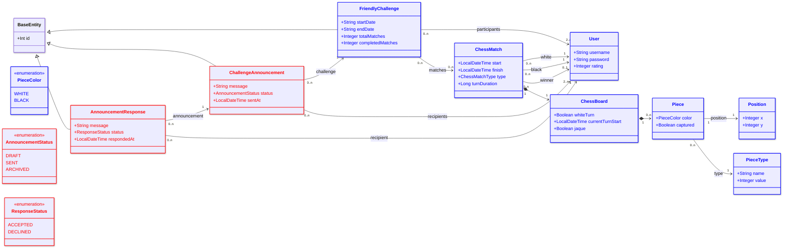

# DP1 2025-2026 Practical Exam (Second Sitting, July 2026)

> ### ⚠️ Puede encontrar la [versión en español aquí](README.md)

## General Description

In this exercise, we will add friendly-challenge management functionality to the chess game. Specifically, a `ChessMatch` class is provided that represents the matches being played, which is associated with an instance of the `ChessBoard` class representing the board state for that match, and therefore has an associated set of `Piece` instances. Each `ChessMatch` also has two registered players (`white` and `black`) and, optionally, a winner (`winner`). Each `User` has a score or `rating` reflecting their skill level.

In addition, we will have the `FriendlyChallenge` class, which represents a friendly challenge between two or more players in which a certain number of matches are played within a period of time. In order to communicate with a challenge's participants, its organizer can send announcements via the `ChallengeAnnouncement` class, addressed to a set of recipients (`recipients`), using the `AnnouncementStatus` enum to express whether the announcement is a draft, has already been sent, or has been archived. Each recipient can, in turn, respond to an announcement via the `AnnouncementResponse` class, indicating whether they accept or decline what is proposed in it, using the `ResponseStatus` enum to express that decision.

The UML diagram describing the classes and relationships we will be working with is as follows:



The classes for which we will carry out the object-relational mapping as JPA entities have been marked in red (`ChallengeAnnouncement`, `AnnouncementStatus`, `AnnouncementResponse`, `ResponseStatus`). The classes in blue (`User`, `ChessMatch`, `ChessBoard`, `Piece`, `FriendlyChallenge`) are classes that are provided already mapped, including their attributes and relationships (such as `rating`, `white`, `black`, `winner`, `matches` and `participants`), but that you will work with during the lab assessment.

---

## 🧪 Instructions

The first task in this assessment will be to clone this repository. If you are using the classroom computers, you will need to use a GitHub authentication token as your password. The repository itself includes a help document explaining how to set up this token. Next, you should import the project into your preferred development environment and start working on the exercises detailed below.

The functionality implemented in each of the exercises will be validated by unit tests. The tests can be run from your IDE or using:

```bash
./mvnw test
```

Each exercise is worth **1 point**. The number of test cases varies from one exercise to another. Your grade for each exercise will depend on the percentage of tests that pass (do not fail). For example:

| Tests passing | Grade |
|---|---|
| 100% | 1.0 |
| 50% | 0.5 |
| 10% | 0.1 |

### 📤 Submission

Submission for this assessment will be done in **two steps**:

1. **Upload the activity on the EV platform associated with the assessment, providing the URL of your personal repository as text.** You can do this at the start of the session.
2. **Make a single `git push` to your individual repository** (the one containing this document) once you have completed all the exercises.

Remember that you **must `push` your work before logging off the computer and leaving the classroom**; otherwise, your attempt will be graded as not submitted.

### ⚠️ Important notes

1. **Do not change class names, method names, return types, or parameters.**  
   The tests depend on the signatures being exactly the same.
2. **Do not modify the unit tests.**  
   Any local changes to the tests will be ignored; your repository will be re-evaluated from scratch.
3. While the exercises are not complete, **some tests will fail** — this is expected.  
   Only projects with a grade of 10 points run all tests without failures.
4. **The use of Git is part of the assessment.** You are not allowed to ask for help on how to use Git or GitHub.
5. Projects that **do not compile or fail to start Spring** will receive **0 points**.
6. Except for **Tests 3 and 4** (which depend on Tests 1 and 2 being correctly solved), the exercises are **independent**. You can solve them in any order.

---
# AI usage policy

For this repository, the use of generative AI tools, coding assistants, LLM-based chatbots, autonomous agents, or AI-assisted code completion is not allowed unless explicitly authorised by the teaching staff for a specific activity.

This includes, but is not limited to, GitHub Copilot, ChatGPT, Claude, Gemini, Codeium, Tabnine, Continue, Cursor, Windsurf, Cline, Roo Code, and local LLMs.

Students are expected to produce, understand, explain, debug, and justify all submitted code. The teaching staff may request an oral explanation, live modification, or supervised reproduction of any part of the submitted work.

---

## Exercises (Tests)

### Test 1 – Creating the ChallengeAnnouncement and AnnouncementResponse entities and their associated repositories

Modify the `ChallengeAnnouncement` class so that it becomes an entity. This class is located in the `es.us.dp1.chess.tournament.challenge` package, and must have the following attributes and constraints:

- The integer-typed (`Integer`) attribute named `id` will act as the primary key in the relational database table associated with the entity.
- A string-typed (`String`) attribute named `message`, mandatory (cannot be null), which must have a minimum length of 10 characters and a maximum of 60.
- An attribute of the enumerated type `AnnouncementStatus` named `status`, indicating the announcement's state. This attribute is mandatory and must be stored as a string in the DB (`"DRAFT"`, `"SENT"`, or `"ARCHIVED"`).
- A temporal-instant-typed (`LocalDateTime`) attribute named `sentAt`, representing the instant at which the announcement was sent. This attribute is optional.

Modify the `AnnouncementResponse` class so that it becomes an entity. This class is located in the `es.us.dp1.chess.tournament.challenge` package, and must have the following attributes and constraints:

- The integer-typed (`Integer`) attribute named `id` will act as the primary key in the relational database table associated with the entity.
- A string-typed (`String`) attribute named `message`, mandatory (cannot be null), which must have a minimum length of 5 characters and a maximum of 200.
- An attribute of the enumerated type `ResponseStatus` named `status`, indicating whether the recipient accepts or declines the announcement. This attribute is mandatory and must be stored as a string in the DB (`"ACCEPTED"`, or `"DECLINED"`).
- A temporal-instant-typed (`LocalDateTime`) attribute named `respondedAt`, representing the instant at which the response was made. This attribute is mandatory.

Do not modify the `@Transient` annotations of the classes for now. Modify the `ChallengeAnnouncementRepository` and `AnnouncementResponseRepository` interfaces located in the same package as `ChallengeAnnouncement` and `AnnouncementResponse` respectively, so that they extend `CrudRepository`. Do not forget to specify its type parameters.

### Test 2 – Creating relations between the entities

Remove the `@Transient` annotations from the methods and attributes that have them in the entities created in the previous exercise. You are asked to create the following relations between the entities:

- Create a unidirectional relation from `ChallengeAnnouncement` to `FriendlyChallenge` expressing the one that appears in the UML diagram, using the `challenge` attribute. You must make sure that the relation properly expresses the cardinality shown in the UML diagram: the attribute cannot be null, since the cardinality at the navigable end is `1`.
- Create a unidirectional relation from `ChallengeAnnouncement` to `User` expressing the one that appears in the UML diagram, using the `recipients` attribute. You must make sure that the relation properly expresses the cardinality shown in the UML diagram: the attribute cannot be null and must contain at least two elements, since the cardinality at the navigable end is `2..n`.
- Create a unidirectional relation from `AnnouncementResponse` to `ChallengeAnnouncement` expressing the one that appears in the UML diagram, using the `announcement` attribute. You must make sure that the relation properly expresses the cardinality shown in the UML diagram: the attribute cannot be null, since the cardinality at the navigable end is `1`.
- Create a unidirectional relation from `AnnouncementResponse` to `User` expressing the one that appears in the UML diagram, using the `recipient` attribute. You must make sure that the relation properly expresses the cardinality shown in the UML diagram: the attribute cannot be null, since the cardinality at the navigable end is `1`.

### Test 3 – Modifying the database initialization script to include announcements and responses

`FriendlyChallenge` already comes with sample data preloaded in the initialization script (the challenges with id 1 and 2), just as is the case with `User` or `ChessMatch`. Modify the database initialization script so that the following announcements are created, each one associated (`challenge`) with one of those already-existing challenges:

| id | message | status | sentAt | challenge |
|---|---|---|---|---|
| 1 | Remember to submit your match results by Friday | SENT | 2026-07-01T10:00:00 | 1 |
| 2 | New format proposal for next season | DRAFT | null | 1 |
| 3 | Please confirm your availability for August | SENT | 2026-08-02T09:30:00 | 2 |

And the following responses to those announcements, each one associated (`announcement`) with one of the previous announcements and (`recipient`) with one of the users already existing in the system:

| id | message | status | respondedAt | announcement | recipient |
|---|---|---|---|---|---|
| 1 | Got it, will submit by Friday | ACCEPTED | 2026-07-01T11:00:00 | 1 | 4 |
| 2 | Sounds good to me | ACCEPTED | 2026-08-02T10:00:00 | 3 | 5 |
| 3 | I can't make it in August | DECLINED | 2026-08-02T12:00:00 | 3 | 6 |

Note, that in order to insert the ' in the description of the table, you must use double accent '', since such value is also the string delimiter in sql.

### Test 4 – Modifying the database initialization script to associate the announcements with their recipients

Modify this database initialization script so that:

- The announcement whose id is 1 is associated with the users whose ids are 4 and 5 as recipients (`recipients`).
- The announcement whose id is 2 is associated with the users whose ids are 4 and 5 as recipients.
- The announcement whose id is 3 is associated with the users whose ids are 5, 6 and 7 as recipients.

Keep in mind that the order in which the `INSERT` statements appear in the database initialization script is relevant when defining the associations, especially in the intermediate table generated for the `recipients` relation.

### Test 5 – Creating match management services

`ChessMatch` is already provided as a fully mapped entity, along with its `ChessMatchRepository` repository. Modify the `ChessMatchService` class so that it becomes a Spring business-logic service and provides an implementation for the methods that allow:

- Getting all the matches stored in the database as a list, using the repository (`findAll` method).
- Getting a match by Id (`findById` method).
- Saving a match to the database, checking that, if the `winner` attribute is not null, its value matches one of the two players of the match (`white` or `black`). Otherwise, an exception of type `InvalidWinnerException` will be thrown (`save` method) and transacktion is rollbacked.

All these methods must be transactional, but the associated annotations must be placed at the method level, not the class level. Do not modify the implementation of the rest of the services' methods for now.

### Test 6 – Annotating the challenge repository with a complex query

Modify the custom query that can be invoked through the `findParticipantPoints` method of the challenge repository `FriendlyChallengeRepository` (located in the `es.us.dp1.chess.tournament.challenge` package), which receives a `FriendlyChallenge` id as a parameter and returns a list of pairs (`Object[]`), containing a user and an integer. The goal is for it to compute, for each participant of the challenge, the accumulated score based on the outcome of the challenge's already-finished matches (`finish` not null). The list of pairs must be sorted by score in descending order (from highest to lowest).

In other words, for each finished match of the challenge:

- The player listed as the match's `winner` gets 2 points.
- If the match ends in a draw (`winner` null), both `white` and `black` get 1 point each.
- The player who loses gets no points.

To implement this exercise you must modify the query associated with the repository method called `findParticipantPoints`, without modifying its signature (return type, name, and parameters).

For example, if a challenge has two matches already finished: in the first, user A beats user B, and in the second, A and B draw, then A should accumulate 2 (for winning the first) + 1 (for the draw in the second) = **3 points**, while B would accumulate 0 (for losing the first) + 1 (for the draw in the second) = **1 point**. Matches that have not yet finished (`finish` null) must not count at all in this calculation, neither for nor against any player.

Note: To give a score of 2 points to the winner, 1 to a draw, and 0 to the loser, you can use this expression as part of the JPQL query, for example as part of a sum aggregator: `SUM(CASE WHEN [winner condition] THEN 2 WHEN [draw condition] THEN 1 ELSE 0 END)`

Note 2: JPQL allows sorting by the components of the `SELECT`. So, if you have a `SELECT x, y...` and you add `ORDER BY 2` to the JPQL query, you will be sorting the result by `y`.

### Test 7 – Creating the controller to return the ranking of an available challenge

Create a method in the `FriendlyChallengeController` controller (located in the `es.us.dp1.chess.tournament.challenge` package) that returns the ranking of a challenge. The method must respond to GET requests at the URL:

```
http://localhost:8080/api/v1/challenges/X/ranking
```

The method must return the challenge's ranking sorted from highest to lowest score, where X is the challenge's Id. Remember that the `UserService` class has a `findCurrentUser()` method that lets you obtain the currently logged-in user; you must use this method to check access.

Status code **404 (NOT_FOUND)** must be returned in the following cases:

- If there is no challenge with the specified id in the system.
- If no match of the challenge has been finished yet.

If the logged-in user is not one of the participants of that challenge, a status code of **403 (FORBIDDEN)** must be returned. Note that exceptions are already provided to represent these scenarios, such as the `ResourceNotFoundException` class or the `AccessDeniedException` class.

To implement this exercise you must modify both the `FriendlyChallengeService` class (`getRanking` method) and the `FriendlyChallengeController` class (adding a method to the controller to respond to requests), implementing the business logic and communication handling where appropriate.

This exercise is independent of Exercise 6 and can be solved even if Exercise 6 has not been completed, simply by invoking the repository from the service code, since the repository is mocked in the tests.

### Test 8 – Implementing a test for an algorithm that computes matchmaking by closest rating

With the goal of deciding which two players will play a challenge's next match, it has been decided to create a set of algorithms that, given a list of ratings of the available players, determine which two should be paired. In this exercise we will create a set of test cases to check that the algorithm works correctly.

The algorithm's interface is specified in the `ClosestRatingPairFinder` interface, found in the `es.us.dp1.chess.tournament.challenge.matchmaking` package, which aims to find, within an array of ratings, the pair of positions whose rating difference is minimal. Specifically, the method that performs the calculation has the following signature:

```java
int[] findClosestPair(int[] ratings)
```

which returns an array of two positions `[i, j]` (with `i < j`) corresponding to the two closest ratings to each other. In case of a tie between several pairs with the same minimal difference, the pair whose sum of indices is smallest must be returned.

For example, given the array `[1000, 1200, 1050]`, the possible differences are: `(0,1)` → 200, `(0,2)` → 50, `(1,2)` → 150. The pair with the smallest difference is `(0,2)`, so the method should return `[0, 2]`.

To illustrate the tie-break criterion, given the array `[0, 10, 14, 100, 200, 4]`, both the pair `(0,5)` (difference `|0-4|=4`) and the pair `(1,2)` (difference `|10-14|=4`) have the smallest possible difference. Since `(1,2)` has a smaller sum of indices (3) than `(0,5)` (5), the method should return `[1, 2]`.

If the algorithm is given an array with fewer than two elements, it must throw an exception of type `InsufficientPlayersException`. If it is given any negative rating value, it must throw an exception of type `InvalidRatingException`.

Four implementations of the algorithm are provided. Modify the test class called `ClosestRatingPairFinderTest`, found in the folder `src/test/java/es/us/dp1/chess/tournament/matchmaking`, and specify as many test-case methods as you consider necessary to validate the algorithm's correct behavior. Note that the class has an attribute of type `ClosestRatingPairFinder` called `algorithm`; use that attribute as the subject under test in all your test methods.

Your test implementation must not use mocks, Spring test annotations (`@DataJpaTest`, `@SpringBootTest`, etc.), or parameterized tests, and all methods annotated with `@Test` must take no parameters.

### Test 9 – Creating a basic React component with challenge information

Modify the React component provided in the file `frontend/src/challenges/challenge.js` so that it displays the ranking details of a challenge. To do this, you must use the API by issuing a GET request against the URL `api/v1/challenges/X/ranking` to obtain the challenge's ranking. This API returns a result similar to the following:

```json
[
  { "user": { "id": 4, "username": "john_doe", "rating": 1500 }, "points": 6 },
  { "user": { "id": 5, "username": "jane_smith", "rating": 1600 }, "points": 4 }
]
```

This component must display the following challenge data:

- A level-1 heading whose content is the text "Challenge info"
- A level-3 heading whose content is "Ranking"
- Show, in a div, the leader of the ranking (the first element of the list). For example, for the case shown above it should display the text: "Leader: john_doe (6 points)".

To run this test and check its result, you can go into the frontend folder and run the `npm test` command, then press 'a' in the jest command menu. Note that you must have previously run the `npm install` command at least once so that all the node libraries are installed.

### Test 10 – Creating a component to display a challenge's full ranking on screen

Complete the code of the `challengeDetail` component, so that it displays an unordered list (`<ul>`) with the full ranking, which it receives as a JSON parameter. Specifically, each participant must be shown in a list item (`<li>`) displaying first the username, a dash, and their score. For example, for the response shown in the previous exercise, it would display:

```
john_doe - 6
jane_smith - 4
```

To run this test and check its result, you can go into the frontend folder and run the `npm test` command, then press 'a' in the jest command menu. Note that you must have previously run the `npm install` command at least once so that all the node libraries are installed.
