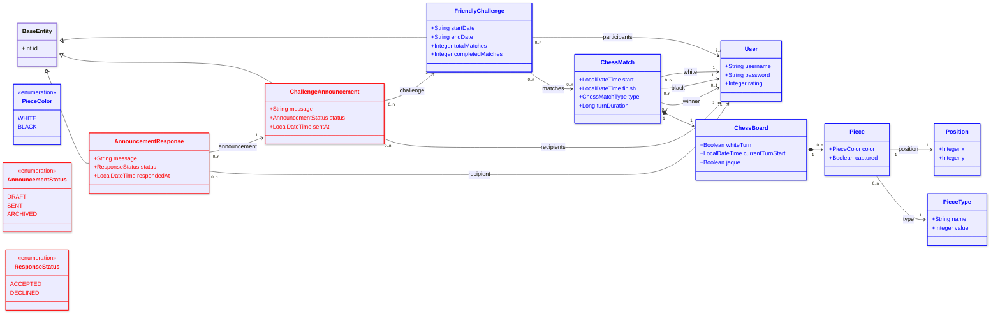

# Control Práctico DP1 2025-2026 (Segunda Convocatoria Julio 2026)

> ### ⚠️ You can find the [English version here](README.en.md)

## Descripción General

En este ejercicio, añadiremos la funcionalidad de gestión de retos amistosos en el juego del ajedrez. Concretamente, se proporciona una clase `ChessMatch` que representa las partidas que se juegan, y que tiene asociada una instancia de la clase `ChessBoard` que representa el estado del tablero para dicha partida, por lo que tendrá asociado un conjunto de instancias de la clase `Piece`. Cada `ChessMatch` tiene además registrados dos jugadores (`white` y `black`) y, opcionalmente, un ganador (`winner`). Cada `User` tiene una puntuación o `rating` que refleja su nivel de juego.

Además, tendremos la clase `FriendlyChallenge`, que representa un desafío amistoso entre dos o más jugadores en el que se disputa un número determinado de partidas dentro de un periodo de tiempo. Para poder comunicarse con los participantes de un desafío, su organizador puede enviar anuncios mediante la clase `ChallengeAnnouncement`, dirigidos a un conjunto de destinatarios (`recipients`), usando el enumerado `AnnouncementStatus` para expresar si el anuncio es un borrador, ya se ha enviado o se ha archivado. Cada destinatario puede a su vez responder a un anuncio mediante la clase `AnnouncementResponse`, indicando si acepta o rechaza lo propuesto en él, usando el enumerado `ResponseStatus` para expresar dicha decisión.

El diagrama UML que describe las clases y relaciones con las que vamos a trabajar es el siguiente:



Las clases para las que realizaremos el mapeo objeto-relacional como entidades JPA se han señalado en rojo (`ChallengeAnnouncement`, `AnnouncementStatus`, `AnnouncementResponse`, `ResponseStatus`). Las clases en azul (`User`, `ChessMatch`, `ChessBoard`, `Piece`, `FriendlyChallenge`) son clases que se proporcionan ya mapeadas, incluyendo sus atributos y relaciones (como `rating`, `white`, `black`, `winner`, `matches` y `participants`), pero con las que se trabajará durante el control de laboratorio.

---

## 🧪 Instrucciones

La primera tarea en este control será clonar este repositorio. Si está utilizando los ordenadores del aula, tendrá que usar un token de autenticación de GitHub como contraseña. En el propio repositorio se incluye un documento de ayuda que explica cómo configurar dicho token. A continuación, deberá importar el proyecto en su entorno de desarrollo preferido y comenzar a trabajar en los ejercicios que se detallan más abajo.

La funcionalidad implementada en cada uno de los ejercicios será validada mediante pruebas unitarias. Las pruebas pueden ejecutarse desde su IDE o utilizando:

```bash
./mvnw test
```

Cada ejercicio vale **1 punto**. El número de casos de prueba varía de un ejercicio a otro. Su nota en cada ejercicio dependerá del porcentaje de tests que pasan (no fallan). Por ejemplo:

| Tests que pasan | Nota |
|---|---|
| 100% | 1.0 |
| 50% | 0.5 |
| 10% | 0.1 |

### 📤 Envío

La entrega de este control se realizará en **dos pasos**:

1. **Suba la actividad en la plataforma EV asociada al control, proporcionando como texto la URL de su repositorio personal.** Puede hacerlo al inicio de la sesión.
2. **Realice un único `git push` a su repositorio individual** (el que contiene este documento) una vez que haya completado todos los ejercicios.

Recuerde que **debe hacer `push` de su trabajo antes de cerrar sesión en el ordenador y abandonar el aula**; de lo contrario, su intento será calificado como no entregado.

### ⚠️ Notas importantes

1. **No cambie los nombres de las clases, los nombres de los métodos, los tipos de retorno ni los parámetros.**  
   Las pruebas dependen de que las firmas sean exactamente las mismas.
2. **No modifique las pruebas unitarias.**  
   Cualquier cambio local en las pruebas será ignorado; su repositorio se volverá a evaluar desde cero.
3. Mientras los ejercicios no estén completos, **algunas pruebas fallarán** — esto es lo esperado.  
   Solo los proyectos con una calificación de 10 puntos ejecutan todas las pruebas sin fallos.
4. **El uso de Git forma parte de la evaluación.** No se permite pedir ayuda sobre el uso de Git o GitHub.
5. Los proyectos que **no compilen o no arranquen** Spring recibirán **0 puntos**.
6. Excepto los **Tests 3 y 4** (que dependen de que los Tests 1 y 2 estén correctamente resueltos), los ejercicios son **independientes**. Puedes resolverlos en cualquier orden.


---
# Política de uso de IA

En este repositorio no está permitido el uso de herramientas de inteligencia artificial generativa, asistentes de programación, chatbots basados en modelos de lenguaje, agentes autónomos ni herramientas de autocompletado asistido por IA, salvo que el profesorado lo autorice explícitamente para una actividad concreta.

Esta restricción incluye, entre otras herramientas, GitHub Copilot, ChatGPT, Claude, Gemini, Codeium, Tabnine, Continue, Cursor, Windsurf, Cline, Roo Code y modelos de lenguaje ejecutados localmente.

El alumnado debe ser capaz de producir, comprender, explicar, depurar y justificar todo el código entregado. El profesorado podrá solicitar una explicación oral, una modificación en directo o la reproducción supervisada de cualquier parte del trabajo entregado.

---

## Ejercicios (Tests)

### Test 1 – Creación de las entidades ChallengeAnnouncement y AnnouncementResponse y sus repositorios asociados

Modificar la clase `ChallengeAnnouncement` para que sea una entidad. Esta clase está alojada en el paquete `es.us.dp1.chess.tournament.challenge`, y debe tener los siguientes atributos y restricciones:

- El atributo de tipo entero (`Integer`) llamado `id` actuará como clave primaria en la tabla de la base de datos relacional asociada a la entidad.
- Un atributo de tipo cadena de caracteres (`String`) llamado `message` obligatorio (no puede ser nulo), que debe tener una longitud mínima de 10 caracteres y máxima de 60.
- Un atributo del tipo enumerado `AnnouncementStatus` llamado `status` que indica el estado del anuncio. Este atributo es obligatorio y debe almacenarse como una cadena en la BD (`"DRAFT"`, `"SENT"`, o `"ARCHIVED"`).
- El atributo de tipo instante temporal (`LocalDateTime`) llamado `sentAt`, que representa el instante en el que se envió el anuncio. Este es un atributo opcional.

Modificar la clase `AnnouncementResponse` para que sea una entidad. Esta clase está alojada en el paquete `es.us.dp1.chess.tournament.challenge`, y debe tener los siguientes atributos y restricciones:

- El atributo de tipo entero (`Integer`) llamado `id` actuará como clave primaria en la tabla de la base de datos relacional asociada a la entidad.
- Un atributo de tipo cadena de caracteres (`String`) llamado `message` obligatorio (no puede ser nulo), que debe tener una longitud mínima de 5 caracteres y máxima de 200.
- Un atributo del tipo enumerado `ResponseStatus` llamado `status` que indica si el destinatario acepta o rechaza el anuncio. Este atributo es obligatorio y debe almacenarse como una cadena en la BD (`"ACCEPTED"`, o `"DECLINED"`).
- El atributo de tipo instante temporal (`LocalDateTime`) llamado `respondedAt`, que representa el instante en el que se produjo la respuesta. Este atributo es obligatorio.

No modifique por ahora las anotaciones `@Transient` de las clases. Modificar las interfaces `ChallengeAnnouncementRepository` y `AnnouncementResponseRepository` alojadas en el mismo paquete que `ChallengeAnnouncement` y `AnnouncementResponse` respectivamente, para que extiendan `CrudRepository`. No olvide especificar sus parámetros de tipo.

### Test 2 – Creación de relaciones entre las entidades

Elimine las anotaciones `@Transient` de los métodos y atributos que las tengan en las entidades creadas en el ejercicio anterior. Se pide crear las siguientes relaciones entre las entidades:

- Cree una relación unidireccional desde `ChallengeAnnouncement` hacia `FriendlyChallenge` que exprese la que aparece en el diagrama UML, usando el atributo `challenge`. Debe asegurarse de que la relación expresa adecuadamente la cardinalidad que muestra el diagrama UML: el atributo no puede ser nulo, puesto que la cardinalidad en el extremo navegable es `1`.
- Cree una relación unidireccional desde `ChallengeAnnouncement` hacia `User` que exprese la que aparece en el diagrama UML, usando el atributo `recipients`. Debe asegurarse de que la relación expresa adecuadamente la cardinalidad que muestra el diagrama UML: el atributo no puede ser nulo y debe contener al menos dos elementos, puesto que la cardinalidad en el extremo navegable es `2..n`.
- Cree una relación unidireccional desde `AnnouncementResponse` hacia `ChallengeAnnouncement` que exprese la que aparece en el diagrama UML, usando el atributo `announcement`. Debe asegurarse de que la relación expresa adecuadamente la cardinalidad que muestra el diagrama UML: el atributo no puede ser nulo, puesto que la cardinalidad en el extremo navegable es `1`.
- Cree una relación unidireccional desde `AnnouncementResponse` hacia `User` que exprese la que aparece en el diagrama UML, usando el atributo `recipient`. Debe asegurarse de que la relación expresa adecuadamente la cardinalidad que muestra el diagrama UML: el atributo no puede ser nulo, puesto que la cardinalidad en el extremo navegable es `1`.

### Test 3 – Modificación del script de inicialización de la base de datos para incluir anuncios y respuestas

`FriendlyChallenge` ya viene con datos de ejemplo precargados en el script de inicialización (los desafíos con id 1 y 2), igual que ocurre con `User` o `ChessMatch`. Modificar el script de inicialización de la base de datos, para que se creen los siguientes anuncios, cada uno asociado (`challenge`) a uno de esos desafíos ya existentes:

| id | message | status | sentAt | challenge |
|---|---|---|---|---|
| 1 | Remember to submit your match results by Friday | SENT | 2026-07-01T10:00:00 | 1 |
| 2 | New format proposal for next season | DRAFT | null | 1 |
| 3 | Please confirm your availability for August | SENT | 2026-08-02T09:30:00 | 2 |

Y las siguientes respuestas a dichos anuncios, cada una asociada (`announcement`) a uno de los anuncios anteriores y (`recipient`) a uno de los usuarios ya existentes en el sistema:

| id | message | status | respondedAt | announcement | recipient |
|---|---|---|---|---|---|
| 1 | Got it, will submit by Friday | ACCEPTED | 2026-07-01T11:00:00 | 1 | 4 |
| 2 | Sounds good to me | ACCEPTED | 2026-08-02T10:00:00 | 3 | 5 |
| 3 | I can't make it in August | DECLINED | 2026-08-02T12:00:00 | 3 | 6 |

Nótese, que para introducir el carácter acento ' en la tabla, deberá usar doble acento '', puesto que dicho valor es también el delimitador de cadenas en sql.

### Test 4 – Modificación del script de inicialización de la base de datos para asociar los anuncios con sus destinatarios

Modificar este script de inicialización de la base de datos para que:

- El anuncio cuyo id es 1 se asocie con los usuarios cuyos id son 4 y 5 como destinatarios (`recipients`).
- El anuncio cuyo id es 2 se asocie con los usuarios cuyos id son 4 y 5 como destinatarios.
- El anuncio cuyo id es 3 se asocie con los usuarios cuyos id son 5, 6 y 7 como destinatarios.

Tenga en cuenta que el orden en que aparecen los `INSERT` en el script de inicialización de la base de datos es relevante al definir las asociaciones, especialmente en la tabla intermedia generada para la relación `recipients`.

### Test 5 – Creación de servicios de gestión de partidas

`ChessMatch` ya se proporciona como entidad completamente mapeada, junto con su repositorio `ChessMatchRepository`. Modificar la clase `ChessMatchService`, para que sea un servicio Spring de lógica de negocio y proporcione una implementación a los métodos que permitan:

- Obtener todas las partidas almacenadas en la base de datos como una lista usando el repositorio (método `findAll`).
- Obtener una partida por Id (método `findById`).
- Grabar una partida en la base de datos, comprobando que, si el atributo `winner` no es nulo, su valor coincide con uno de los dos jugadores de la partida (`white` o `black`). En caso contrario se lanzará una excepción de tipo `InvalidWinnerException` (método `save`) y se hará rollback de la transacción.

Todos estos métodos deben ser transaccionales, pero las anotaciones asociadas deben realizarse a nivel de método, no a nivel de clase. No modifique por ahora la implementación del resto de métodos de los servicios.

### Test 6 – Anotar el repositorio de desafíos con una consulta compleja

Modificar la consulta personalizada que puede invocarse a través del método `findParticipantPoints` del repositorio de desafíos `FriendlyChallengeRepository` (alojado en el paquete `es.us.dp1.chess.tournament.challenge`) que recibe como parámetro un id de `FriendlyChallenge` y devuelve una lista de pares (`Object[]`), que contienen un usuario y un entero. El objetivo es que calcule, para cada participante del desafío, la puntuación acumulada según el resultado de las partidas ya finalizadas (`finish` no nulo) de ese desafío. La lista de pares debe estar ordenada por puntuación en orden descendente (de mayor a menor).

En otras palabras, para cada partida finalizada del desafío:

- El jugador que figure como `winner` de la partida obtiene 2 puntos.
- Si la partida termina en tablas (`winner` nulo), tanto `white` como `black` obtienen 1 punto cada uno.
- El jugador que pierde no obtiene puntos.

Para implementar este ejercicio debe modificar la consulta asociada al método del repositorio llamado `findParticipantPoints`, sin modificar su signatura (tipo de respuesta, nombre y parámetros).

Por ejemplo, si un desafío tiene dos partidas ya finalizadas: en la primera el usuario A gana al usuario B, y en la segunda A y B terminan en tablas, entonces A debería acumular 2 (por ganar la primera) + 1 (por las tablas de la segunda) = **3 puntos**, mientras que B acumularía 0 (por perder la primera) + 1 (por las tablas de la segunda) = **1 punto**. Las partidas que todavía no se hayan finalizado (`finish` nulo) no deben contar en absoluto en este cálculo, ni para bien ni para mal.

Nota: Para dar una puntuación de 2 puntos al vencedor, 1 a las tablas y 0 al que pierde se puede usar en la consulta JPQL esta expresión como parte, por ejemplo de un agregador de suma: `SUM(CASE WHEN [condicion ganador] THEN 2 WHEN [condicion tablas] THEN 1 ELSE 0 END)`

Nota 2: JPQL permite ordenar por los componentes del `SELECT`. Así, si se tiene un `SELECT x, y...` y se añade a la consulta JPQL `ORDER BY 2`, se estará ordenando el resultado por `y`. 

### Test 7 – Creación del controlador para devolver la clasificación de un desafío disponible

Crear un método en el controlador `FriendlyChallengeController` (alojado en el paquete `es.us.dp1.chess.tournament.challenge`) que permita devolver la clasificación de un desafío. El método debe responder a peticiones tipo GET en la URL:

```
http://localhost:8080/api/v1/challenges/X/ranking
```

El método debe devolver la clasificación del desafío ordenada de mayor a menor puntuación, donde X es la Id del desafío. Recuerde que la clase `UserService` tiene un método `findCurrentUser()` que permite obtener el usuario actualmente logado, debe usar dicho método para comprobar el acceso.

Se debe devolver el código de estado **404 (NOT_FOUND)** en los siguientes casos:

- En caso de que no exista un desafío con el id especificado en el sistema.
- En caso de que aún no se haya finalizado ninguna partida del desafío.

En caso de que el usuario logado no sea uno de los participantes de dicho desafío debe devolverse un código de estado **403 (FORBIDDEN)**. Nótese que se proporcionan excepciones ya creadas para representar estos escenarios, como la clase `ResourceNotFoundException` o la clase `AccessDeniedException`.

Para implementar este ejercicio debe modificar tanto la clase `FriendlyChallengeService` (método `getRanking`) como la clase `FriendlyChallengeController` (añadiendo un método al controlador para responder a las peticiones), implementando la lógica de negocio y gestión de la comunicación donde corresponda.

Este ejercicio es independiente del 6 y puede resolverse aún cuando el ejercicio 6 no esté resuelto, sencillamente invocando al repositorio desde el código del serivico (puesto que el repositorio en los tests esta mockeado).

### Test 8 – Implementar una prueba para un algoritmo que calcula el emparejamiento por rating más cercano

Con el objetivo de decidir qué dos jugadores disputan la siguiente partida de un desafío, se ha decidido crear un conjunto de algoritmos que, dada una lista de puntuaciones (rating) de los jugadores disponibles, determine cuáles dos deben emparejarse. En este ejercicio crearemos un conjunto de casos de prueba que permitan comprobar que el algoritmo funciona correctamente.

La interfaz del algoritmo está especificada en la interfaz `ClosestRatingPairFinder` que se encuentra en el paquete `es.us.dp1.chess.tournament.challenge.matchmaking`, que pretende encontrar, dentro de un array de puntuaciones, la pareja de posiciones cuya diferencia de rating sea mínima. Concretamente el método que realiza el cálculo tiene la siguiente signatura:

```java
int[] findClosestPair(int[] ratings)
```

que devuelve un array de dos posiciones `[i, j]` (con `i < j`) correspondientes a los dos ratings más cercanos entre sí. En caso de empate entre varias parejas con la misma diferencia mínima, debe devolverse la pareja cuya suma de índices sea menor.

Por ejemplo, dado el array `[1000, 1200, 1050]`, las diferencias posibles son: `(0,1)` → 200, `(0,2)` → 50, `(1,2)` → 150. La pareja con menor diferencia es `(0,2)`, por lo que el método debería devolver `[0, 2]`.

Para ilustrar el criterio de desempate, dado el array `[0, 10, 14, 100, 200, 4]`, tanto la pareja `(0,5)` (diferencia `|0-4|=4`) como la pareja `(1,2)` (diferencia `|10-14|=4`) tienen la menor diferencia posible. Como `(1,2)` tiene una suma de índices menor (3) que `(0,5)` (5), el método debería devolver `[1, 2]`.

Si se le pasa al algoritmo un array con menos de dos elementos, el algoritmo debe lanzar una excepción de tipo `InsufficientPlayersException`. Si se le pasa algún valor de rating negativo, el algoritmo debe lanzar una excepción de tipo `InvalidRatingException`.

Se proporcionan cuatro implementaciones del algoritmo. Modifique la clase de pruebas llamada `ClosestRatingPairFinderTest` que se encuentra en la carpeta `src/test/java/es/us/dp1/chess/tournament/matchmaking` y especifique tantos métodos con casos de prueba como considere necesarios para validar el correcto funcionamiento del algoritmo. Nótese que la clase tiene un atributo de tipo `ClosestRatingPairFinder` llamado `algorithm`, use dicho atributo como sujeto bajo prueba en todos sus métodos de prueba.

Su implementación del test no debe usar mocks, ni anotaciones de pruebas de spring (`@DataJpaTest`, `@SpringBootTest`, etc.), ni tests parametrizados, y todos los métodos anotados con `@Test` deben ser sin parámetros.

### Test 9 – Creación de un componente básico React de información de un desafío

Modificar el componente React proporcionado en el fichero `frontend/src/challenges/challenge.js` para que muestre los detalles de clasificación de un desafío. Para ello debe hacer uso de la API lanzando una petición tipo GET contra la URL `api/v1/challenges/X/ranking` para obtener la clasificación del desafío. Dicha API devuelve un resultado similar al siguiente:

```json
[
  { "user": { "id": 4, "username": "john_doe", "rating": 1500 }, "points": 6 },
  { "user": { "id": 5, "username": "jane_smith", "rating": 1600 }, "points": 4 }
]
```

Este componente debe mostrar los siguientes datos del desafío:

- Un título de nivel 1 cuyo contenido sea el texto "Challenge info"
- Un título de nivel 3 cuyo contenido sea "Ranking"
- Mostrar en un div el líder de la clasificación (el primer elemento de la lista). Por ejemplo, para el caso mostrado arriba debería mostrar el texto: "Leader: john_doe (6 points)".

Para poder lanzar esta prueba y comprobar su resultado puede colocarse en la carpeta de frontend y ejecutar el comando `npm test` y pulsar 'a' en el menú de comandos de jest. Nótese que previamente debe haber lanzado al menos una vez el comando `npm install` para que todas las librerías de node estén instaladas.

### Test 10 – Creación de un componente para mostrar por pantalla la clasificación completa de un desafío

Complete el código del componente `challengeDetail`, para hacer que se muestre una lista no ordenada (`<ul>`) con la clasificación completa, que recibe en JSON como parámetro. Concretamente cada participante debe mostrarse en un item de lista (`<li>`) mostrando primero el nombre de usuario, un guión y su puntuación. Por ejemplo, para la respuesta mostrada en el ejercicio anterior se mostraría:

```
john_doe - 6
jane_smith - 4
```

Para poder lanzar esta prueba y comprobar su resultado puede colocarse en la carpeta de frontend y ejecutar el comando `npm test` y pulsar 'a' en el menú de comandos de jest. Nótese que previamente debe haber lanzado al menos una vez el comando `npm install` para que todas las librerías de node estén instaladas.
